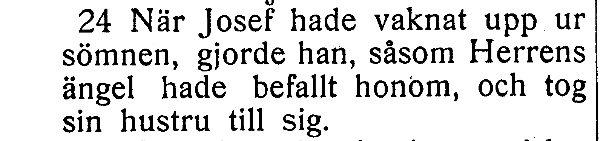
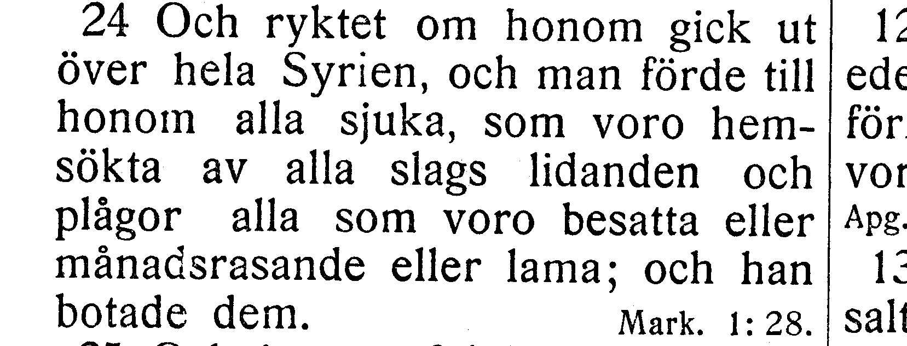
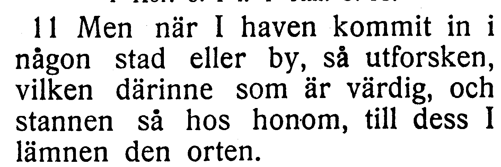

# Fotobunt 1: tre läsningar i Matteus

**Löst 2026-10-26.** Användaren skickade tre foton utan att behöva transkribera eller tolka texten. Codex läste dem: V007 och V009 ger rättelser, V008 bekräftar befintlig korpustext som en tryckskillnad. Ingen fråga i denna bunt återstår.

| Fråga | Fotots läsning | Beslut | Originalfoto |
| --- | --- | --- | --- |
| V007, Matt. 1:24 | gjorde han såsom Herrens ängel | som → såsom, R029; inget extra komma | [V007](../sv1917-print-witnesses/V007.jpg) |
| V008, Matt. 4:24 | hemsökta av olika slags lidanden | olika behålls; bekräftad tryckskillnad | [V008](../sv1917-print-witnesses/V008.jpg) |
| V009, Matt. 10:11 | och stannen så hos honom | så återställt, R030 | [V009](../sv1917-print-witnesses/V009.jpg) |

Ursprunglig frågebunt och korpustext före bedömningen bevaras nedan. Utsnitten är direkt beskurna från Runebergs TIFF-bilder; de är inte ny OCR eller rekonstruerad text. Fulla sidor länkas nedan. Vanliga kommaskillnader harmoniseras inte automatiskt.

## V007 – Matteus 1:24

**Korpustext före bedömningen:** När Josef hade vaknat upp ur sömnen, gjorde han som Herrens ängel hade befallt honom och tog sin hustru till sig.

**Skillnad:** korpusen har **gjorde han som Herrens ängel hade befallt honom**; [EFS 1927, NT s. 4](https://runeberg.org/bibeln/efs1927/nt/0004.html) har **gjorde han, såsom Herrens ängel hade befallt honom**.

Källbild: `https://runeberg.org/img/bibeln/efs1927/nt/0004.1.tif`; SHA-256 `e6851d608787053c11bb95945dfba72147f0d71f9e2c71f43c1902f0c899bad0`.

## V008 – Matteus 4:24

**Korpustext före bedömningen:** Och ryktet om honom gick ut över hela Syrien, och man förde till honom alla sjuka som voro hemsökta av olika slags lidanden och plågor, alla som voro besatta eller månadsrasande eller lama; och han botade dem.

**Skillnad:** korpusen har **hemsökta av olika slags lidanden**; [EFS 1927, NT s. 7](https://runeberg.org/bibeln/efs1927/nt/0007.html) har **hemsökta av alla slags lidanden**.

Källbild: `https://runeberg.org/img/bibeln/efs1927/nt/0007.1.tif`; SHA-256 `de80978742e0a8455a54a7d7aee4b48f47a8d865c1f112ad6bf5a50dc5099c10`.

## V009 – Matteus 10:11

**Korpustext före bedömningen:** Men när I haven kommit in i någon stad eller by, så utforsken vilken därinne som är värdig, och stannen hos honom, till dess I lämnen den orten.

**Skillnad:** korpusen har **stannen hos honom**; [EFS 1927, NT s. 16](https://runeberg.org/bibeln/efs1927/nt/0016.html) har **stannen så hos honom**.

Källbild: `https://runeberg.org/img/bibeln/efs1927/nt/0016.1.tif`; SHA-256 `bf371ad386ae6f2eb8b420007c139becec867edb60a4bf1596ee3b83d34101a7`.
