# Fotobunt 10: Johannes 9–21 till senare boktillgång

**Sparad 2026-10-26. Ingen åtgärd behövs nu.** Hela Johannes och därmed alla fyra evangelier har bildjämförts. I detta slutblock lämnas tjugoen frågor öppna tills ett annat tryck har jämförts. Detta är frågor, inte tjugoen fastställda fel. Johannes 15, 16, 19 och 21 är verifierade; 9–14, 17–18 och 20 står som `needs-review`. Tidigare [fotofrågor](README.md) återstår också.

När boken finns till hands räcker foton av hela verserna, utan transkription eller egen diagnos. Codex tolkar bilderna och frågar bara om osäkerheten kvarstår. Närliggande verser kan samlas i samma foto/uppslag: 9:16/22; 11:25/32/33/48/54; 12:12/35/41; 13:10/36; 14:6/21; 18:13/33/37; 20:1/21. Ingen särskild gruppering krävs.

Korpustexten nedan visar aktuellt läge efter separata säkra rättelser. Frågornas ord och alla verskoordinater/mappningar behålls. Originalupplösning bekräftar då i 11:45 och nu i 18:6 utan ytterligare foto. Utsnitten är direkt beskurna originalbilder, utan OCR eller rekonstruerade bokstäver.

| Fråga | Vers | Korpus / EFS 1927 |
| --- | --- | --- |
| [V102](#v102) | Joh. 9:16 | icke från Gud / icke ifrån Gud |
| [V103](#v103) | Joh. 9:22 | fruktade judarna / fruktade för judarna |
| [V104](#v104) | Joh. 10:7 | Åter sade Jesus / Åter sade då Jesus |
| [V105](#v105) | Joh. 11:25 | Jesus svarade till henne / Jesus sade till henne |
| [V106](#v106) | Joh. 11:32 | hade du varit där / hade du varit här |
| [V107](#v107) | Joh. 11:33 | såg jämväl att de / såg att jämväl de |
| [V108](#v108) | Joh. 11:48 | Om vi skola låta / Om vi låta |
| [V109](#v109) | Joh. 11:54 | öppet bland judarna / öppet omkring bland judarna |
| [V110](#v110) | Joh. 12:12 | det myckna folk / det myckna folket |
| [V111](#v111) | Joh. 12:35 | var han går / vart han går |
| [V112](#v112) | Joh. 12:41 | talade med honom / talade om honom |
| [V113](#v113) | Joh. 13:10 | behöver allenast / behöver sedan allenast |
| [V114](#v114) | Joh. 13:36 | icke nu följa mig / icke följa mig |
| [V115](#v115) | Joh. 14:6 | utom genom mig / utan genom mig |
| [V116](#v116) | Joh. 14:21 | och jag skall uppenbara / och skall uppenbara |
| [V117](#v117) | Joh. 17:3 | den enda sanne Guden / den ende sanne Guden |
| [V118](#v118) | Joh. 18:13 | överstepräst det året / överstepräst för det året |
| [V119](#v119) | Joh. 18:33 | Pilatus gick åter in / Pilatus gick då åter in |
| [V120](#v120) | Joh. 18:37 | Så sade Pilatus / Då sade Pilatus |
| [V121](#v121) | Joh. 20:1 | på första veckodagen, medan / på första veckodagen om morgonen, medan |
| [V122](#v122) | Joh. 20:21 | så sänder ock jag eder / så sänder jag ock eder |

## V102

**Johannes 9:16 — icke från Gud / icke ifrån Gud.**

**Korpustext:** Då sade några av fariséerna: »Den mannen är icke från Gud, eftersom han icke håller sabbaten.» Andra sade: »Huru skulle någon som är en syndare kunna göra sådana tecken?» Så funnos bland dem stridiga meningar.

**Foto till senare:** hela 9:16. Korpusens ord och versnummer behålls tills ett kompletterande tryckvittne har bedömts.

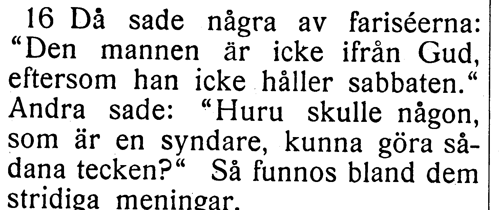

[Full sida, NT s. 163](https://runeberg.org/bibeln/efs1927/nt/0163.html). TIFF: `https://runeberg.org/img/bibeln/efs1927/nt/0163.1.tif`; SHA-256 `6898d98fea0de041156fa4a7f5da7f7f394e57a762e4c168ce03196ebff04b32`. Utsnittets SHA-256 `e870216ac47ea80a1295c15fc2c4f8103fe17c186c9bd732c2999b6f756156fd`.

**Beslut:** öppet; inget rättelse-ID för frågan.

## V103

**Johannes 9:22 — fruktade judarna / fruktade för judarna.**

**Korpustext:** Detta sade hans föräldrar, därför att de fruktade judarna; ty judarna hade redan kommit överens om att den som bekände Jesus vara Messias, han skulle utstötas ur synagogan.

**Foto till senare:** hela 9:22. Korpusens ord och versnummer behålls tills ett kompletterande tryckvittne har bedömts.

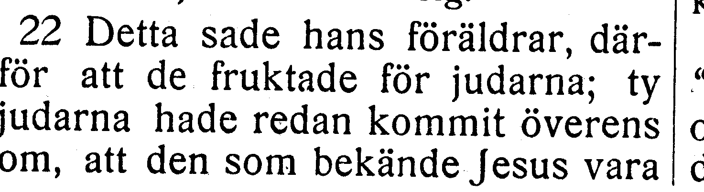

[Full sida, NT s. 163](https://runeberg.org/bibeln/efs1927/nt/0163.html). TIFF: `https://runeberg.org/img/bibeln/efs1927/nt/0163.1.tif`; SHA-256 `6898d98fea0de041156fa4a7f5da7f7f394e57a762e4c168ce03196ebff04b32`. Utsnittets SHA-256 `d31667b567740c67255514d7be02d0e6af18cd41a183aa0db8367928fc4bd498`.

**Beslut:** öppet; inget rättelse-ID för frågan.

## V104

**Johannes 10:7 — Åter sade Jesus / Åter sade då Jesus.**

**Korpustext:** Åter sade Jesus till dem: »Sannerligen, sannerligen säger jag eder: Jag är dörren in till fåren.

**Foto till senare:** hela 10:7. Korpusens ord och versnummer behålls tills ett kompletterande tryckvittne har bedömts.

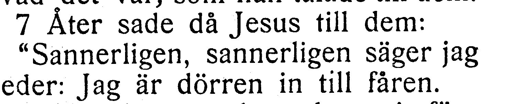

[Full sida, NT s. 164](https://runeberg.org/bibeln/efs1927/nt/0164.html). TIFF: `https://runeberg.org/img/bibeln/efs1927/nt/0164.1.tif`; SHA-256 `aec192f4c609c9cfe2103d357511fab848aa46a1c4569b329d762ea95f3a678f`. Utsnittets SHA-256 `c41e830076130d52e911ae02ffb7835c0ea95761c2938d854c0f5dca2a74a732`.

**Beslut:** öppet; inget rättelse-ID för frågan.

## V105

**Johannes 11:25 — Jesus svarade till henne / Jesus sade till henne.**

**Korpustext:** Jesus svarade till henne: »Jag är uppståndelsen och livet. Den som tror på mig, han skall leva, om han än dör;

**Foto till senare:** hela 11:25. Korpusens ord och versnummer behålls tills ett kompletterande tryckvittne har bedömts.

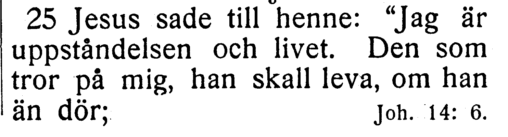

[Full sida, NT s. 166](https://runeberg.org/bibeln/efs1927/nt/0166.html). TIFF: `https://runeberg.org/img/bibeln/efs1927/nt/0166.1.tif`; SHA-256 `eaae5173ceffa38f66cbde30e7c4f7c810b5127054187220ea1befb59d592d0a`. Utsnittets SHA-256 `91b245d3fa59dc46a0b33ae51c26c50b10f9c9bfbaef8c2ef87300f17fe6d395`.

**Beslut:** öppet; inget rättelse-ID för frågan.

## V106

**Johannes 11:32 — hade du varit där / hade du varit här.**

**Korpustext:** När så Maria kom till det ställe där Jesus var och fick se honom, föll hon ned för hans fötter och sade till honom: »Herre, hade du varit där, så vore min broder icke död.»

**Foto till senare:** hela 11:32. Korpusens ord och versnummer behålls tills ett kompletterande tryckvittne har bedömts.

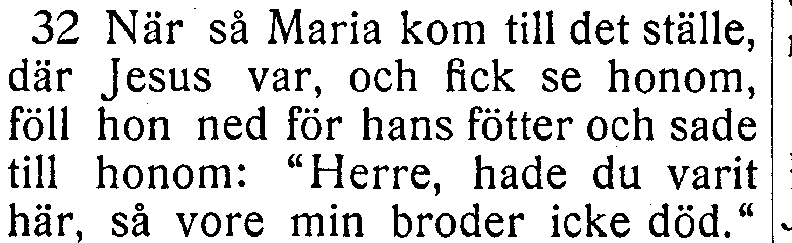

[Full sida, NT s. 167](https://runeberg.org/bibeln/efs1927/nt/0167.html). TIFF: `https://runeberg.org/img/bibeln/efs1927/nt/0167.1.tif`; SHA-256 `1307835c177d37cff2595443fce45209446827e13bbead1a70a53cff31872e38`. Utsnittets SHA-256 `834a5f57284fc643abf566a81bfa7733d73f5b90a70593ba0ba88873e0ef5776`.

**Beslut:** öppet; inget rättelse-ID för frågan.

## V107

**Johannes 11:33 — såg jämväl att de / såg att jämväl de.**

**Korpustext:** Då nu Jesus såg henne gråta och såg jämväl att de judar, som hade kommit med henne, gräto, upptändes han i sin ande och blev upprörd

**Foto till senare:** hela 11:33. Korpusens ord och versnummer behålls tills ett kompletterande tryckvittne har bedömts.

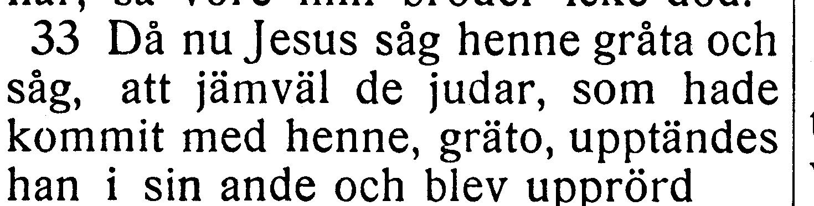

[Full sida, NT s. 167](https://runeberg.org/bibeln/efs1927/nt/0167.html). TIFF: `https://runeberg.org/img/bibeln/efs1927/nt/0167.1.tif`; SHA-256 `1307835c177d37cff2595443fce45209446827e13bbead1a70a53cff31872e38`. Utsnittets SHA-256 `6548a1420bdb2438830029e6ecaa75996ef80dae809d4e5a699f3d9584f7014d`.

**Beslut:** öppet; inget rättelse-ID för frågan.

## V108

**Johannes 11:48 — Om vi skola låta / Om vi låta.**

**Korpustext:** Om vi skola låta honom så fortfara, skola alla tro på honom, och romarna komma då att taga ifrån oss både land och folk.»

**Foto till senare:** hela 11:48. Korpusens ord och versnummer behålls tills ett kompletterande tryckvittne har bedömts.

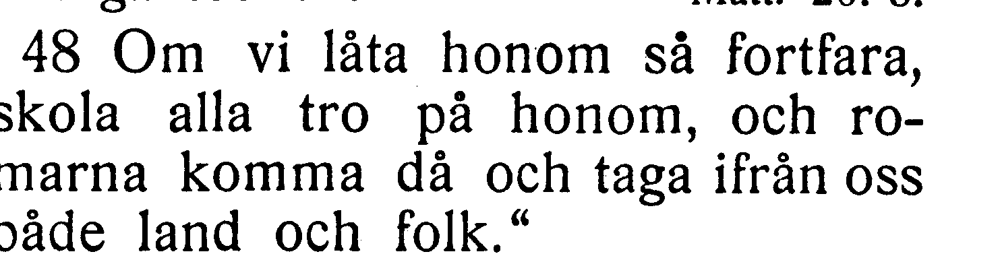

[Full sida, NT s. 167](https://runeberg.org/bibeln/efs1927/nt/0167.html). TIFF: `https://runeberg.org/img/bibeln/efs1927/nt/0167.1.tif`; SHA-256 `1307835c177d37cff2595443fce45209446827e13bbead1a70a53cff31872e38`. Utsnittets SHA-256 `97b97c3ef1e1d9bdfb3e08b29bedad67ced723fb624dce85641b6dd355b9c421`.

**Beslut:** öppet; inget rättelse-ID för frågan.

## V109

**Johannes 11:54 — öppet bland judarna / öppet omkring bland judarna.**

**Korpustext:** Så vandrade då Jesus icke längre öppet bland judarna, utan drog sig undan till en stad som hette Efraim, på landsbygden, i närheten av öknen; där stannade han kvar med sina lärjungar.

**Foto till senare:** hela 11:54. Korpusens ord och versnummer behålls tills ett kompletterande tryckvittne har bedömts.

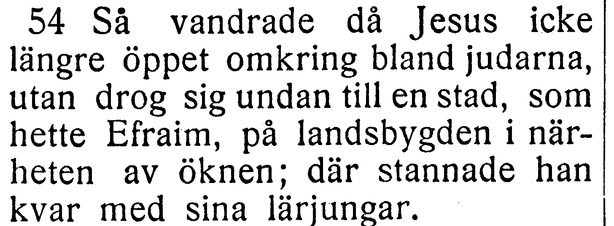

[Full sida, NT s. 168](https://runeberg.org/bibeln/efs1927/nt/0168.html). TIFF: `https://runeberg.org/img/bibeln/efs1927/nt/0168.1.tif`; SHA-256 `4669f00c0607c172500bfce2e2a634460e7c16036374212e3a528d2c2ae23860`. Utsnittets SHA-256 `7d1cebc903293fbf67e449607da152b0660c403aab5b14f3b5886ac82edfffe5`.

**Beslut:** öppet; inget rättelse-ID för frågan.

## V110

**Johannes 12:12 — det myckna folk / det myckna folket.**

**Korpustext:** När dagen därefter det myckna folk som hade kommit till högtiden fick höra att Jesus var på väg till Jerusalem,

**Foto till senare:** hela 12:12. Korpusens ord och versnummer behålls tills ett kompletterande tryckvittne har bedömts.

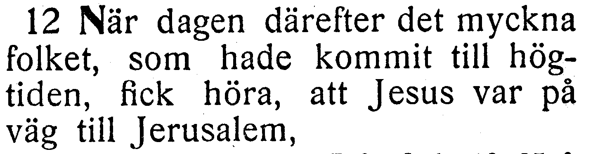

[Full sida, NT s. 168](https://runeberg.org/bibeln/efs1927/nt/0168.html). TIFF: `https://runeberg.org/img/bibeln/efs1927/nt/0168.1.tif`; SHA-256 `4669f00c0607c172500bfce2e2a634460e7c16036374212e3a528d2c2ae23860`. Utsnittets SHA-256 `aaf4f3da1a2e5949b41b9601f209e27aebe189d979225963deac4a6511e5b5b6`.

**Beslut:** öppet; inget rättelse-ID för frågan.

## V111

**Johannes 12:35 — var han går / vart han går.**

**Korpustext:** Jesus sade till dem: »Ännu en liten tid är ljuset ibland eder. Vandren medan I haven ljuset, på det att mörkret icke må få makt med eder; den som vandrar i mörkret, han vet ju icke var han går.

**Foto till senare:** hela 12:35. Korpusens ord och versnummer behålls tills ett kompletterande tryckvittne har bedömts.

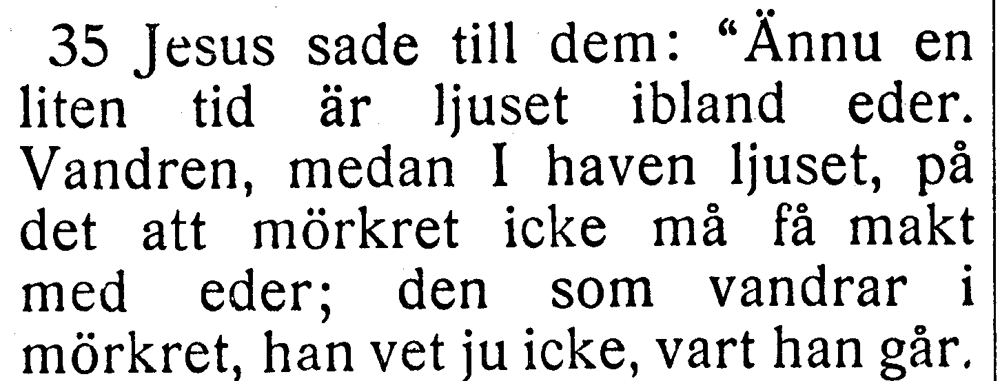

[Full sida, NT s. 170](https://runeberg.org/bibeln/efs1927/nt/0170.html). TIFF: `https://runeberg.org/img/bibeln/efs1927/nt/0170.1.tif`; SHA-256 `3af8881be848db91e2d46348e7adbefdb3469baa101675c14b5cc90ec577294c`. Utsnittets SHA-256 `23de6f97d6e7847b72b984bef5d4c334bf0c108fcb839759fe7841f67352a825`.

**Beslut:** öppet; inget rättelse-ID för frågan.

## V112

**Johannes 12:41 — talade med honom / talade om honom.**

**Korpustext:** Detta kunde Esaias säga, eftersom han hade sett hans härlighet, när han talade med honom. –

**Foto till senare:** hela 12:41. Korpusens ord och versnummer behålls tills ett kompletterande tryckvittne har bedömts.

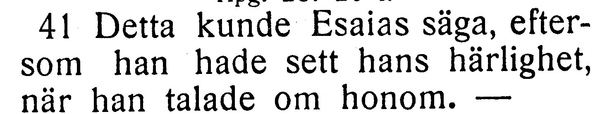

[Full sida, NT s. 170](https://runeberg.org/bibeln/efs1927/nt/0170.html). TIFF: `https://runeberg.org/img/bibeln/efs1927/nt/0170.1.tif`; SHA-256 `3af8881be848db91e2d46348e7adbefdb3469baa101675c14b5cc90ec577294c`. Utsnittets SHA-256 `8b681d89c64cf109bfa06ef2254e48b4e2c58e85ce8820a6256b7e95d69c215c`.

**Beslut:** öppet; inget rättelse-ID för frågan.

## V113

**Johannes 13:10 — behöver allenast / behöver sedan allenast.**

**Korpustext:** Jesus svarade honom: »Den som är helt tvagen, han behöver allenast två fötterna; han är ju i övrigt hel och hållen ren. Så ären ock I rena – dock icke alla.»

**Foto till senare:** hela 13:10. Korpusens ord och versnummer behålls tills ett kompletterande tryckvittne har bedömts.

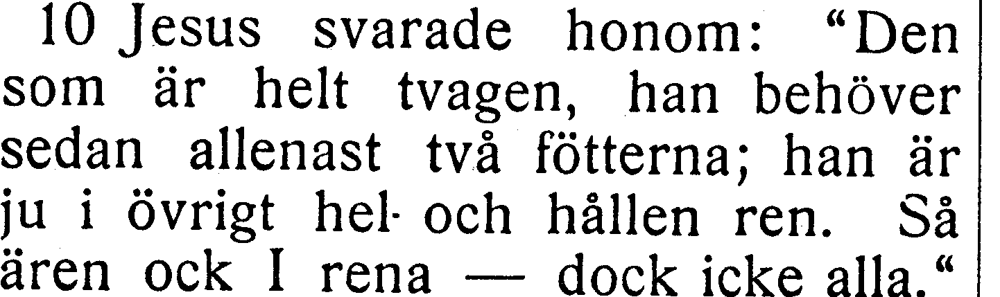

[Full sida, NT s. 171](https://runeberg.org/bibeln/efs1927/nt/0171.html). TIFF: `https://runeberg.org/img/bibeln/efs1927/nt/0171.1.tif`; SHA-256 `6cec39047aabc052b241bb885393dc0e0df1ca769a5517f979199aa83813195b`. Utsnittets SHA-256 `36ef2c6fdbb079de6f66a8091155da5cc22a1b1a1eac0b10a210a9e90315ba37`.

**Beslut:** öppet; inget rättelse-ID för frågan.

## V114

**Johannes 13:36 — icke nu följa mig / icke följa mig.**

**Korpustext:** Då frågade Simon Petrus honom: »Herre, vart går du?» Jesus svarade: »Dit jag går, dit kan du icke nu följa mig; men framdeles skall du följa mig.»

**Foto till senare:** hela 13:36. Korpusens ord och versnummer behålls tills ett kompletterande tryckvittne har bedömts.

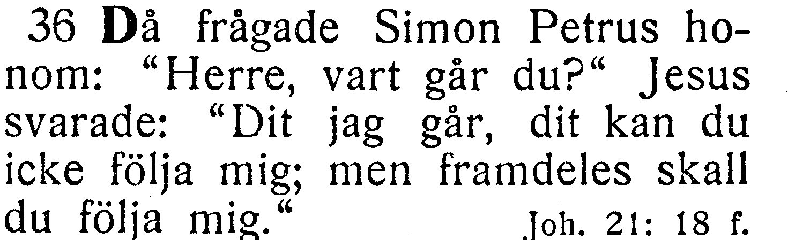

[Full sida, NT s. 172](https://runeberg.org/bibeln/efs1927/nt/0172.html). TIFF: `https://runeberg.org/img/bibeln/efs1927/nt/0172.1.tif`; SHA-256 `5944956b581910b57a3266fec68e047127423f18ce2ffd92b81c163d633b7c30`. Utsnittets SHA-256 `2c7114b8ec584fe38b4e3909c593c455e538dbc02fb45756efed4a7034594492`.

**Beslut:** öppet; inget rättelse-ID för frågan.

## V115

**Johannes 14:6 — utom genom mig / utan genom mig.**

**Korpustext:** Jesus svarade honom: »Jag är vägen och sanningen och livet; ingen kommer till Fadern utom genom mig.

**Foto till senare:** hela 14:6. Korpusens ord och versnummer behålls tills ett kompletterande tryckvittne har bedömts.

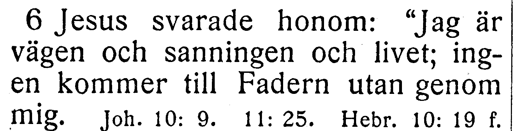

[Full sida, NT s. 173](https://runeberg.org/bibeln/efs1927/nt/0173.html). TIFF: `https://runeberg.org/img/bibeln/efs1927/nt/0173.1.tif`; SHA-256 `1fce908948a12c5e3ad4e8b4b8eea8f49038d480283a78691ba33a7ae5930427`. Utsnittets SHA-256 `a67baaa96e763a59c2565ed43d89702ec605778379e7bb7e246e657366e8fd1d`.

**Beslut:** öppet; inget rättelse-ID för frågan.

## V116

**Johannes 14:21 — och jag skall uppenbara / och skall uppenbara.**

**Korpustext:** Den som har mina bud och håller dem, han är den som älskar mig; och den som älskar mig, han skall bliva älskad av min Fader, och jag skall älska honom och jag skall uppenbara mig för honom.»

**Foto till senare:** hela 14:21. Korpusens ord och versnummer behålls tills ett kompletterande tryckvittne har bedömts.

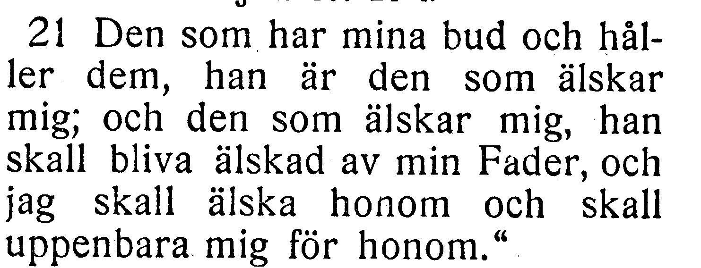

[Full sida, NT s. 173](https://runeberg.org/bibeln/efs1927/nt/0173.html). TIFF: `https://runeberg.org/img/bibeln/efs1927/nt/0173.1.tif`; SHA-256 `1fce908948a12c5e3ad4e8b4b8eea8f49038d480283a78691ba33a7ae5930427`. Utsnittets SHA-256 `962069b162e0ad27102a6a60f0eb2d2dafb12611d89d68303170cbc95599b497`.

**Beslut:** öppet; inget rättelse-ID för frågan.

## V117

**Johannes 17:3 — den enda sanne Guden / den ende sanne Guden.**

**Korpustext:** Och detta är evigt liv, att de känna dig, den enda sanne Guden, och den du har sänt, Jesus Kristus.

**Foto till senare:** hela 17:3. Korpusens ord och versnummer behålls tills ett kompletterande tryckvittne har bedömts.

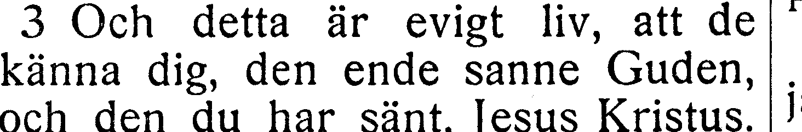

[Full sida, NT s. 177](https://runeberg.org/bibeln/efs1927/nt/0177.html). TIFF: `https://runeberg.org/img/bibeln/efs1927/nt/0177.1.tif`; SHA-256 `81cece844f571c4570a3983d824927593be39241b30dcff201caa096c20382e3`. Utsnittets SHA-256 `d3e6a0db0165343d9652e5e01568c088051eb646e3cee94081b55ec61053a776`.

**Beslut:** öppet; inget rättelse-ID för frågan.

## V118

**Johannes 18:13 — överstepräst det året / överstepräst för det året.**

**Korpustext:** och förde honom bort, först till Hannas; denne var nämligen svärfader till Kaifas, som var överstepräst det året.

**Foto till senare:** hela 18:13. Korpusens ord och versnummer behålls tills ett kompletterande tryckvittne har bedömts.

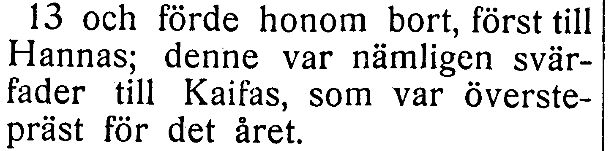

[Full sida, NT s. 179](https://runeberg.org/bibeln/efs1927/nt/0179.html). TIFF: `https://runeberg.org/img/bibeln/efs1927/nt/0179.1.tif`; SHA-256 `b5891b1b0b4f98c7a495374efdadc0c09b2bad1781ec97f7b1fce84be6231f9a`. Utsnittets SHA-256 `1e647bc3fc2070b6ae0f7d78738feb6bfe9c5efbb5054c248f8ab7b777241b42`.

**Beslut:** öppet; inget rättelse-ID för frågan.

## V119

**Johannes 18:33 — Pilatus gick åter in / Pilatus gick då åter in.**

**Korpustext:** Pilatus gick åter in i pretoriet och kallade Jesus till sig och sade till honom: »Är du judarnas konung?»

**Foto till senare:** hela 18:33. Korpusens ord och versnummer behålls tills ett kompletterande tryckvittne har bedömts.

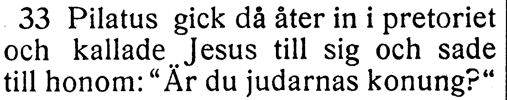

[Full sida, NT s. 180](https://runeberg.org/bibeln/efs1927/nt/0180.html). TIFF: `https://runeberg.org/img/bibeln/efs1927/nt/0180.1.tif`; SHA-256 `102f4139a920f68789efdbea9e41b22850292a6df49d674f7d66b1adf78f95dc`. Utsnittets SHA-256 `a69de3015110e8ac719b3c6f7b666e9922fad72ab9850d27ad33ef96b635e1b2`.

**Beslut:** öppet; inget rättelse-ID för frågan.

## V120

**Johannes 18:37 — Så sade Pilatus / Då sade Pilatus.**

**Korpustext:** Så sade Pilatus till honom: »Så är du dock en konung?» Jesus svarade: »Du säger det själv, att jag är en konung. Ja, därtill är jag född, och därtill har jag kommit i världen, att jag skall vittna för sanningen. Var och en som är av sanningen, han hör min röst.»

**Foto till senare:** hela 18:37. Korpusens ord och versnummer behålls tills ett kompletterande tryckvittne har bedömts.

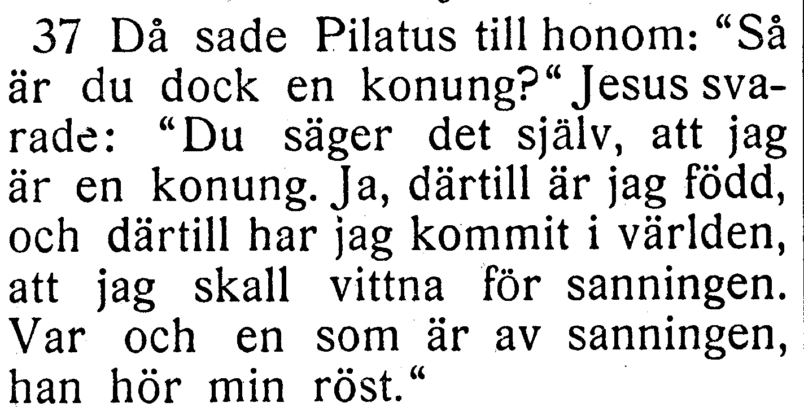

[Full sida, NT s. 180](https://runeberg.org/bibeln/efs1927/nt/0180.html). TIFF: `https://runeberg.org/img/bibeln/efs1927/nt/0180.1.tif`; SHA-256 `102f4139a920f68789efdbea9e41b22850292a6df49d674f7d66b1adf78f95dc`. Utsnittets SHA-256 `7dce1b17a7464ea3e36686f18a50ee766552d5f224aa23b44241b2d6f9b10805`.

**Beslut:** öppet; inget rättelse-ID för frågan.

## V121

**Johannes 20:1 — på första veckodagen, medan / på första veckodagen om morgonen, medan.**

**Korpustext:** Men på första veckodagen, medan det ännu var mörkt, kom Maria från Magdala dit till graven och fick se stenen vara borttagen från graven.

**Foto till senare:** hela 20:1. Korpusens ord och versnummer behålls tills ett kompletterande tryckvittne har bedömts.

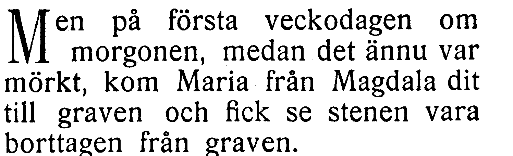

[Full sida, NT s. 182](https://runeberg.org/bibeln/efs1927/nt/0182.html). TIFF: `https://runeberg.org/img/bibeln/efs1927/nt/0182.1.tif`; SHA-256 `841dbc64f1dad53b4345ad9805975b9298725d85ed1a55b08e3535521618d1e4`. Utsnittets SHA-256 `cd7ba6b21f541dfe24ee3470bab664f2095a524f4c3d942af08bfce94d59c2d4`.

**Beslut:** öppet; inget rättelse-ID för frågan.

## V122

**Johannes 20:21 — så sänder ock jag eder / så sänder jag ock eder.**

**Korpustext:** Åter sade Jesus till dem: »Frid vare med eder! Såsom Fadern har sänt mig, så sänder ock jag eder.»

**Foto till senare:** hela 20:21. Korpusens ord och versnummer behålls tills ett kompletterande tryckvittne har bedömts.

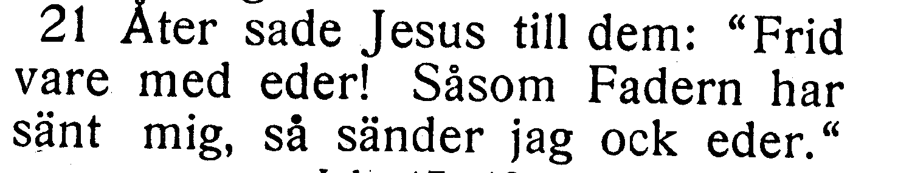

[Full sida, NT s. 183](https://runeberg.org/bibeln/efs1927/nt/0183.html). TIFF: `https://runeberg.org/img/bibeln/efs1927/nt/0183.1.tif`; SHA-256 `44c985a65bbb3be8edadc794eafab9487a28ced64374bb55871abd63a42e2ccb`. Utsnittets SHA-256 `4c24e3886b515f338133dbc4b7eb79b1234b87f46ceb3bffd88b337c6f64d3cc`.

**Beslut:** öppet; inget rättelse-ID för frågan.
