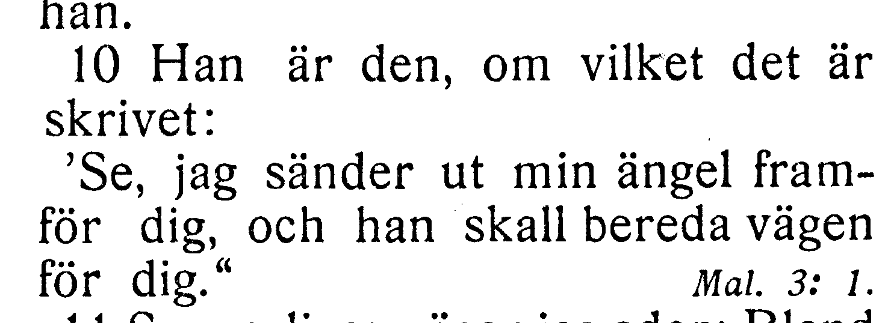
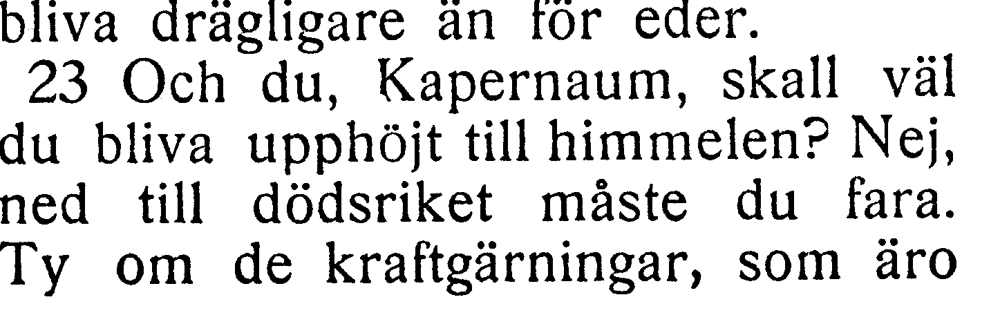
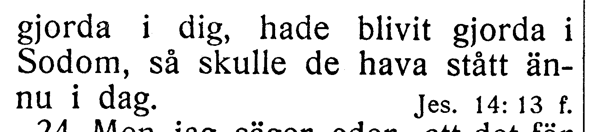
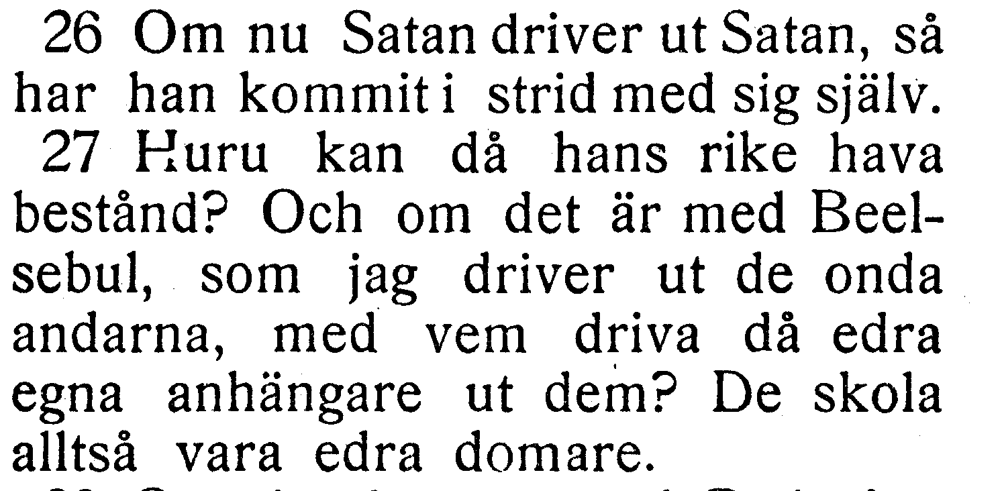
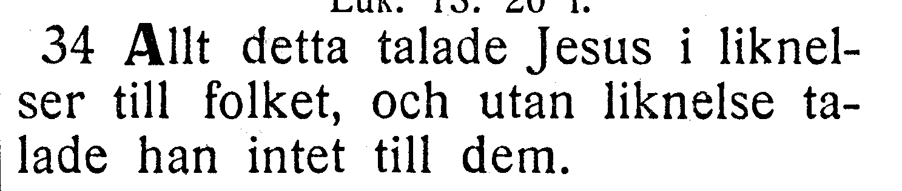
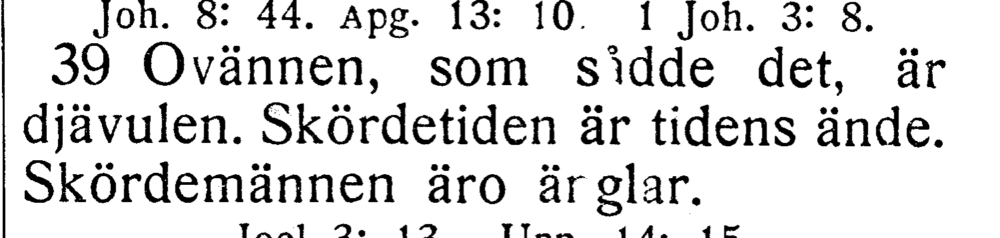
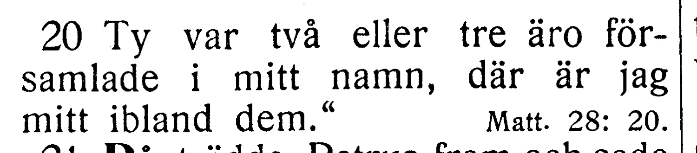
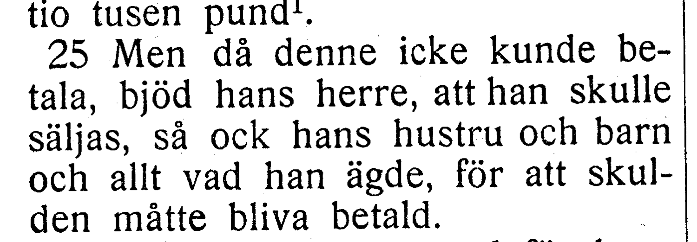

# Fotobunt 2: sparad till senare boktillgång

**Sparad 2026-10-26. V010–V016 är öppna och uppskjutna medan användaren är utan boken. Ingen åtgärd behövs nu.** Codex har läst hela Matteus 11–18 mot EFS 1927 och kontrollerat dessa skillnader i originalupplösning. Korpustexten för frågorna behålls tills ett annat tryck kan bedömas. Kapitel 11, 12, 13 och 18 står därför som `needs-review`; andra kapitel kan granskas vidare.

När boken finns till hands räcker foton, utan transkription eller egen tolkning. Både 13:34 och 13:39 kan få plats i samma foto, liksom 18:20 och 18:25. **Fem foton kan alltså räcka för sju frågor:** 11:10; 11:23; 12:26–27; 13:34 + 13:39; 18:20 + 18:25. För 12:26–27 måste versnumren synas. Codex tolkar dem senare och tar bara kvarstående oklarhet vidare.

| Fråga | Vers | Att jämföra | Status |
| --- | --- | --- | --- |
| [V010](#v010) | Matt. 11:10 | om vilken / om vilket | Uppskjuten, korpusen behålls |
| [V011](#v011) | Matt. 11:23 | det / de hava stått | Uppskjuten, korpusen behålls |
| [V012](#v012) | Matt. 12:26, 27 | versgränsen före Huru / före Och om | Uppskjuten, korpusen behålls |
| [V013](#v013) | Matt. 13:34 | utan liknelser / utan liknelse | Uppskjuten, korpusen behålls |
| [V014](#v014) | Matt. 13:39 | Skördemännen är / äro | Uppskjuten, korpusen behålls |
| [V015](#v015) | Matt. 18:20 | två eller tre är / äro | Uppskjuten, korpusen behålls |
| [V016](#v016) | Matt. 18:25 | då denna / då denne | Uppskjuten, korpusen behålls |

Utsnitten nedan är direkt beskurna ur TIFF-originalen, utan OCR, skärpning eller återskapad text. Hela korpusverser och länkar till fulla trycksidor följer. Exakta kapitel- och TIFF-hashar finns även i [liggaren](../sv1917-verification.json).

## V010

**Matteus 11:10 — om vilken / om vilket.**

Korpus: Han är den om vilken det är skrivet. EFS 1927: Han är den, om vilket det är skrivet. Båda läsningarna sparas; inget avgörs genom grammatisk sannolikhet.

**Korpustext 11:10:** Han är den om vilken det är skrivet: 'Se, jag sänder ut min ängel framför dig, och han skall bereda vägen för dig.'

**Foto till senare:** ett foto av hela 11:10.

[Full sida, NT s. 18](https://runeberg.org/bibeln/efs1927/nt/0018.html). TIFF: `https://runeberg.org/img/bibeln/efs1927/nt/0018.1.tif`; SHA-256 `a79622f489fc3970d1218a78b4369473a3e71b94ae845837c134365414d8c77c`. Utsnittets SHA-256 `3123c692061a20fbf4897c54012d0260b56e51da38be73121afeb20e2ba0c54b`.

**Beslut:** öppet; ingen ändring av denna läsning före ytterligare tryckvittne.

## V011

**Matteus 11:23 — det / de hava stått.**

Korpus: så skulle det hava stått ännu i dag. EFS 1927:s sidfortsättning: så skulle de hava stått ännu i dag. Originalupplösningen bekräftar de i trycket; det kan vara tryckfel eller variant.

**Korpustext 11:23:** Och du, Kapernaum, skall väl du bliva upphöjt till himmelen? Nej, ned till dödsriket måste du fara. Ty om de kraftgärningar som äro gjorda i dig hade blivit gjorda i Sodom, så skulle det hava stått ännu i dag.

**Foto till senare:** hela 11:23, även versens slut.

[Full sida, NT s. 18](https://runeberg.org/bibeln/efs1927/nt/0018.html). TIFF: `https://runeberg.org/img/bibeln/efs1927/nt/0018.1.tif`; SHA-256 `a79622f489fc3970d1218a78b4369473a3e71b94ae845837c134365414d8c77c`. Utsnittets SHA-256 `f5e9a1553d79f252699bd88ecf1d9363c74b22ea4676349fad8600ca06b1dfc5`.

[Full sida, NT s. 19](https://runeberg.org/bibeln/efs1927/nt/0019.html). TIFF: `https://runeberg.org/img/bibeln/efs1927/nt/0019.1.tif`; SHA-256 `e96f2177c3fa9b6c92ae170f84e84c91285cef3b7efea3292d34c8634ed18b20`. Utsnittets SHA-256 `cfacea533b566224a160ac3bdd736b60d56b867625e950da003843a0314bc28e`.

**Beslut:** öppet; ingen ändring av denna läsning före ytterligare tryckvittne.

## V012

**Matteus 12:26–27 — versgränsen före Huru / före Och om.**

Korpusens 12:26 slutar med Huru kan då hans rike hava bestånd? I EFS 1927 står nummer 27 före denna fråga. Inga ord saknas; versgräns och mappningar behålls i väntan på jämförelse med ett annat tryck.

**Korpustext 12:26:** Om nu Satan driver ut Satan, så har han kommit i strid med sig själv. Huru kan då hans rike hava bestånd?

**Korpustext 12:27:** Och om det är med Beelsebul som jag driver ut de onda andarna, med vem driva då edra egna anhängare ut dem? De skola alltså vara edra domare.

**Foto till senare:** ett foto som visar hela 12:26–27 och båda versnumren.

[Full sida, NT s. 20](https://runeberg.org/bibeln/efs1927/nt/0020.html). TIFF: `https://runeberg.org/img/bibeln/efs1927/nt/0020.1.tif`; SHA-256 `eb2082256242ceeec1b66445c47409c5fa7b14828f0e7c791f8b541aaf7cfcc1`. Utsnittets SHA-256 `38331559931048d96a9ce96cb2f09278f7c0d74f9d5e497a9c7b7821f3eca1bb`.

**Beslut:** öppet; ingen ändring av denna läsning före ytterligare tryckvittne.

## V013

**Matteus 13:34 — utan liknelser / utan liknelse.**

Korpus: utan liknelser talade han intet till dem. EFS 1927: utan liknelse talade han intet till dem. Singular/plural behöver jämföras; korpusen behålls tills vidare.

**Korpustext 13:34:** Allt detta talade Jesus i liknelser till folket, och utan liknelser talade han intet till dem.

**Foto till senare:** hela 13:34; kan samlas med 13:39 i samma foto.

[Full sida, NT s. 23](https://runeberg.org/bibeln/efs1927/nt/0023.html). TIFF: `https://runeberg.org/img/bibeln/efs1927/nt/0023.1.tif`; SHA-256 `6ae4c43040e0850322eb04d8db26219ad78de1a5d8d71d85871c6a91cf0df11c`. Utsnittets SHA-256 `6307dd59c58c76abfc3b54148079b3228f927779ede41fe21cecfa99102aede1`.

**Beslut:** öppet; ingen ändring av denna läsning före ytterligare tryckvittne.

## V014

**Matteus 13:39 — Skördemännen är / äro.**

Korpus: Skördemännen är änglar. EFS 1927: Skördemännen äro änglar. Möjligt bortfall av o i e-texten; annan tryckning efterfrågas innan ordformen ändras.

**Korpustext 13:39:** Ovännen, som sådde det, är djävulen. Skördetiden är tidens ände. Skördemännen är änglar.

**Foto till senare:** hela 13:39; kan samlas med 13:34 i samma foto.

[Full sida, NT s. 23](https://runeberg.org/bibeln/efs1927/nt/0023.html). TIFF: `https://runeberg.org/img/bibeln/efs1927/nt/0023.1.tif`; SHA-256 `6ae4c43040e0850322eb04d8db26219ad78de1a5d8d71d85871c6a91cf0df11c`. Utsnittets SHA-256 `9afc2e8c4418022cfd468108cd668f36dee0e779a63d98ae52183fd6590b4e5f`.

**Beslut:** öppet; ingen ändring av denna läsning före ytterligare tryckvittne.

## V015

**Matteus 18:20 — två eller tre är / äro.**

Korpus: Ty var två eller tre är församlade i mitt namn. EFS 1927: Ty var två eller tre äro församlade i mitt namn. Möjligt bortfall av o; ingen automatisk harmonisering.

**Korpustext 18:20:** Ty var två eller tre är församlade i mitt namn, där är jag mitt ibland dem.»

**Foto till senare:** hela 18:20; kan samlas med 18:25 i samma foto.

[Full sida, NT s. 32](https://runeberg.org/bibeln/efs1927/nt/0032.html). TIFF: `https://runeberg.org/img/bibeln/efs1927/nt/0032.1.tif`; SHA-256 `34f1ed91c62ec36b6c8dda8ac20b427efa5c7bc1c560945dc1a25daaadc90952`. Utsnittets SHA-256 `53d04dd1b29913091816b580017047909415ab2c325037ed757fe3c201cf9c64`.

**Beslut:** öppet; ingen ändring av denna läsning före ytterligare tryckvittne.

## V016

**Matteus 18:25 — då denna / då denne.**

Korpus: Men då denna icke kunde betala. EFS 1927: Men då denne icke kunde betala. Pronomenets slutbokstav behöver jämföras med ett annat tryck.

**Korpustext 18:25:** Men då denna icke kunde betala, bjöd hans herre att han skulle säljas, så ock hans hustru och barn och allt vad han ägde, för att skulden måtte bliva betald.

**Foto till senare:** hela 18:25; kan samlas med 18:20 i samma foto.

[Full sida, NT s. 32](https://runeberg.org/bibeln/efs1927/nt/0032.html). TIFF: `https://runeberg.org/img/bibeln/efs1927/nt/0032.1.tif`; SHA-256 `34f1ed91c62ec36b6c8dda8ac20b427efa5c7bc1c560945dc1a25daaadc90952`. Utsnittets SHA-256 `10658098b4fdd9daaa9d650e6f4682a32f92591c6c0285feae2a63245cfcbb70`.

**Beslut:** öppet; ingen ändring av denna läsning före ytterligare tryckvittne.
