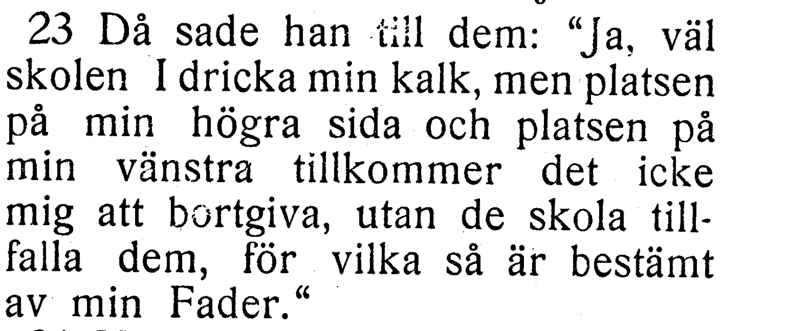
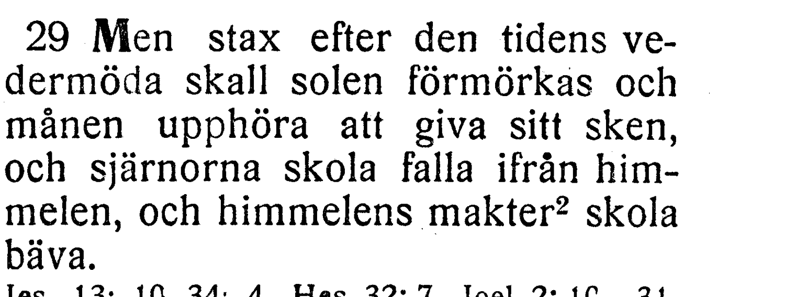
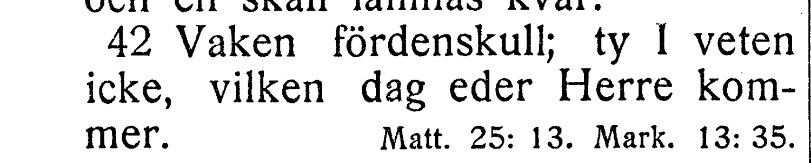
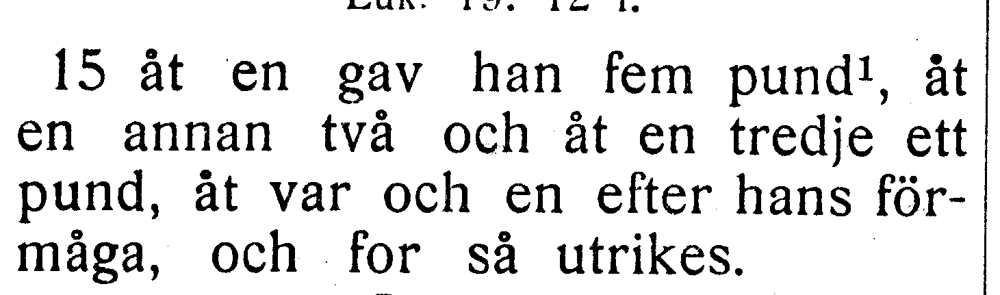

# Fotobunt 3: återstående Matteusfrågor

**Alla frågor i denna bunt avgjorda 2026-10-27 mot [EFS 1926](../sv1917-efs1926-witnesses/README.md). Ingen fotobegäran återstår.** Hela Matteus och Markus är nu verifierade. Tabellens jämförelse visar texten före besluten; aktuella korpusverser nedan är uppdaterade. Originalfrågor, stabila V-ID och EFS 1927-utsnitt behålls för återkontroll.

| Fråga | Vers | Korpus / EFS 1927 |
| --- | --- | --- |
| [V017](#v017), löst | Matt. 20:23 | väl skolen I få dricka / väl skolen I dricka |
| [V018](#v018), löst | Matt. 24:29 | strax / stax |
| [V019](#v019), löst | Matt. 24:42 | vår Herre / eder Herre |
| [V020](#v020), löst | Matt. 25:15 | och for utrikes / och for så utrikes |

## V017

**Matteus 20:23 — väl skolen I få dricka / väl skolen I dricka.**

Korpusens få saknas i EFS 1927. Jämför en annan tryckning innan ett ord tas bort.

**Korpustext:** Då sade han till dem: »Ja, väl skolen I få dricka min kalk, men platsen på min högra sida och platsen på min vänstra tillkommer det icke mig att bortgiva, utan de skola tillfalla dem för vilka så är bestämt av min Fader.»

**Komplettering:** hela versen visuellt jämförd i EFS 1926. Ingen fotobegäran återstår.

[Full sida, NT s. 35](https://runeberg.org/bibeln/efs1927/nt/0035.html). TIFF: `https://runeberg.org/img/bibeln/efs1927/nt/0035.1.tif`; SHA-256 `dd355fc245aa32efaf45fb0987732e50666c2c7efcde1113e8e775c55e3aac67`. Utsnittets SHA-256 `ed52b6b4f8b02f16a0386052e04089be499e80e66764fdcf1db0dec2a7be24fd`.

**Beslut:** löst 2026-10-27. EFS 1926 bekräftar korpusens väl skolen I få dricka; få saknas endast i EFS 1927. Ordet behålls.

[Bevarad originalfullsida från EFS 1926, NT s. 31](../sv1917-efs1926-witnesses/nt0031.jpg), SHA-256 `fed26662223d40224e0997ec12c6b6b90a1ddca0106d7e691d041c0971135f1c`. [Hämtningsadress](https://archive.org/download/bibelnellerdenhe0000unse/page/n1240.jpg).

## V018

**Matteus 24:29 — strax / stax.**

EFS 1927 har tydligt stax i originalupplösning, möjligen ett tryckfel. Korpusens strax behålls.

**Korpustext:** Men strax efter den tidens vedermöda skall solen förmörkas och månen upphöra att giva sitt sken, och stjärnorna skola falla ifrån himmelen, och himmelens makter skola bäva.

**Komplettering:** hela versen visuellt jämförd i EFS 1926. Ingen fotobegäran återstår.

[Full sida, NT s. 43](https://runeberg.org/bibeln/efs1927/nt/0043.html). TIFF: `https://runeberg.org/img/bibeln/efs1927/nt/0043.1.tif`; SHA-256 `c2d8162c32fe436fc6efa008039191bdb32458461ce2501d36358b8ae7ab2ac1`. Utsnittets SHA-256 `634a257c51dd6ac12a74802cf6ad63847dd91c80144537209af8148adfb37aaf`.

**Beslut:** löst 2026-10-27. EFS 1926 har tydligt strax. Korpusens strax behålls mot EFS 1927:s stax; ingen gissad bokstav eller ny rättelse.

[Bevarad originalfullsida från EFS 1926, NT s. 38](../sv1917-efs1926-witnesses/nt0038.jpg), SHA-256 `5f2c0e067c036d8d480257b7dc2f6539922b0d7505e125a4075a900a576bb7d9`. [Hämtningsadress](https://archive.org/download/bibelnellerdenhe0000unse/page/n1247.jpg).

## V019

**Matteus 24:42 — vår Herre / eder Herre.**

Korpusens vår Herre skiljer sig från tryckets eder Herre. Båda är möjliga läsningar.

**Korpustext:** Vaken fördenskull; ty I veten icke vilken dag eder Herre kommer.

**Komplettering:** hela versen visuellt jämförd i EFS 1926. Ingen fotobegäran återstår.

[Full sida, NT s. 44](https://runeberg.org/bibeln/efs1927/nt/0044.html). TIFF: `https://runeberg.org/img/bibeln/efs1927/nt/0044.1.tif`; SHA-256 `5e25b940867b6cdad90c65ec1f0d96c17b80a913449573135613a29fad13029e`. Utsnittets SHA-256 `6c57eb88f1c17504e69238798df4406fbe62f16de5b88ca3aaf5d2fa429f1b56`.

**Beslut:** löst 2026-10-27. EFS 1926 och 1927 visar båda eder Herre. R358 rättar vår Herre till eder Herre. Hela versen visuellt jämförd. Vanlig kommatering och övriga ord behålls.

[Bevarad originalfullsida från EFS 1926, NT s. 39](../sv1917-efs1926-witnesses/nt0039.jpg), SHA-256 `5413245f998b9a84dd4ac6078e85430454cb9796b521b4085667f584201f09d5`. [Hämtningsadress](https://archive.org/download/bibelnellerdenhe0000unse/page/n1248.jpg).

## V020

**Matteus 25:15 — och for utrikes / och for så utrikes.**

Trycket har så, som saknas i korpusen. Inget ord läggs till före kompletterande vittne.

**Korpustext:** åt en gav han fem pund, åt en annan två och åt en tredje ett pund, åt var och en efter hans förmåga, och for så utrikes.

**Komplettering:** hela versen visuellt jämförd i EFS 1926. Ingen fotobegäran återstår.

[Full sida, NT s. 45](https://runeberg.org/bibeln/efs1927/nt/0045.html). TIFF: `https://runeberg.org/img/bibeln/efs1927/nt/0045.1.tif`; SHA-256 `8fdb7fbfb4100b87ffe2599d1541178391fca6293c98753013f256ca58155086`. Utsnittets SHA-256 `b928b6947676a2fd9ec22dc0e9b77b15c12a79d504779f46074f682e30052f84`.

**Beslut:** löst 2026-10-27. EFS 1926 och 1927 visar båda och for så utrikes. R359 rättar och for utrikes till och for så utrikes. Hela versen visuellt jämförd. Vanlig kommatering och övriga ord behålls.

[Bevarad originalfullsida från EFS 1926, NT s. 39](../sv1917-efs1926-witnesses/nt0039.jpg), SHA-256 `5413245f998b9a84dd4ac6078e85430454cb9796b521b4085667f584201f09d5`. [Hämtningsadress](https://archive.org/download/bibelnellerdenhe0000unse/page/n1248.jpg).
