# Fotobunt 4: Markusfrågor till senare boktillgång

**Alla frågor i denna bunt avgjorda 2026-10-27 mot [EFS 1926](../sv1917-efs1926-witnesses/README.md). Ingen fotobegäran återstår.** Hela Matteus och Markus är nu verifierade. Tabellens jämförelse visar texten före besluten; aktuella korpusverser nedan är uppdaterade. Originalfrågor, stabila V-ID och EFS 1927-utsnitt behålls för återkontroll.

| Fråga | Vers | Korpus / EFS 1927 |
| --- | --- | --- |
| [V021](#v021), löst | Mark. 1:43 | vände / visade |
| [V022](#v022), löst | Mark. 2:14 | steg / stod |
| [V023](#v023), löst | Mark. 3:29 | någonsin / någon |
| [V024](#v024), löst | Mark. 4:1 | en stor hop / en hop |
| [V025](#v025), löst | Mark. 4:15 | ock / och |
| [V026](#v026), löst | Mark. 5:8 | orena / orene |
| [V027](#v027), löst | Mark. 6:5 | han botade / han där botade |
| [V028](#v028), löst | Mark. 6:9 | finge / fingo |
| [V029](#v029), löst | Mark. 7:27 | ju otillbörligt / otillbörligt |
| [V030](#v030), löst | Mark. 8:6 | Ock / Och |
| [V031](#v031), löst | Mark. 9:18 | får / fått |
| [V032](#v032), löst | Mark. 13:17 | de / dem |
| [V033](#v033), löst | Mark. 14:6 | en god gärning / ju en god gärning |
| [V034](#v034), löst | Mark. 14:11 | lovade att giva / lovade giva |
| [V035](#v035), löst | Mark. 14:23 | ock / och |
| [V036](#v036), löst | Mark. 15:8 | kom ditupp / kom nu ditupp |
| [V037](#v037), löst | Mark. 16:5 | vit fotsid klädnad / fotsid klädnad |
| [V038](#v038), löst | Mark. 16:14 | när / där |

## V021

**Markus 1:43 — vände / visade.**

**Korpustext:** Sedan visade Jesus strax bort honom med stränga ord

**Komplettering:** hela versen visuellt jämförd i EFS 1926. Ingen fotobegäran återstår.

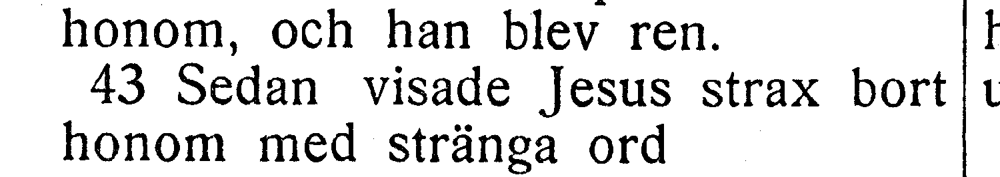

[Full sida, NT s. 57](https://runeberg.org/bibeln/efs1927/nt/0057.html). TIFF: `https://runeberg.org/img/bibeln/efs1927/nt/0057.1.tif`; SHA-256 `e58fa98c3817d473a083a8a19be2cc6f4f0f9ce89c570b9a1ca4d6a7e96facab`. Utsnittets SHA-256 `20af64526f78f2a5307637e38aefd7d8c46cad1009d667d8afddc5b5d5a628d9`.

**Beslut:** löst 2026-10-27. EFS 1926 och 1927 visar båda Sedan visade Jesus. R360 rättar Sedan vände Jesus till Sedan visade Jesus. Hela versen visuellt jämförd. Vanlig kommatering och övriga ord behålls.

[Bevarad originalfullsida från EFS 1926, NT s. 51](../sv1917-efs1926-witnesses/nt0051.jpg), SHA-256 `7f9db22064a7ee92f7e950b5a8adc6171a1680913e421d38b56e243aefb0b3b5`. [Hämtningsadress](https://archive.org/download/bibelnellerdenhe0000unse/page/n1260.jpg).

## V022

**Markus 2:14 — steg / stod.**

**Korpustext:** När han nu gick där fram, fick han se Levi, Alfeus' son, sitta vid tullhuset. Och han sade till denne: »Följ mig.» Då stod han upp och följde honom.

**Komplettering:** hela versen visuellt jämförd i EFS 1926. Ingen fotobegäran återstår.

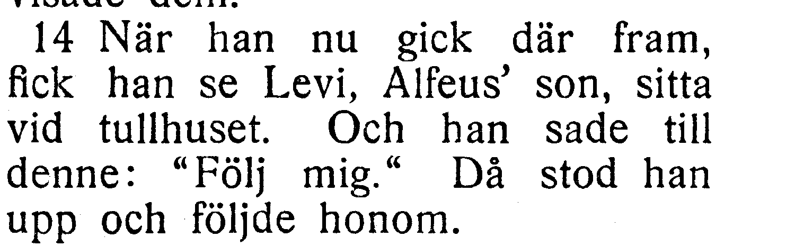

[Full sida, NT s. 57](https://runeberg.org/bibeln/efs1927/nt/0057.html). TIFF: `https://runeberg.org/img/bibeln/efs1927/nt/0057.1.tif`; SHA-256 `e58fa98c3817d473a083a8a19be2cc6f4f0f9ce89c570b9a1ca4d6a7e96facab`. Utsnittets SHA-256 `c206a79999cfd9c7b1dbdd80b1bf0005fff8f01fc33e9fb4cd0b0199f8c17530`.

**Beslut:** löst 2026-10-27. EFS 1926 och 1927 visar båda Då stod han upp. R361 rättar Då steg han upp till Då stod han upp. Hela versen visuellt jämförd. Vanlig kommatering och övriga ord behålls.

[Bevarad originalfullsida från EFS 1926, NT s. 51](../sv1917-efs1926-witnesses/nt0051.jpg), SHA-256 `7f9db22064a7ee92f7e950b5a8adc6171a1680913e421d38b56e243aefb0b3b5`. [Hämtningsadress](https://archive.org/download/bibelnellerdenhe0000unse/page/n1260.jpg).

## V023

**Markus 3:29 — någonsin / någon.**

**Korpustext:** men den som hädar den helige Ande, han får icke någonsin förlåtelse, utan är skyldig till evig synd.»

**Komplettering:** hela versen visuellt jämförd i EFS 1926. Ingen fotobegäran återstår.

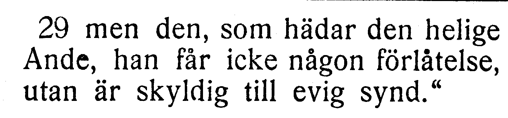

[Full sida, NT s. 60](https://runeberg.org/bibeln/efs1927/nt/0060.html). TIFF: `https://runeberg.org/img/bibeln/efs1927/nt/0060.1.tif`; SHA-256 `2965ec8a3e2da7044d417f124b6335b0846c5ebf9777546515e297e844859fbf`. Utsnittets SHA-256 `190c68c3a24f9ef1a00129181044d41d95afea4ffb973dfb32ad6813348cacd9`.

**Beslut:** löst 2026-10-27. EFS 1926 har icke någonsin förlåtelse, som i korpusen; EFS 1927 har någon. Befintlig text behålls.

[Bevarad originalfullsida från EFS 1926, NT s. 53](../sv1917-efs1926-witnesses/nt0053.jpg), SHA-256 `00c6ce70ae35315c7baad27bd3285cbfaf2aff69136851f87f33be4550164b55`. [Hämtningsadress](https://archive.org/download/bibelnellerdenhe0000unse/page/n1262.jpg).

## V024

**Markus 4:1 — en stor hop / en hop.**

**Korpustext:** Och han begynte åter undervisa vid sjön. Och där församlade sig en stor hop folk omkring honom. Därför steg han i en båt; och han satt i den ute på sjön, under det att allt folket stod på land utmed sjön.

**Komplettering:** hela versen visuellt jämförd i EFS 1926. Ingen fotobegäran återstår.

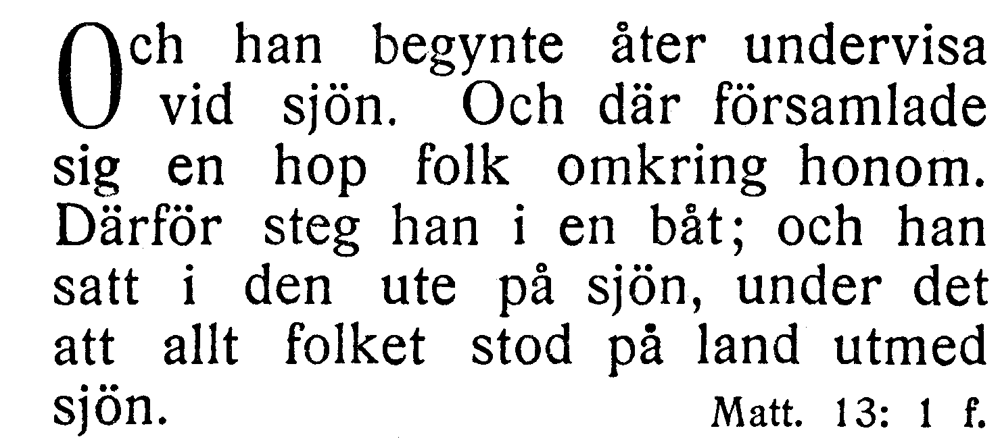

[Full sida, NT s. 60](https://runeberg.org/bibeln/efs1927/nt/0060.html). TIFF: `https://runeberg.org/img/bibeln/efs1927/nt/0060.1.tif`; SHA-256 `2965ec8a3e2da7044d417f124b6335b0846c5ebf9777546515e297e844859fbf`. Utsnittets SHA-256 `8ce7209b298199c21a9a02ff740bb5f84bff7c93e206ea1b47f9062b52c3dd8c`.

**Beslut:** löst 2026-10-27. EFS 1926 bekräftar en stor hop folk; stor saknas i EFS 1927. Befintlig text behålls.

[Bevarad originalfullsida från EFS 1926, NT s. 54](../sv1917-efs1926-witnesses/nt0054.jpg), SHA-256 `75dced4535796d320dc36cad6184dca6b4e63087930db7b64deb7e00002f247b`. [Hämtningsadress](https://archive.org/download/bibelnellerdenhe0000unse/page/n1263.jpg).

## V025

**Markus 4:15 — ock / och.**

**Korpustext:** Och att säden såddes vid vägen, det är sagt om dem i vilka ordet väl bliver sått, men när de hava hört det, kommer strax Satan och tager bort ordet som såddes i dem.

**Komplettering:** hela versen visuellt jämförd i EFS 1926. Ingen fotobegäran återstår.

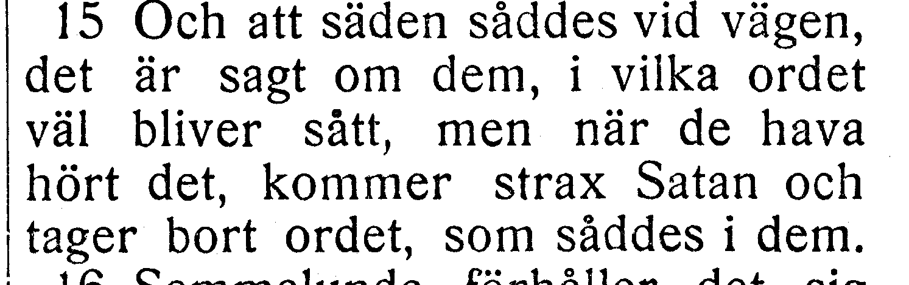

[Full sida, NT s. 60](https://runeberg.org/bibeln/efs1927/nt/0060.html). TIFF: `https://runeberg.org/img/bibeln/efs1927/nt/0060.1.tif`; SHA-256 `2965ec8a3e2da7044d417f124b6335b0846c5ebf9777546515e297e844859fbf`. Utsnittets SHA-256 `2498b40faa80b4d0bc9d057c702fdcaf1a3e0a3f143d3c99bf55d2384e13379e`.

**Beslut:** löst 2026-10-27. EFS 1926 och 1927 visar båda Satan och tager. R362 rättar Satan ock tager till Satan och tager. Hela versen visuellt jämförd. Vanlig kommatering och övriga ord behålls.

[Bevarad originalfullsida från EFS 1926, NT s. 54](../sv1917-efs1926-witnesses/nt0054.jpg), SHA-256 `75dced4535796d320dc36cad6184dca6b4e63087930db7b64deb7e00002f247b`. [Hämtningsadress](https://archive.org/download/bibelnellerdenhe0000unse/page/n1263.jpg).

## V026

**Markus 5:8 — orena / orene.**

**Korpustext:** Jesus skulle nämligen just säga till honom: »Far ut ur mannen, du orene ande.»

**Komplettering:** hela versen visuellt jämförd i EFS 1926. Ingen fotobegäran återstår.

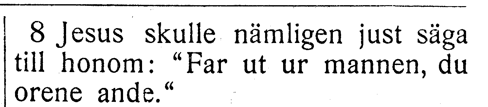

[Full sida, NT s. 62](https://runeberg.org/bibeln/efs1927/nt/0062.html). TIFF: `https://runeberg.org/img/bibeln/efs1927/nt/0062.1.tif`; SHA-256 `7e91af547c6b826f363550cd6fce7830ebdc1111af00b57a6bc3d0d3fc505c84`. Utsnittets SHA-256 `d380cf1a7bcd5f084950da8ad49954fe0b05ca40aab0ce35638dc77252ee9591`.

**Beslut:** löst 2026-10-27. EFS 1926 och 1927 visar båda du orene ande. R363 rättar du orena ande till du orene ande. Hela versen visuellt jämförd. Vanlig kommatering och övriga ord behålls.

[Bevarad originalfullsida från EFS 1926, NT s. 55](../sv1917-efs1926-witnesses/nt0055.jpg), SHA-256 `fce9f5176020f0e34bf43bae1e8241b27dffbfede3e72a712de8412b97b91a46`. [Hämtningsadress](https://archive.org/download/bibelnellerdenhe0000unse/page/n1264.jpg).

## V027

**Markus 6:5 — han botade / han där botade.**

**Korpustext:** Och han kunde icke där göra någon kraftgärning, utom att han botade några få sjuka, genom att lägga händerna på dem.

**Komplettering:** hela versen visuellt jämförd i EFS 1926. Ingen fotobegäran återstår.

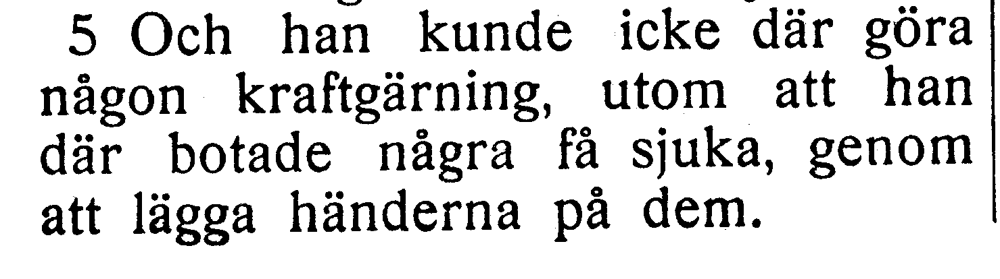

[Full sida, NT s. 64](https://runeberg.org/bibeln/efs1927/nt/0064.html). TIFF: `https://runeberg.org/img/bibeln/efs1927/nt/0064.1.tif`; SHA-256 `bda715ff523ea8355e15dbd5db3ba57104a018d17fc9dc772570586f9611044e`. Utsnittets SHA-256 `f9ef208be8ee22e5050ea27cb9959a0e497b79f7d18820ede90d8541e2b795ad`.

**Beslut:** löst 2026-10-27. EFS 1926 bekräftar utom att han botade utan ett andra där, som i korpusen. EFS 1927:s tillägg kopieras inte.

[Bevarad originalfullsida från EFS 1926, NT s. 57](../sv1917-efs1926-witnesses/nt0057.jpg), SHA-256 `9c95bff374d12635882bc2fb1dd76c795a2a3361c4cf266b9bd4ff71d462f114`. [Hämtningsadress](https://archive.org/download/bibelnellerdenhe0000unse/page/n1266.jpg).

## V028

**Markus 6:9 — finge / fingo.**

**Korpustext:** Sandaler fingo de dock hava på fötterna, men de skulle icke bära dubbla livklädnader.

**Komplettering:** hela versen visuellt jämförd i EFS 1926. Ingen fotobegäran återstår.

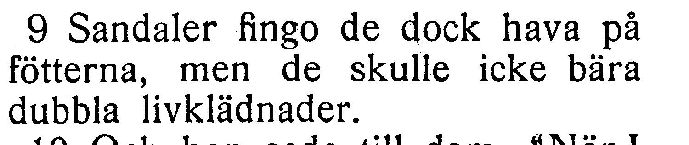

[Full sida, NT s. 64](https://runeberg.org/bibeln/efs1927/nt/0064.html). TIFF: `https://runeberg.org/img/bibeln/efs1927/nt/0064.1.tif`; SHA-256 `bda715ff523ea8355e15dbd5db3ba57104a018d17fc9dc772570586f9611044e`. Utsnittets SHA-256 `9d767640868e37ea70e97b7760d21843c01ae18c26f0eed6e022307221726be9`.

**Beslut:** löst 2026-10-27. EFS 1926 och 1927 visar båda Sandaler fingo de. R364 rättar Sandaler finge de till Sandaler fingo de. Hela versen visuellt jämförd. Vanlig kommatering och övriga ord behålls.

[Bevarad originalfullsida från EFS 1926, NT s. 57](../sv1917-efs1926-witnesses/nt0057.jpg), SHA-256 `9c95bff374d12635882bc2fb1dd76c795a2a3361c4cf266b9bd4ff71d462f114`. [Hämtningsadress](https://archive.org/download/bibelnellerdenhe0000unse/page/n1266.jpg).

## V029

**Markus 7:27 — ju otillbörligt / otillbörligt.**

**Korpustext:** Men han sade till henne: »Låt barnen först bliva mättade; det är ju otillbörligt att taga brödet från barnen och kasta det åt hundarna.»

**Komplettering:** hela versen visuellt jämförd i EFS 1926. Ingen fotobegäran återstår.

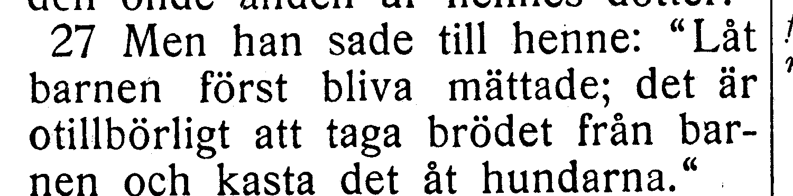

[Full sida, NT s. 68](https://runeberg.org/bibeln/efs1927/nt/0068.html). TIFF: `https://runeberg.org/img/bibeln/efs1927/nt/0068.1.tif`; SHA-256 `9839e515026bc1ccf0d28943fb11c86f897f5f4c6efcfd34e7be78d913fa0fc1`. Utsnittets SHA-256 `d6b36d5009fc16e6705049af89e8b7e48ca03f625dfda46a8ba03443221b9e27`.

**Beslut:** löst 2026-10-27. EFS 1926 bekräftar det är ju otillbörligt. Ju saknas endast i EFS 1927 och behålls i korpusen.

[Bevarad originalfullsida från EFS 1926, NT s. 61](../sv1917-efs1926-witnesses/nt0061.jpg), SHA-256 `639b9f617f50f6fec0091205357d9e3407f8e89414d8c35c87e69fb786f5148b`. [Hämtningsadress](https://archive.org/download/bibelnellerdenhe0000unse/page/n1270.jpg).

## V030

**Markus 8:6 — Ock / Och.**

**Korpustext:** Då tillsade han folket att lägra sig på marken. Och han tog de sju bröden, tackade Gud och bröt dem och gav åt sina lärjungar, för att de skulle lägga fram dem; och de lade fram åt folket.

**Komplettering:** hela versen visuellt jämförd i EFS 1926. Ingen fotobegäran återstår.

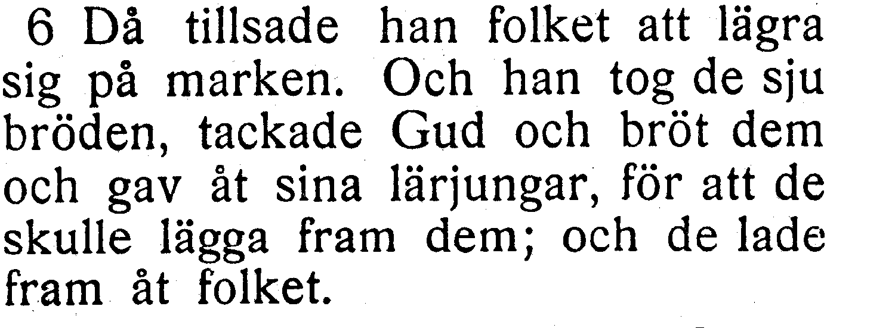

[Full sida, NT s. 68](https://runeberg.org/bibeln/efs1927/nt/0068.html). TIFF: `https://runeberg.org/img/bibeln/efs1927/nt/0068.1.tif`; SHA-256 `9839e515026bc1ccf0d28943fb11c86f897f5f4c6efcfd34e7be78d913fa0fc1`. Utsnittets SHA-256 `44b4f60f4938f2ee6165faccdd7c42af4d32ec5ea0c4bbc166dbc6068048189f`.

**Beslut:** löst 2026-10-27. EFS 1926 och 1927 visar båda Och han tog. R365 rättar Ock han tog till Och han tog. Hela versen visuellt jämförd. Vanlig kommatering och övriga ord behålls.

[Bevarad originalfullsida från EFS 1926, NT s. 61](../sv1917-efs1926-witnesses/nt0061.jpg), SHA-256 `639b9f617f50f6fec0091205357d9e3407f8e89414d8c35c87e69fb786f5148b`. [Hämtningsadress](https://archive.org/download/bibelnellerdenhe0000unse/page/n1270.jpg).

## V031

**Markus 9:18 — får / fått.**

**Korpustext:** Och varhelst denne får fatt i honom kastar han omkull honom, och fradgan står gossen om munnen, och han gnisslar med tänderna och bliver såsom livlös. Nu bad jag dina lärjungar att de skulle driva ut honom, men de förmådde det icke.»

**Komplettering:** hela versen visuellt jämförd i EFS 1926. Ingen fotobegäran återstår.

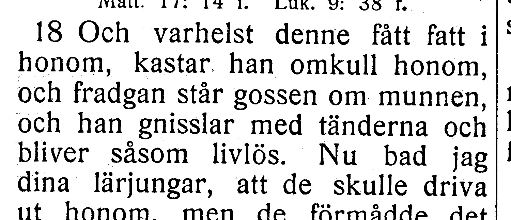

[Full sida, NT s. 71](https://runeberg.org/bibeln/efs1927/nt/0071.html). TIFF: `https://runeberg.org/img/bibeln/efs1927/nt/0071.1.tif`; SHA-256 `a1509c182edd71179ae89238ee04669e49a6becf61e1b80ce539bc7365937bd2`. Utsnittets SHA-256 `b39aab5dab6440b89a28aa5bd629f11ca5540f85ec2ab099d431aa5b84d76d85`.

**Beslut:** löst 2026-10-27. EFS 1926 har får fatt som i korpusen, mot EFS 1927:s fått fatt. Hela 9:18 visuellt jämförd över s. 63–64. Båda fullsidorna bevaras; källnoten anger även fortsättningsbildens hash.

[Bevarad originalfullsida från EFS 1926, NT s. 63](../sv1917-efs1926-witnesses/nt0063.jpg), SHA-256 `e9ec3e2e6857abc030ec7835cfd3056ec0f9a1ae9f80e08f687f11831fbc9f75`. [Hämtningsadress](https://archive.org/download/bibelnellerdenhe0000unse/page/n1272.jpg). [Versens fortsättning på s. 64](../sv1917-efs1926-witnesses/nt0064.jpg); hash i vittnesförteckningen och liggaren.

## V032

**Markus 13:17 — de / dem.**

**Korpustext:** Och ve dem som äro havande, eller som giva di på den tiden!

**Komplettering:** hela versen visuellt jämförd i EFS 1926. Ingen fotobegäran återstår.

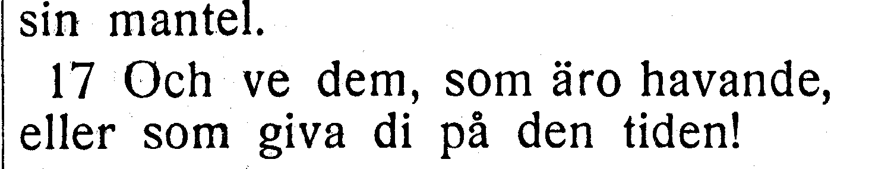

[Full sida, NT s. 80](https://runeberg.org/bibeln/efs1927/nt/0080.html). TIFF: `https://runeberg.org/img/bibeln/efs1927/nt/0080.1.tif`; SHA-256 `c0ed8d569a765854c484d8504661a788005f1f007ace23413f39fbf04e2b787c`. Utsnittets SHA-256 `1cd51ade8d19e624bc6d470bf55cebb27dfde1a687f2d93a6c8f32df321aaaa6`.

**Beslut:** löst 2026-10-27. EFS 1926 och 1927 visar båda Och ve dem som. R366 rättar Och ve de som till Och ve dem som. Hela versen visuellt jämförd. Vanlig kommatering och övriga ord behålls.

[Bevarad originalfullsida från EFS 1926, NT s. 72](../sv1917-efs1926-witnesses/nt0072.jpg), SHA-256 `b75890fbf0c36cfbb5ff12aa518165bb7503cd7c41c510c678e34b6aa3876299`. [Hämtningsadress](https://archive.org/download/bibelnellerdenhe0000unse/page/n1281.jpg).

## V033

**Markus 14:6 — en god gärning / ju en god gärning.**

**Korpustext:** Men Jesus sade: »Låten henne vara. Varför oroen I henne? Det är en god gärning som hon har gjort mot mig.

**Komplettering:** hela versen visuellt jämförd i EFS 1926. Ingen fotobegäran återstår.

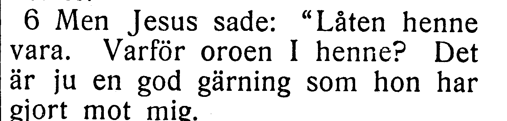

[Full sida, NT s. 81](https://runeberg.org/bibeln/efs1927/nt/0081.html). TIFF: `https://runeberg.org/img/bibeln/efs1927/nt/0081.1.tif`; SHA-256 `b8a6f83ee1dbd0ed6dddcf2deab9a9622316f4a6dff22343b68c8ea8f38877c1`. Utsnittets SHA-256 `0a0ead346992a137a6a66342754ec9c4cbe2e6a4b2df3578ab738940fbde4849`.

**Beslut:** löst 2026-10-27. EFS 1926 visar Det är en god gärning utan ju, precis som korpusen. EFS 1927:s ju kopieras inte.

[Bevarad originalfullsida från EFS 1926, NT s. 73](../sv1917-efs1926-witnesses/nt0073.jpg), SHA-256 `4bcd8a4e12ecf947f20ed5397ca4492abb80e1d2930d61f5619599c6c9872a88`. [Hämtningsadress](https://archive.org/download/bibelnellerdenhe0000unse/page/n1282.jpg).

## V034

**Markus 14:11 — lovade att giva / lovade giva.**

**Korpustext:** När de hörde detta, blevo de glada och lovade att giva honom en summa penningar. Sedan sökte han efter tillfälle att förråda honom, då lägligt var.

**Komplettering:** hela versen visuellt jämförd i EFS 1926. Ingen fotobegäran återstår.

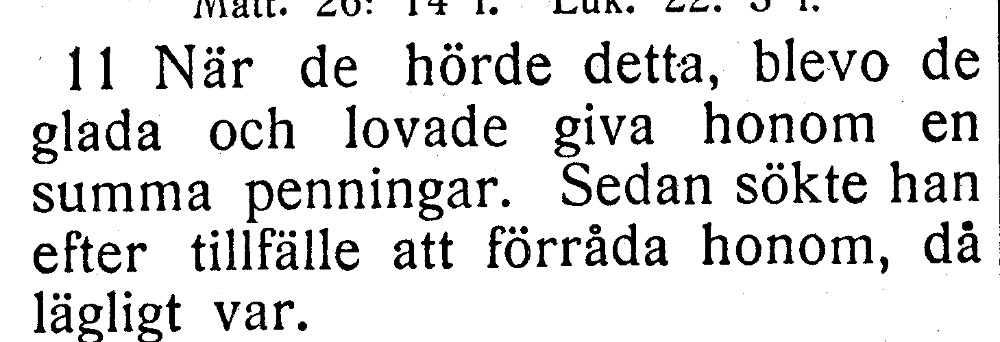

[Full sida, NT s. 82](https://runeberg.org/bibeln/efs1927/nt/0082.html). TIFF: `https://runeberg.org/img/bibeln/efs1927/nt/0082.1.tif`; SHA-256 `fce6c98a0778894d477dd931b1460d29f6b7d679b5b71d1eb38dc79afbec04c5`. Utsnittets SHA-256 `9083911950a2cb0bb9c758ba2004a0c1d65dbcbbfa91a593b20b5d9d50b79853`.

**Beslut:** löst 2026-10-27. EFS 1926 bekräftar lovade att giva; att saknas endast i EFS 1927. Hela versen synlig på samma sida, korpusen behålls.

[Bevarad originalfullsida från EFS 1926, NT s. 73](../sv1917-efs1926-witnesses/nt0073.jpg), SHA-256 `4bcd8a4e12ecf947f20ed5397ca4492abb80e1d2930d61f5619599c6c9872a88`. [Hämtningsadress](https://archive.org/download/bibelnellerdenhe0000unse/page/n1282.jpg).

## V035

**Markus 14:23 — ock / och.**

**Korpustext:** Och han tog en kalk och tackade Gud och gav åt dem; och de drucko alla därav.

**Komplettering:** hela versen visuellt jämförd i EFS 1926. Ingen fotobegäran återstår.

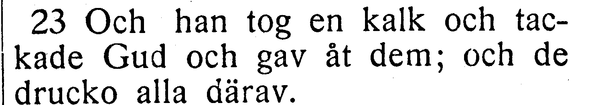

[Full sida, NT s. 82](https://runeberg.org/bibeln/efs1927/nt/0082.html). TIFF: `https://runeberg.org/img/bibeln/efs1927/nt/0082.1.tif`; SHA-256 `fce6c98a0778894d477dd931b1460d29f6b7d679b5b71d1eb38dc79afbec04c5`. Utsnittets SHA-256 `0248f5021bca008eac096357cdabf81a620d7ca1a446a6ba67cb55a6f86f29f0`.

**Beslut:** löst 2026-10-27. EFS 1926 och 1927 visar båda tackade Gud och gav. R367 rättar tackade Gud ock gav till tackade Gud och gav. Hela versen visuellt jämförd. Vanlig kommatering och övriga ord behålls.

[Bevarad originalfullsida från EFS 1926, NT s. 74](../sv1917-efs1926-witnesses/nt0074.jpg), SHA-256 `ce3665ebee68e75273a9e520e83bb0e62a44a49a3015a93309aa50c13d3c42e9`. [Hämtningsadress](https://archive.org/download/bibelnellerdenhe0000unse/page/n1283.jpg).

## V036

**Markus 15:8 — kom ditupp / kom nu ditupp.**

**Korpustext:** Folket kom nu ditupp och begynte begära att han skulle göra åt dem såsom han plägade göra.

**Komplettering:** hela versen visuellt jämförd i EFS 1926. Ingen fotobegäran återstår.

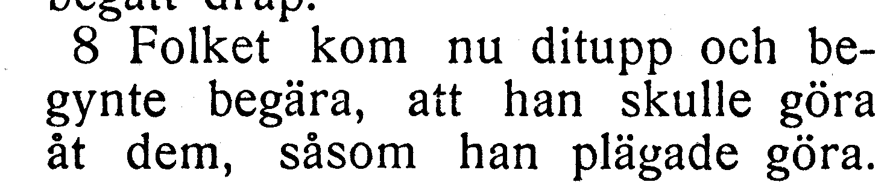

[Full sida, NT s. 85](https://runeberg.org/bibeln/efs1927/nt/0085.html). TIFF: `https://runeberg.org/img/bibeln/efs1927/nt/0085.1.tif`; SHA-256 `e63376e6ce04936cb61e3b8b2c49e53f3842d3ab1dc8d5d967a27b1f58b54ff6`. Utsnittets SHA-256 `5e503ad030f9f5f5978543868798aa8043590fa64f4c8a38551610751e96f0d1`.

**Beslut:** löst 2026-10-27. EFS 1926 och 1927 visar båda Folket kom nu ditupp. R368 rättar Folket kom ditupp till Folket kom nu ditupp. Hela versen visuellt jämförd. Vanlig kommatering och övriga ord behålls.

[Bevarad originalfullsida från EFS 1926, NT s. 76](../sv1917-efs1926-witnesses/nt0076.jpg), SHA-256 `985902e692192668c45638331c82fa7ef85d3263048f44715fc9439e9325688c`. [Hämtningsadress](https://archive.org/download/bibelnellerdenhe0000unse/page/n1285.jpg).

## V037

**Markus 16:5 — vit fotsid klädnad / fotsid klädnad.**

**Korpustext:** Och när de hade kommit in i graven, fingo de se en ung man sitta där på högra sidan, klädd i en vit fotsid klädnad; och de blevo förskräckta.

**Komplettering:** hela versen visuellt jämförd i EFS 1926. Ingen fotobegäran återstår.

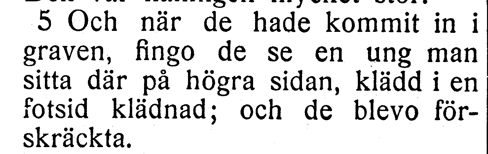

[Full sida, NT s. 87](https://runeberg.org/bibeln/efs1927/nt/0087.html). TIFF: `https://runeberg.org/img/bibeln/efs1927/nt/0087.1.tif`; SHA-256 `3cb5fa9603afc505bd398394174710786fe3ef02224b3d5e2abbe7981c46455f`. Utsnittets SHA-256 `4ee39cf7869083cf6ab10b040efa83bb5c21d87248bb573eb4af63dabcc5d410`.

**Beslut:** löst 2026-10-27. EFS 1926 bekräftar en vit fotsid klädnad; vit saknas endast i EFS 1927. Hela versen och ordet vit synliga, texten behålls.

[Bevarad originalfullsida från EFS 1926, NT s. 78](../sv1917-efs1926-witnesses/nt0078.jpg), SHA-256 `8571f91e5a4f0048557232352ff7ed2053ff3204a17482d7077d3cf449b58c1c`. [Hämtningsadress](https://archive.org/download/bibelnellerdenhe0000unse/page/n1287.jpg).

## V038

**Markus 16:14 — när / där.**

**Korpustext:** Sedan uppenbarade han sig också för de elva, när de lågo till bords; och han förebrådde dem då deras otro och deras hjärtans hårdhet, i det att de icke hade trott dem som hade sett honom vara uppstånden.

**Komplettering:** hela versen visuellt jämförd i EFS 1926. Ingen fotobegäran återstår.

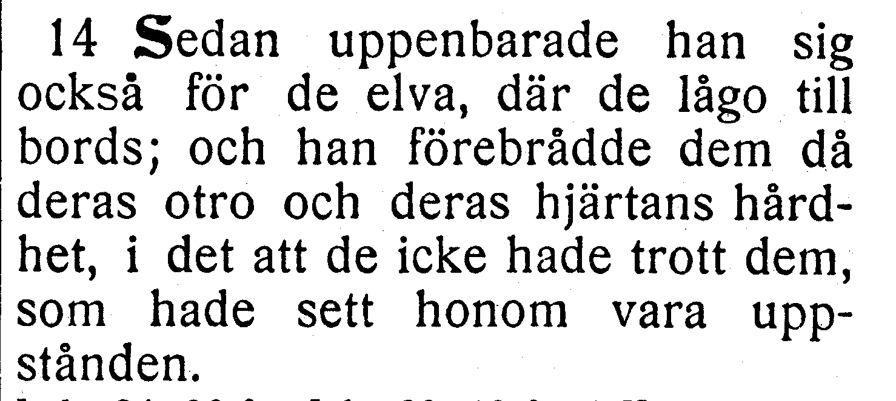

[Full sida, NT s. 87](https://runeberg.org/bibeln/efs1927/nt/0087.html). TIFF: `https://runeberg.org/img/bibeln/efs1927/nt/0087.1.tif`; SHA-256 `3cb5fa9603afc505bd398394174710786fe3ef02224b3d5e2abbe7981c46455f`. Utsnittets SHA-256 `17212ca6502821faa9199191b00779f990a19e2f97db5498c2bb94468109db83`.

**Beslut:** löst 2026-10-27. EFS 1926 bekräftar när de lågo till bords mot EFS 1927:s där. Korpusens när behålls.

[Bevarad originalfullsida från EFS 1926, NT s. 78](../sv1917-efs1926-witnesses/nt0078.jpg), SHA-256 `8571f91e5a4f0048557232352ff7ed2053ff3204a17482d7077d3cf449b58c1c`. [Hämtningsadress](https://archive.org/download/bibelnellerdenhe0000unse/page/n1287.jpg).
