# Fotobunt 5: Lukas 1–8 till senare boktillgång

**Alla 22 frågor V039–V060 avgjorda 2026-10-27 mot [EFS 1926](../sv1917-efs1926-witnesses/README.md). Ingen fotobegäran återstår i denna bunt.** Hela Lukas 1–8 är verifierad. R369–R382 tillför 14 rättelser och åtta befintliga läsningar bekräftas. Tabellen visar jämförelsen före besluten; korpusverser nedan är uppdaterade. Stabilt V-ID, ursprungliga scanutsnitt och exakta hashvärden bevaras. R053:s slutpunkt i 1:73 och R055:s citatavslut i 3:9 bevaras i samma versbundna ersättningar. V056 är jämförd över båda fullsidorna 91–92.

| Fråga | Vers | Korpus / EFS 1927 |
| --- | --- | --- |
| [V039](#v039), löst | Luk. 1:2 | som själva / som från begynnelsen själva |
| [V040](#v040), löst | Luk. 1:9 | hände det sig / hände sig |
| [V041](#v041), löst | Luk. 1:41 | fylld / uppfylld |
| [V042](#v042), löst | Luk. 1:57 | Elisabet / Elisabeth |
| [V043](#v043), löst | Luk. 1:73 | för vår fader / vår fader |
| [V044](#v044), löst | Luk. 2:15 | det som där har skett / det som har skett |
| [V045](#v045), löst | Luk. 2:20 | det blivit / det hade blivit |
| [V046](#v046), löst | Luk. 2:24 | duvor/turturduvor / turturduvor/duvor |
| [V047](#v047), löst | Luk. 3:9 | kastat på elden / kastat i elden |
| [V048](#v048), löst | Luk. 3:11 | en som har matförråd / den som har matförråd |
| [V049](#v049), löst | Luk. 4:10 | att de skola / och de skola |
| [V050](#v050), löst | Luk. 4:18 | satt / sänt |
| [V051](#v051), löst | Luk. 4:41 | tillsade / tillstadde |
| [V052](#v052), löst | Luk. 5:1 | Gennesarets / Genesarets |
| [V053](#v053), löst | Luk. 5:3 | från / ifrån |
| [V054](#v054), löst | Luk. 5:7 | begynte / begynta |
| [V055](#v055), löst | Luk. 6:17 | tog han nu med sig / tog han med sig |
| [V056](#v056), löst | Luk. 6:48 | så byggt / så väl byggt |
| [V057](#v057), löst | Luk. 8:1 | igenom / genom |
| [V058](#v058), löst | Luk. 8:35 | När de då kommo / När de kommo |
| [V059](#v059), löst | Luk. 8:36 | sett / åsett |
| [V060](#v060), löst | Luk. 8:37 | gerasenernas / gerassenernas |

## V039

**Lukas 1:2 — som själva / som från begynnelsen själva.**

**Korpustext:** i enlighet med vad som har blivit oss meddelat av dem som från begynnelsen själva voro åsyna vittnen och ordets tjänare,

**Komplettering:** hela berörda versen visuellt jämförd i EFS 1926; ingen fotobegäran återstår.

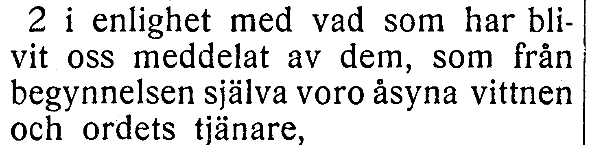

[Full sida, NT s. 88](https://runeberg.org/bibeln/efs1927/nt/0088.html). TIFF: `https://runeberg.org/img/bibeln/efs1927/nt/0088.1.tif`; SHA-256 `36f31ebf5e21e67ae47b93f04978ec23694771ebcbe56a7b9b1adeb72eab6c8d`. Utsnittets SHA-256 `d3f46fbfc0aace254c4d0c0d59f806eabfbd075b629cc4b76ab7b86d649ff25d`.

**Beslut:** löst 2026-10-27. EFS 1926 och 1927 visar båda dem som från begynnelsen själva. R369 rättar dem som själva till dem som från begynnelsen själva. Hela versen visuellt jämförd. Vanlig kommatering och övriga ord behålls.

[Bevarad full originalbild, EFS 1926 NT s. 79](../sv1917-efs1926-witnesses/nt0079.jpg), SHA-256 `652df0eccf3fc5a07e8e0cecbec5242a49067e3544b5ebb9783b5de8f9579e7c`. [Hämtningsadress](https://archive.org/download/bibelnellerdenhe0000unse/page/n1288.jpg).

## V040

**Lukas 1:9 — hände det sig / hände sig.**

**Korpustext:** hände sig, vid den övliga lottningen om de prästerliga sysslorna, att det tillföll honom att gå in i Herrens tempel och tända rökelsen.

**Komplettering:** hela berörda versen visuellt jämförd i EFS 1926; ingen fotobegäran återstår.

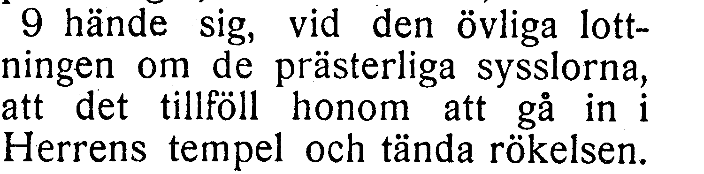

[Full sida, NT s. 88](https://runeberg.org/bibeln/efs1927/nt/0088.html). TIFF: `https://runeberg.org/img/bibeln/efs1927/nt/0088.1.tif`; SHA-256 `36f31ebf5e21e67ae47b93f04978ec23694771ebcbe56a7b9b1adeb72eab6c8d`. Utsnittets SHA-256 `ef00836ff73954ad78bf9e222ac4d44bcb372777148d3f7ef6fcba454f5e598b`.

**Beslut:** löst 2026-10-27. EFS 1926 och 1927 visar båda hände sig. R370 rättar hände det sig till hände sig. Hela versen visuellt jämförd. Vanlig kommatering och övriga ord behålls.

[Bevarad full originalbild, EFS 1926 NT s. 79](../sv1917-efs1926-witnesses/nt0079.jpg), SHA-256 `652df0eccf3fc5a07e8e0cecbec5242a49067e3544b5ebb9783b5de8f9579e7c`. [Hämtningsadress](https://archive.org/download/bibelnellerdenhe0000unse/page/n1288.jpg).

## V041

**Lukas 1:41 — fylld / uppfylld.**

**Korpustext:** När då Elisabet hörde Marias hälsning, spratt barnet till i hennes liv; och Elisabet blev uppfylld av helig ande

**Komplettering:** hela berörda versen visuellt jämförd i EFS 1926; ingen fotobegäran återstår.

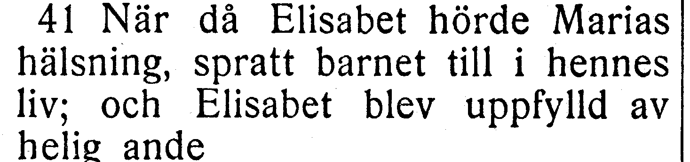

[Full sida, NT s. 90](https://runeberg.org/bibeln/efs1927/nt/0090.html). TIFF: `https://runeberg.org/img/bibeln/efs1927/nt/0090.1.tif`; SHA-256 `59ecff142aeac378ba042c0e34ad18e83bdf661abd23d25916cd80b166c35eb3`. Utsnittets SHA-256 `26a82e5f737789eab7ae3eddbb10b9b91f68554fe34b5291113ec85a7935c9da`.

**Beslut:** löst 2026-10-27. EFS 1926 och 1927 visar båda blev uppfylld av. R371 rättar blev fylld av till blev uppfylld av. Hela versen visuellt jämförd. Vanlig kommatering och övriga ord behålls.

[Bevarad full originalbild, EFS 1926 NT s. 80](../sv1917-efs1926-witnesses/nt0080.jpg), SHA-256 `68d6e37cd186db4eee5292e514b1148970300904b322d04a1d82033417598a2e`. [Hämtningsadress](https://archive.org/download/bibelnellerdenhe0000unse/page/n1289.jpg).

## V042

**Lukas 1:57 — Elisabet / Elisabeth.**

**Korpustext:** Så var nu för Elisabet tiden inne, då hon skulle föda; och hon födde en son.

**Komplettering:** hela berörda versen visuellt jämförd i EFS 1926; ingen fotobegäran återstår.

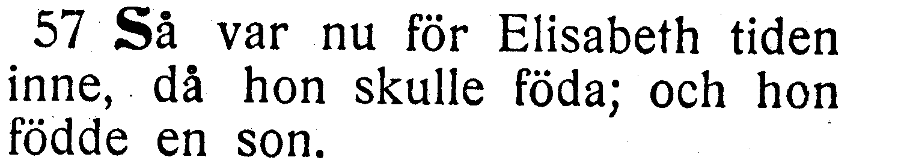

[Full sida, NT s. 90](https://runeberg.org/bibeln/efs1927/nt/0090.html). TIFF: `https://runeberg.org/img/bibeln/efs1927/nt/0090.1.tif`; SHA-256 `59ecff142aeac378ba042c0e34ad18e83bdf661abd23d25916cd80b166c35eb3`. Utsnittets SHA-256 `e8cf8b4940bf2605af76e8c887eb33813cac977fdb056ba08d123a82b38be174`.

**Beslut:** löst 2026-10-27. EFS 1926 bekräftar Elisabet utan h, som i korpusen, mot EFS 1927:s Elisabeth i denna vers. Namnet behålls som belagd tryckvariant.

[Bevarad full originalbild, EFS 1926 NT s. 81](../sv1917-efs1926-witnesses/nt0081.jpg), SHA-256 `c833e091091713d453241fbc26db852277a880d3a1a70df184399280c0613359`. [Hämtningsadress](https://archive.org/download/bibelnellerdenhe0000unse/page/n1290.jpg).

## V043

**Lukas 1:73 — för vår fader / vår fader.**

**Korpustext:** vad han med ed hade lovat vår fader Abraham.

**Komplettering:** hela berörda versen visuellt jämförd i EFS 1926; ingen fotobegäran återstår.

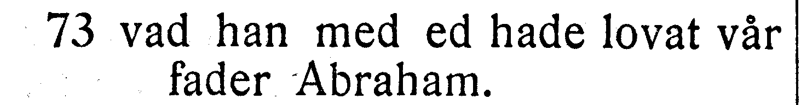

[Full sida, NT s. 91](https://runeberg.org/bibeln/efs1927/nt/0091.html). TIFF: `https://runeberg.org/img/bibeln/efs1927/nt/0091.1.tif`; SHA-256 `7dca5bee022de7344903655951d5342d5bcdad60746f4f73a095c79e6d2daa31`. Utsnittets SHA-256 `a53d6275bbbbe98fd57a10a1036766382f1bb38f7794a5f1d04cc54d90a634fc`.

**Beslut:** löst 2026-10-27. EFS 1926 och 1927 saknar för före vår fader. R372 tar bort det främmande för; R053:s tidigare slutpunkt bevaras i samma versbundna ersättning.

[Bevarad full originalbild, EFS 1926 NT s. 82](../sv1917-efs1926-witnesses/nt0082.jpg), SHA-256 `2af75fb2d06d7e36d8bdc29b554d941d17ba71426c743efaa601e60163025e7c`. [Hämtningsadress](https://archive.org/download/bibelnellerdenhe0000unse/page/n1291.jpg).

## V044

**Lukas 2:15 — det som där har skett / det som har skett.**

**Korpustext:** När så änglarna hade farit ifrån herdarna upp i himmelen, sade dessa till varandra: »Låt oss nu gå till Betlehem och se det som där har skett, och som Herren har kungjort för oss.»

**Komplettering:** hela berörda versen visuellt jämförd i EFS 1926; ingen fotobegäran återstår.

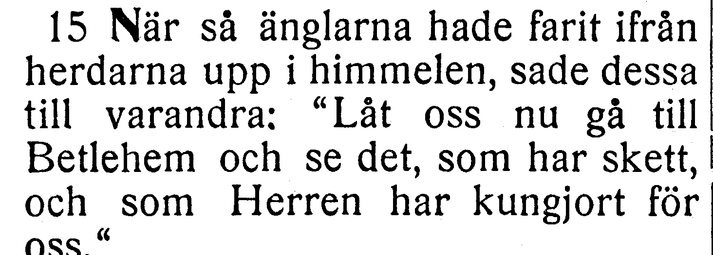

[Full sida, NT s. 92](https://runeberg.org/bibeln/efs1927/nt/0092.html). TIFF: `https://runeberg.org/img/bibeln/efs1927/nt/0092.1.tif`; SHA-256 `df289bb3b12f387301686ee3f8872a520435c337d387a460d3064065f5cf471d`. Utsnittets SHA-256 `0a84bc74918f84018e7a01e532c371e24db2815dc652bc2a0d9cd233e0d398ff`.

**Beslut:** löst 2026-10-27. EFS 1926 bekräftar det som där har skett, som i korpusen; där saknas endast i EFS 1927. Befintlig text behålls.

[Bevarad full originalbild, EFS 1926 NT s. 82](../sv1917-efs1926-witnesses/nt0082.jpg), SHA-256 `2af75fb2d06d7e36d8bdc29b554d941d17ba71426c743efaa601e60163025e7c`. [Hämtningsadress](https://archive.org/download/bibelnellerdenhe0000unse/page/n1291.jpg).

## V045

**Lukas 2:20 — det blivit / det hade blivit.**

**Korpustext:** Och herdarna vände tillbaka och prisade och lovade Gud för allt vad de hade fått höra och se, alldeles såsom det hade blivit dem sagt.

**Komplettering:** hela berörda versen visuellt jämförd i EFS 1926; ingen fotobegäran återstår.

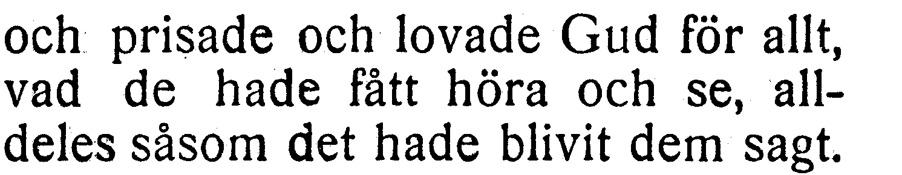

[Full sida, NT s. 92](https://runeberg.org/bibeln/efs1927/nt/0092.html). TIFF: `https://runeberg.org/img/bibeln/efs1927/nt/0092.1.tif`; SHA-256 `df289bb3b12f387301686ee3f8872a520435c337d387a460d3064065f5cf471d`. Utsnittets SHA-256 `0c4c4d9ed538415b4ccf85783fb25375752dfabbd26e988b12e6af7d63ca3b5d`.

**Beslut:** löst 2026-10-27. EFS 1926 och 1927 visar båda såsom det hade blivit. R373 rättar såsom det blivit till såsom det hade blivit. Hela versen visuellt jämförd. Vanlig kommatering och övriga ord behålls.

[Bevarad full originalbild, EFS 1926 NT s. 83](../sv1917-efs1926-witnesses/nt0083.jpg), SHA-256 `127fe88b57ff1b4f7e7829ca90af8927b90dc9528d063d61405417335d2872dc`. [Hämtningsadress](https://archive.org/download/bibelnellerdenhe0000unse/page/n1292.jpg).

## V046

**Lukas 2:24 — duvor/turturduvor / turturduvor/duvor.**

**Korpustext:** så ock för att offra »ett par turturduvor eller två unga duvor», såsom stadgat var i Herrens lag.

**Komplettering:** hela berörda versen visuellt jämförd i EFS 1926; ingen fotobegäran återstår.

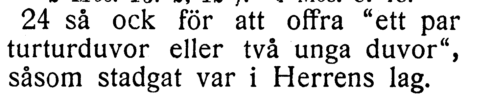

[Full sida, NT s. 92](https://runeberg.org/bibeln/efs1927/nt/0092.html). TIFF: `https://runeberg.org/img/bibeln/efs1927/nt/0092.1.tif`; SHA-256 `df289bb3b12f387301686ee3f8872a520435c337d387a460d3064065f5cf471d`. Utsnittets SHA-256 `c5ca405c8ce025b1e23a9974d7e57c2a0b78ba2573477bf3004df391ab1e4f0b`.

**Beslut:** löst 2026-10-27. EFS 1926 och 1927 visar båda ett par turturduvor eller två unga duvor. R374 rättar ett par duvor eller två unga turturduvor till ett par turturduvor eller två unga duvor. Hela versen visuellt jämförd. Vanlig kommatering och övriga ord behålls.

[Bevarad full originalbild, EFS 1926 NT s. 83](../sv1917-efs1926-witnesses/nt0083.jpg), SHA-256 `127fe88b57ff1b4f7e7829ca90af8927b90dc9528d063d61405417335d2872dc`. [Hämtningsadress](https://archive.org/download/bibelnellerdenhe0000unse/page/n1292.jpg).

## V047

**Lukas 3:9 — kastat på elden / kastat i elden.**

**Korpustext:** Redan är också yxan satt till roten på träden; så bliver då vart träd som icke bär god frukt avhugget och kastat i elden.»

**Komplettering:** hela berörda versen visuellt jämförd i EFS 1926; ingen fotobegäran återstår.

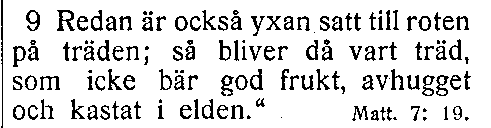

[Full sida, NT s. 94](https://runeberg.org/bibeln/efs1927/nt/0094.html). TIFF: `https://runeberg.org/img/bibeln/efs1927/nt/0094.1.tif`; SHA-256 `fa5caf49e0206947666e96c77fba7a279095f681afa6ecbd9d43b754f080d06a`. Utsnittets SHA-256 `d353c77c3254c7322dbd03e84eefc20d5d24b5ecbfcc4b180fd9a7f2199596e4`.

**Beslut:** löst 2026-10-27. EFS 1926 och 1927 visar kastat i elden. R375 rättar på till i; R055:s tidigare citatavslut bevaras i samma versbundna ersättning.

[Bevarad full originalbild, EFS 1926 NT s. 84](../sv1917-efs1926-witnesses/nt0084.jpg), SHA-256 `47fd0cb5852ed64682338751811f77970ac96d0cd6ccb9296f96716c3ac5697d`. [Hämtningsadress](https://archive.org/download/bibelnellerdenhe0000unse/page/n1293.jpg).

## V048

**Lukas 3:11 — en som har matförråd / den som har matförråd.**

**Korpustext:** Han svarade och sade till dem: »Den som har två livklädnader, han dele med sig åt den som icke har någon; och den som har matförråd, han göre sammalunda.»

**Komplettering:** hela berörda versen visuellt jämförd i EFS 1926; ingen fotobegäran återstår.

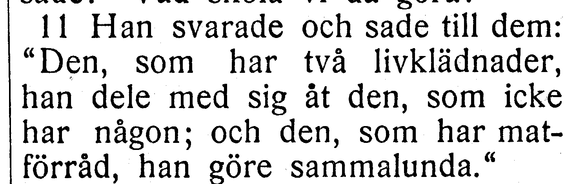

[Full sida, NT s. 94](https://runeberg.org/bibeln/efs1927/nt/0094.html). TIFF: `https://runeberg.org/img/bibeln/efs1927/nt/0094.1.tif`; SHA-256 `fa5caf49e0206947666e96c77fba7a279095f681afa6ecbd9d43b754f080d06a`. Utsnittets SHA-256 `f6567816f4ac3706f8812f362ea2a5af0862894d6f81583051af030a94df8b6f`.

**Beslut:** löst 2026-10-27. EFS 1926 och 1927 visar båda och den som har matförråd. R376 rättar och en som har matförråd till och den som har matförråd. Hela versen visuellt jämförd. Vanlig kommatering och övriga ord behålls.

[Bevarad full originalbild, EFS 1926 NT s. 84](../sv1917-efs1926-witnesses/nt0084.jpg), SHA-256 `47fd0cb5852ed64682338751811f77970ac96d0cd6ccb9296f96716c3ac5697d`. [Hämtningsadress](https://archive.org/download/bibelnellerdenhe0000unse/page/n1293.jpg).

## V049

**Lukas 4:10 — att de skola / och de skola.**

**Korpustext:** det är ju skrivet: 'Han skall giva sina änglar befallning om dig, att de skola väl bevara dig';

**Komplettering:** hela berörda versen visuellt jämförd i EFS 1926; ingen fotobegäran återstår.

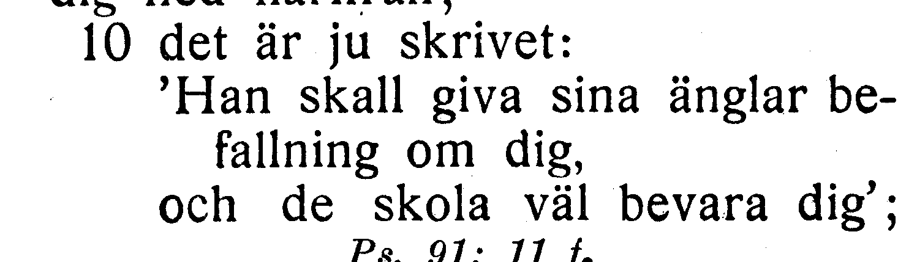

[Full sida, NT s. 96](https://runeberg.org/bibeln/efs1927/nt/0096.html). TIFF: `https://runeberg.org/img/bibeln/efs1927/nt/0096.1.tif`; SHA-256 `1dfc297ae725f6ea950212ccb101260e98e642b22bcc662713af068c6cfc4e54`. Utsnittets SHA-256 `bab7748c1735bbb6787bd955e13e37eef2830b2ac0804326c94d025505567062`.

**Beslut:** löst 2026-10-27. EFS 1926 bekräftar att de skola väl bevara dig mot EFS 1927:s och. Texten behålls som belagd tryckvariant.

[Bevarad full originalbild, EFS 1926 NT s. 86](../sv1917-efs1926-witnesses/nt0086.jpg), SHA-256 `4144ebe743bf99ed05df739932ec9dd7e10fb85228d1190069cf267bc972e288`. [Hämtningsadress](https://archive.org/download/bibelnellerdenhe0000unse/page/n1295.jpg).

## V050

**Lukas 4:18 — satt / sänt.**

**Korpustext:** »Herrens Ande är över mig, ty han har smort mig. Han har sänt mig till att förkunna glädjens budskap för de fattiga, till att predika frihet för de fångna och syn för de blinda, ja, till att giva de förtryckta frihet

**Komplettering:** hela berörda versen visuellt jämförd i EFS 1926; ingen fotobegäran återstår.

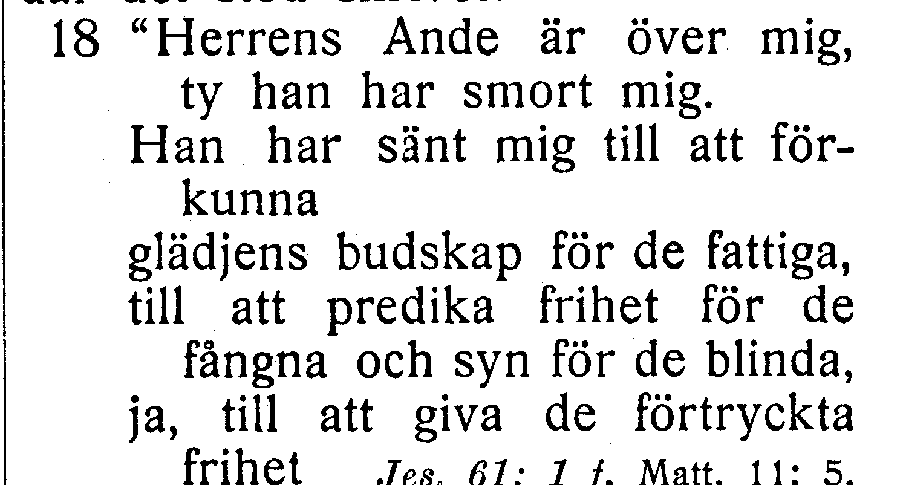

[Full sida, NT s. 96](https://runeberg.org/bibeln/efs1927/nt/0096.html). TIFF: `https://runeberg.org/img/bibeln/efs1927/nt/0096.1.tif`; SHA-256 `1dfc297ae725f6ea950212ccb101260e98e642b22bcc662713af068c6cfc4e54`. Utsnittets SHA-256 `f58a3ad0a72ff140c6d4f083026779416de5f132d2902402d57ce2a9de06ce2f`.

**Beslut:** löst 2026-10-27. EFS 1926 och 1927 visar båda Han har sänt mig. R377 rättar Han har satt mig till Han har sänt mig. Hela versen visuellt jämförd. Vanlig kommatering och övriga ord behålls.

[Bevarad full originalbild, EFS 1926 NT s. 86](../sv1917-efs1926-witnesses/nt0086.jpg), SHA-256 `4144ebe743bf99ed05df739932ec9dd7e10fb85228d1190069cf267bc972e288`. [Hämtningsadress](https://archive.org/download/bibelnellerdenhe0000unse/page/n1295.jpg).

## V051

**Lukas 4:41 — tillsade / tillstadde.**

**Korpustext:** Onda andar blevo ock utdrivna ur många, och de ropade därvid och sade: »Du är Guds Son.» Men han tilltalade dem strängt och tillstadde dem att icke säga något, eftersom de visste att han var Messias.

**Komplettering:** hela berörda versen visuellt jämförd i EFS 1926; ingen fotobegäran återstår.

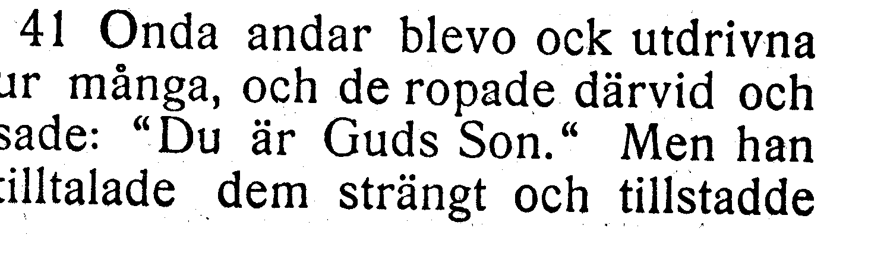

[Full sida, NT s. 97](https://runeberg.org/bibeln/efs1927/nt/0097.html). TIFF: `https://runeberg.org/img/bibeln/efs1927/nt/0097.1.tif`; SHA-256 `4f13a03f9b9323bce237501ae9faa24233e5c5da46b99ea2ee19a7b6324afe03`. Utsnittets SHA-256 `bb84c1346fc588d53c300deed421024096a256fc5d56d9d43b5c3ec875da12f3`.

**Beslut:** löst 2026-10-27. EFS 1926 och 1927 visar båda tillstadde dem att icke säga. R378 rättar tillsade dem att icke säga till tillstadde dem att icke säga. Hela versen visuellt jämförd. Vanlig kommatering och övriga ord behålls.

[Bevarad full originalbild, EFS 1926 NT s. 87](../sv1917-efs1926-witnesses/nt0087.jpg), SHA-256 `210958404b491957258c41016565a92bb9c16519b868c0f101b205ac592b3859`. [Hämtningsadress](https://archive.org/download/bibelnellerdenhe0000unse/page/n1296.jpg).

## V052

**Lukas 5:1 — Gennesarets / Genesarets.**

**Korpustext:** Då nu en gång folket, för att höra Guds ord, trängde sig inpå honom där han stod vid Gennesarets sjö,

**Komplettering:** hela berörda versen visuellt jämförd i EFS 1926; ingen fotobegäran återstår.

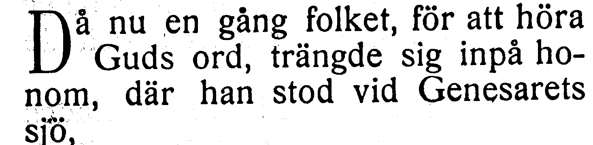

[Full sida, NT s. 98](https://runeberg.org/bibeln/efs1927/nt/0098.html). TIFF: `https://runeberg.org/img/bibeln/efs1927/nt/0098.1.tif`; SHA-256 `0e1ca0ab8a0051194ddcd689ac182ef51536f73f7754045490cc6ed3208fb8f0`. Utsnittets SHA-256 `589ef51b1f148445b8629bb99b5dbef645c5aab6f4e078bf317dcf67f1fe8446`.

**Beslut:** löst 2026-10-27. EFS 1926 har Gennesarets med nn, som i korpusen; EFS 1927 har Genesarets. Namnet behålls.

[Bevarad full originalbild, EFS 1926 NT s. 88](../sv1917-efs1926-witnesses/nt0088.jpg), SHA-256 `a2cddadb1e61431a2644fe96215337357f8d45086f912c5fca25ea9334275d67`. [Hämtningsadress](https://archive.org/download/bibelnellerdenhe0000unse/page/n1297.jpg).

## V053

**Lukas 5:3 — från / ifrån.**

**Korpustext:** Då steg han i en av båtarna, den som tillhörde Simon, och bad honom lägga ut något litet från land. Sedan satte han sig ned och undervisade folket ifrån båten.

**Komplettering:** hela berörda versen visuellt jämförd i EFS 1926; ingen fotobegäran återstår.

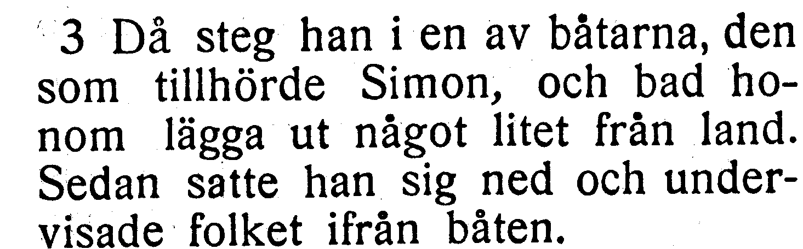

[Full sida, NT s. 98](https://runeberg.org/bibeln/efs1927/nt/0098.html). TIFF: `https://runeberg.org/img/bibeln/efs1927/nt/0098.1.tif`; SHA-256 `0e1ca0ab8a0051194ddcd689ac182ef51536f73f7754045490cc6ed3208fb8f0`. Utsnittets SHA-256 `95cec0ae265e0c917d959208ffad2988bead50e20607d94016f77124ae05200a`.

**Beslut:** löst 2026-10-27. EFS 1926 och 1927 har från land i första meningen och ifrån båten i den andra. R379 ändrar endast andra från till ifrån; första från bevaras.

[Bevarad full originalbild, EFS 1926 NT s. 88](../sv1917-efs1926-witnesses/nt0088.jpg), SHA-256 `a2cddadb1e61431a2644fe96215337357f8d45086f912c5fca25ea9334275d67`. [Hämtningsadress](https://archive.org/download/bibelnellerdenhe0000unse/page/n1297.jpg).

## V054

**Lukas 5:7 — begynte / begynta.**

**Korpustext:** Då vinkade de åt sina kamrater i den andra båten, att dessa skulle komma och hjälpa dem. Och de kommo och fyllde upp båda båtarna, så att de begynte sjunka.

**Komplettering:** hela berörda versen visuellt jämförd i EFS 1926; ingen fotobegäran återstår.

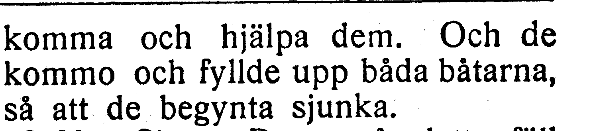

[Full sida, NT s. 98](https://runeberg.org/bibeln/efs1927/nt/0098.html). TIFF: `https://runeberg.org/img/bibeln/efs1927/nt/0098.1.tif`; SHA-256 `0e1ca0ab8a0051194ddcd689ac182ef51536f73f7754045490cc6ed3208fb8f0`. Utsnittets SHA-256 `555e7ed4c1070c89e1b6502c5dfb518b0fb6fad7bd145b30daaf6695be64ad8a`.

**Beslut:** löst 2026-10-27. EFS 1926 bekräftar de begynte sjunka mot EFS 1927:s begynta. Befintlig text behålls.

[Bevarad full originalbild, EFS 1926 NT s. 88](../sv1917-efs1926-witnesses/nt0088.jpg), SHA-256 `a2cddadb1e61431a2644fe96215337357f8d45086f912c5fca25ea9334275d67`. [Hämtningsadress](https://archive.org/download/bibelnellerdenhe0000unse/page/n1297.jpg).

## V055

**Lukas 6:17 — tog han nu med sig / tog han med sig.**

**Korpustext:** Dessa tog han nu med sig och steg åter ned och stannade på en jämn plats; och en stor skara av hans lärjungar var där församlad, så ock en stor hop folk ifrån hela Judeen och Jerusalem, och från kuststräckan vid Tyrus och Sidon.

**Komplettering:** hela berörda versen visuellt jämförd i EFS 1926; ingen fotobegäran återstår.

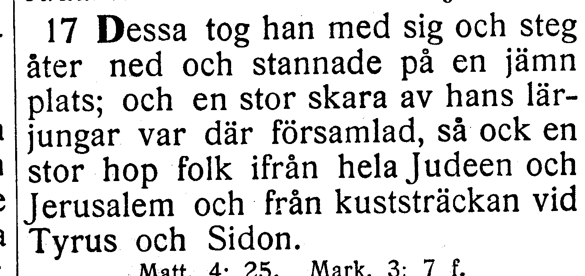

[Full sida, NT s. 100](https://runeberg.org/bibeln/efs1927/nt/0100.html). TIFF: `https://runeberg.org/img/bibeln/efs1927/nt/0100.1.tif`; SHA-256 `a28d4e6a5c4df3187d04478f02cb3b8ba476143d676d2ac11a93037b9ef4fc90`. Utsnittets SHA-256 `c59dbab55ce71e735704b571e70be3c0ed5c3fffdeb6f0b005223f86cb6ddf85`.

**Beslut:** löst 2026-10-27. EFS 1926 bekräftar Dessa tog han nu med sig. Nu saknas endast i EFS 1927 och behålls.

[Bevarad full originalbild, EFS 1926 NT s. 90](../sv1917-efs1926-witnesses/nt0090.jpg), SHA-256 `c5f8a9f6fac0a23c8f4abbb7ba09265ec021e7ade80a8d774a899eaf24916cbf`. [Hämtningsadress](https://archive.org/download/bibelnellerdenhe0000unse/page/n1299.jpg).

## V056

**Lukas 6:48 — så byggt / så väl byggt.**

**Korpustext:** Han är lik en man som ville bygga ett hus och som då grävde djupt och lade dess grund på hälleberget. När sedan översvämning kom, störtade sig vattenströmmen mot det huset, men den förmådde dock icke skaka det, eftersom det var så väl byggt.

**Komplettering:** hela berörda versen visuellt jämförd i EFS 1926; ingen fotobegäran återstår.

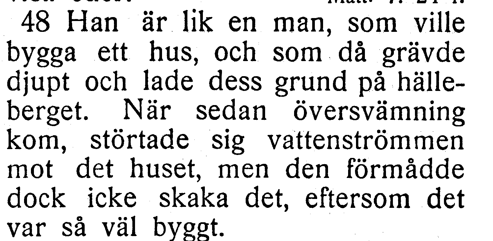

[Full sida, NT s. 102](https://runeberg.org/bibeln/efs1927/nt/0102.html). TIFF: `https://runeberg.org/img/bibeln/efs1927/nt/0102.1.tif`; SHA-256 `5dec45263f5b0bb6ca95d0a88d811e4fb5d0f97dad778f58c42bdecf6cece21e`. Utsnittets SHA-256 `b0198b132faad930e69b3d8ccbdfe95dc40f18f941daabcd5c6c272e35f71ba6`.

**Beslut:** löst 2026-10-27. EFS 1926 och 1927 har så väl byggt. R380 återställer väl. Hela 6:48 visuellt jämförd över tryckta s. 91–92; båda fullbilderna bevaras, med fortsättningsbildens hash i källnoten.

[Bevarad full originalbild, EFS 1926 NT s. 92](../sv1917-efs1926-witnesses/nt0092.jpg), SHA-256 `a0435a8341e284c90bcaae511f1c012e761e2052b810e46f2172104714e04a99`. [Hämtningsadress](https://archive.org/download/bibelnellerdenhe0000unse/page/n1301.jpg). [Versens början på s. 91](../sv1917-efs1926-witnesses/nt0091.jpg); hash i vittnesförteckningen och liggaren.

## V057

**Lukas 8:1 — igenom / genom.**

**Korpustext:** Därefter vandrade han genom landet, från stad till stad och från by till by, och predikade och förkunnade evangelium om Guds rike. Och med honom följde de tolv,

**Komplettering:** hela berörda versen visuellt jämförd i EFS 1926; ingen fotobegäran återstår.

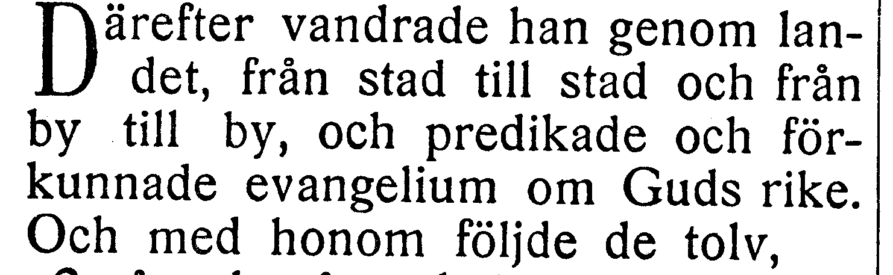

[Full sida, NT s. 105](https://runeberg.org/bibeln/efs1927/nt/0105.html). TIFF: `https://runeberg.org/img/bibeln/efs1927/nt/0105.1.tif`; SHA-256 `d604bb6d1073c114ccd86897fe39346fa1a9d5e07ff4859eabad63c0bea02a08`. Utsnittets SHA-256 `8b510bd5c8f295452da7716b758dcbcff27f7d367a7d18e9db68fcec8a6ea138`.

**Beslut:** löst 2026-10-27. EFS 1926 och 1927 visar båda vandrade han genom landet. R381 rättar vandrade han igenom landet till vandrade han genom landet. Hela versen visuellt jämförd. Vanlig kommatering och övriga ord behålls.

[Bevarad full originalbild, EFS 1926 NT s. 94](../sv1917-efs1926-witnesses/nt0094.jpg), SHA-256 `01fd2d89d4d1f0964ec78098c0394a20c59f7574d3e9e8ce24a04e195060cacb`. [Hämtningsadress](https://archive.org/download/bibelnellerdenhe0000unse/page/n1303.jpg).

## V058

**Lukas 8:35 — När de då kommo / När de kommo.**

**Korpustext:** Och folket gick ut för att se vad som hade skett. När de då kommo till Jesus, funno de mannen, ur vilken de onda andarna hade blivit utdrivna, sitta invid Jesu fötter, klädd och vid sina sinnen; och de betogos av häpnad.

**Komplettering:** hela berörda versen visuellt jämförd i EFS 1926; ingen fotobegäran återstår.

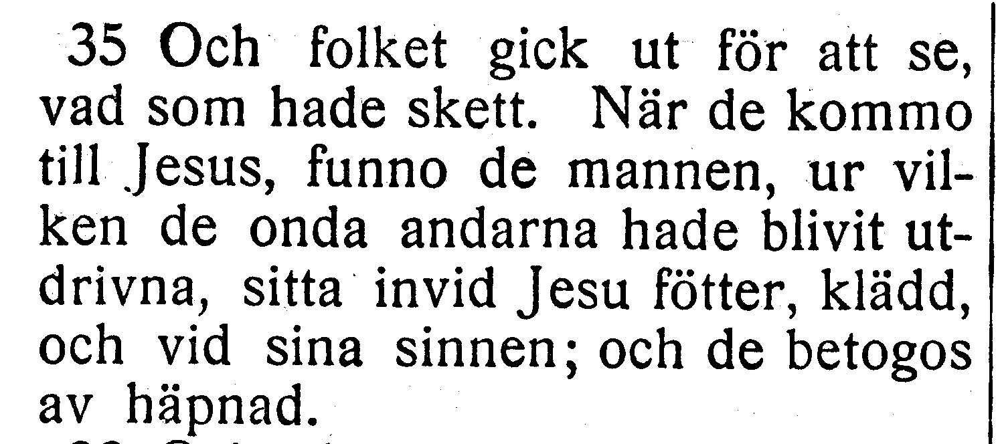

[Full sida, NT s. 107](https://runeberg.org/bibeln/efs1927/nt/0107.html). TIFF: `https://runeberg.org/img/bibeln/efs1927/nt/0107.1.tif`; SHA-256 `13507cb7115b8b0e5d84c9f83d50528fdfa1a3e6bd27aeda102077e7201a7212`. Utsnittets SHA-256 `71a37900646924a4776f39ab04149245ff1e969144cefea6e7c966a567a63657`.

**Beslut:** löst 2026-10-27. EFS 1926 bekräftar När de då kommo till Jesus. Då saknas endast i EFS 1927 och behålls.

[Bevarad full originalbild, EFS 1926 NT s. 96](../sv1917-efs1926-witnesses/nt0096.jpg), SHA-256 `a1f5ecf6a801e4f4fb7e32327bcf4c6c53ac3161597dfce10a9637c3e6dc6202`. [Hämtningsadress](https://archive.org/download/bibelnellerdenhe0000unse/page/n1305.jpg).

## V059

**Lukas 8:36 — sett / åsett.**

**Korpustext:** Och de som hade åsett händelsen omtalade för dem huru den besatte hade blivit botad.

**Komplettering:** hela berörda versen visuellt jämförd i EFS 1926; ingen fotobegäran återstår.

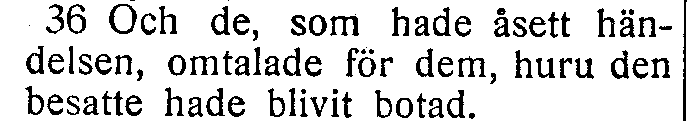

[Full sida, NT s. 107](https://runeberg.org/bibeln/efs1927/nt/0107.html). TIFF: `https://runeberg.org/img/bibeln/efs1927/nt/0107.1.tif`; SHA-256 `13507cb7115b8b0e5d84c9f83d50528fdfa1a3e6bd27aeda102077e7201a7212`. Utsnittets SHA-256 `070ff569f4f586c54ad5c1e5af278fd0c1eb54fca614044b94e3ea752016f667`.

**Beslut:** löst 2026-10-27. EFS 1926 och 1927 visar båda de som hade åsett händelsen. R382 rättar de som hade sett händelsen till de som hade åsett händelsen. Hela versen visuellt jämförd. Vanlig kommatering och övriga ord behålls.

[Bevarad full originalbild, EFS 1926 NT s. 96](../sv1917-efs1926-witnesses/nt0096.jpg), SHA-256 `a1f5ecf6a801e4f4fb7e32327bcf4c6c53ac3161597dfce10a9637c3e6dc6202`. [Hämtningsadress](https://archive.org/download/bibelnellerdenhe0000unse/page/n1305.jpg).

## V060

**Lukas 8:37 — gerasenernas / gerassenernas.**

**Korpustext:** Allt folket ifrån den kringliggande trakten av gerasenernas land bad då Jesus att han skulle gå bort ifrån dem, ty de voro gripna av stor förskräckelse. Så steg han då i en båt för att vända tillbaka.

**Komplettering:** hela berörda versen visuellt jämförd i EFS 1926; ingen fotobegäran återstår.

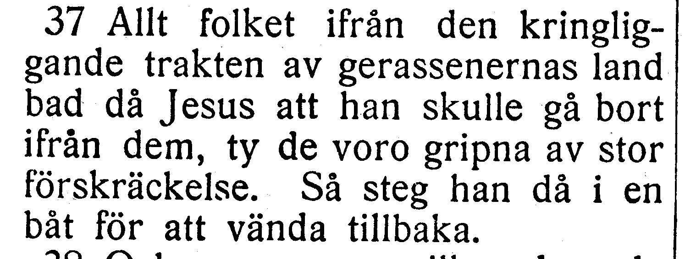

[Full sida, NT s. 107](https://runeberg.org/bibeln/efs1927/nt/0107.html). TIFF: `https://runeberg.org/img/bibeln/efs1927/nt/0107.1.tif`; SHA-256 `13507cb7115b8b0e5d84c9f83d50528fdfa1a3e6bd27aeda102077e7201a7212`. Utsnittets SHA-256 `07a7b898a07fe4c88f192b23810d13bc1edaa4c6e25b9e73f9cd2c38c521bbef`.

**Beslut:** löst 2026-10-27. EFS 1926 har gerasenernas med ett s, som i korpusen, mot EFS 1927:s gerassenernas. Namnet behålls.

[Bevarad full originalbild, EFS 1926 NT s. 96](../sv1917-efs1926-witnesses/nt0096.jpg), SHA-256 `a1f5ecf6a801e4f4fb7e32327bcf4c6c53ac3161597dfce10a9637c3e6dc6202`. [Hämtningsadress](https://archive.org/download/bibelnellerdenhe0000unse/page/n1305.jpg).
