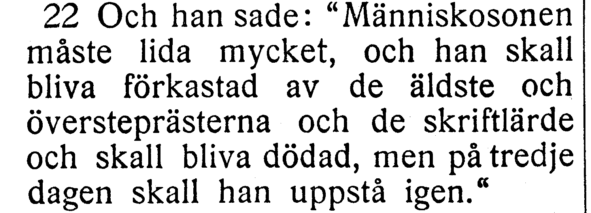
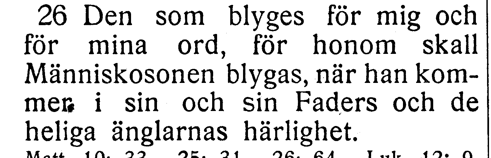
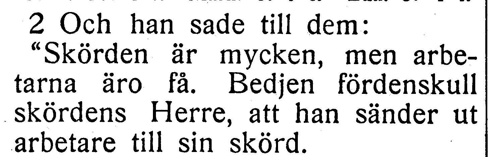
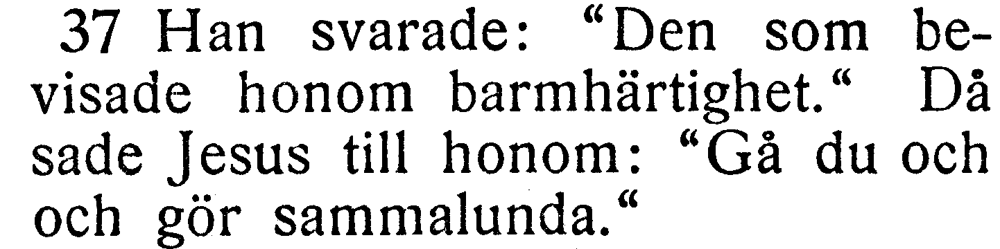
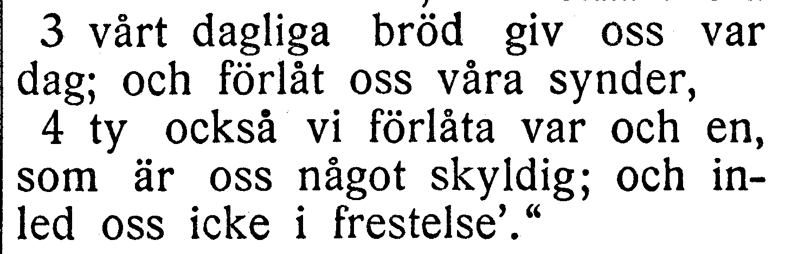
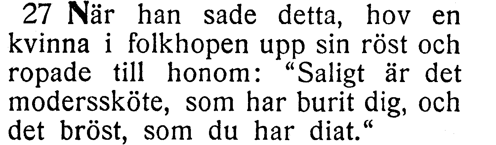

# Fotobunt 6: Lukas 9–12 till senare boktillgång

**Sparad 2026-10-26. Ingen åtgärd behövs nu.** Hela Lukas 9–12 har bildjämförts. Sex frågor lämnas öppna tills ett annat tryck har jämförts. Detta är frågor, inte sex fastställda fel. Kapitel 12 är verifierat; 9–11 står som `needs-review`. Tidigare [fotofrågor](README.md) återstår också.

När boken finns till hands räcker foton av hela verserna. Ingen transkription eller egen diagnos behövs; Codex tolkar bilderna och frågar bara om osäkerheten kvarstår. 9:22/26, 10:2/37 och 11:3–4/27 kan ibland samlas i samma foto eller uppslag. Ingen särskild gruppering krävs. För V065 behövs både vers 3 och 4, med synliga versnummer. Under väntan fortsätter nästa avsnitt.

Originalupplösningen bekräftar **ifrån** i 9:5 och **vapnen** i 11:22 utan foto; de misstankarna har inte lagts i kön. I 9:26 och 11:27 är ett entydigt separat fel rättat (kom mer→kommer respektive in→i), medan ordfrågorna nedan behålls. Aktuell korpustext återges efter dessa rättelser. Utsnitten är direkt beskurna originalbilder, utan OCR eller rekonstruerade bokstäver.

| Fråga | Vers | Korpus / EFS 1927 |
| --- | --- | --- |
| [V061](#v061) | Luk. 9:22 | skriftlärda / skriftlärde |
| [V062](#v062) | Luk. 9:26 | min Faders / sin Faders |
| [V063](#v063) | Luk. 10:2 | saknad inledning / Och han sade till dem: |
| [V064](#v064) | Luk. 10:37 | Gå du och gör / Gå du och och gör |
| [V065](#v065) | Luk. 11:3–4 | versgräns 11:3–4 / förlåt i 11:3 |
| [V066](#v066) | Luk. 11:27 | de bröst / det bröst |

## V061

**Lukas 9:22 — skriftlärda / skriftlärde.**

**Korpustext 9:22:** Och han sade: »Människosonen måste lida mycket, och han skall bliva förkastad av de äldste och översteprästerna och de skriftlärda och skall bliva dödad, men på tredje dagen skall han uppstå igen.»

**Foto till senare:** hela 9:22. Korpusens ord och versgränser behålls tills ett kompletterande tryckvittne har bedömts.

[Full sida, NT s. 109](https://runeberg.org/bibeln/efs1927/nt/0109.html). TIFF: `https://runeberg.org/img/bibeln/efs1927/nt/0109.1.tif`; SHA-256 `267d6ec1bbcfeed2a4fd252cff79a43348acb918f76011e8dd98555312635f98`. Utsnittets SHA-256 `5cb0628fb0d70a11806521419093ac4e0205c6c0a40eba8a64642f3472fb4e99`.

**Beslut:** öppet; inget rättelse-ID för frågan.

## V062

**Lukas 9:26 — min Faders / sin Faders.**

**Korpustext 9:26:** Den som blyges för mig och för mina ord, för honom skall Människosonen blygas, när han kommer i sin och min Faders och de heliga änglarnas härlighet.

**Foto till senare:** hela 9:26. Korpusens ord och versgränser behålls tills ett kompletterande tryckvittne har bedömts.

[Full sida, NT s. 109](https://runeberg.org/bibeln/efs1927/nt/0109.html). TIFF: `https://runeberg.org/img/bibeln/efs1927/nt/0109.1.tif`; SHA-256 `267d6ec1bbcfeed2a4fd252cff79a43348acb918f76011e8dd98555312635f98`. Utsnittets SHA-256 `06ea75952993ce7fdac90892e25b505a44653ccc3b91ae7d798bed3f9b2c67a8`.

**Beslut:** öppet; inget rättelse-ID för frågan.

## V063

**Lukas 10:2 — saknad inledning / Och han sade till dem:.**

**Korpustext 10:2:** »Skörden är mycken, men arbetarna äro få. Bedjen fördenskull skördens Herre att han sänder ut arbetare till sin skörd.

**Foto till senare:** hela 10:2. Korpusens ord och versgränser behålls tills ett kompletterande tryckvittne har bedömts.

[Full sida, NT s. 111](https://runeberg.org/bibeln/efs1927/nt/0111.html). TIFF: `https://runeberg.org/img/bibeln/efs1927/nt/0111.1.tif`; SHA-256 `5b4f1622163f2dd2689f6d6ef3ccd1a53124a6c0c2ae5e334fe78d9f681e778a`. Utsnittets SHA-256 `10e477f4a5881208d212b8d5f9e5cd7be8f8b1a44a01659f49564ea29b1456e5`.

**Beslut:** öppet; inget rättelse-ID för frågan.

## V064

**Lukas 10:37 — Gå du och gör / Gå du och och gör.**

**Korpustext 10:37:** Han svarade: »Den som bevisade honom barmhärtighet.» Då sade Jesus till honom: »Gå du och gör sammalunda.»

**Foto till senare:** hela 10:37. Korpusens ord och versgränser behålls tills ett kompletterande tryckvittne har bedömts.

[Full sida, NT s. 113](https://runeberg.org/bibeln/efs1927/nt/0113.html). TIFF: `https://runeberg.org/img/bibeln/efs1927/nt/0113.1.tif`; SHA-256 `1e4ab6f594b77e5700eb8d0bf6403d07c423b79d633dba4e204591c0b7609ffc`. Utsnittets SHA-256 `c78237b5f3d74b8fd4d82a7fee4b32ab23df7f9346c5bf5bf5e848ad3e322241`.

**Beslut:** öppet; inget rättelse-ID för frågan.

## V065

**Lukas 11:3–4 — versgräns 11:3–4 / förlåt i 11:3.**

**Korpustext 11:3:** vårt dagliga bröd giv oss var dag;

**Korpustext 11:4:** och förlåt oss våra synder, ty också vi förlåta var och en som är oss något skyldig; och inled oss icke i frestelse.'»

**Foto till senare:** hela 11:3–4. Korpusens ord och versgränser behålls tills ett kompletterande tryckvittne har bedömts.

[Full sida, NT s. 113](https://runeberg.org/bibeln/efs1927/nt/0113.html). TIFF: `https://runeberg.org/img/bibeln/efs1927/nt/0113.1.tif`; SHA-256 `1e4ab6f594b77e5700eb8d0bf6403d07c423b79d633dba4e204591c0b7609ffc`. Utsnittets SHA-256 `ff7c468be63993853cb8dd4a83254fc3f3cdf403c1b11e4da8cfffb173ea1eb6`.

**Beslut:** öppet; inget rättelse-ID för frågan.

## V066

**Lukas 11:27 — de bröst / det bröst.**

**Korpustext 11:27:** När han sade detta, hov en kvinna i folkhopen upp sin röst och ropade till honom: »Saligt är det moderssköte som har burit dig, och de bröst som du har diat.»

**Foto till senare:** hela 11:27. Korpusens ord och versgränser behålls tills ett kompletterande tryckvittne har bedömts.

[Full sida, NT s. 114](https://runeberg.org/bibeln/efs1927/nt/0114.html). TIFF: `https://runeberg.org/img/bibeln/efs1927/nt/0114.1.tif`; SHA-256 `21c920d338d59e01f4aaa73bc0d024060e60b0507da687b6b6c98f5acb50be8c`. Utsnittets SHA-256 `d6ce80d9ea767ebe731ac079479d7995a8a6ea6ed1996cbe6a2e08e3aa6db912`.

**Beslut:** öppet; inget rättelse-ID för frågan.
