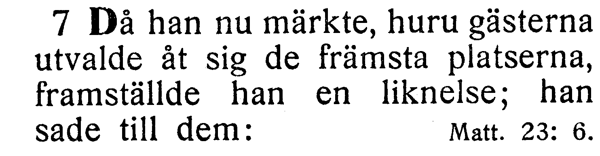
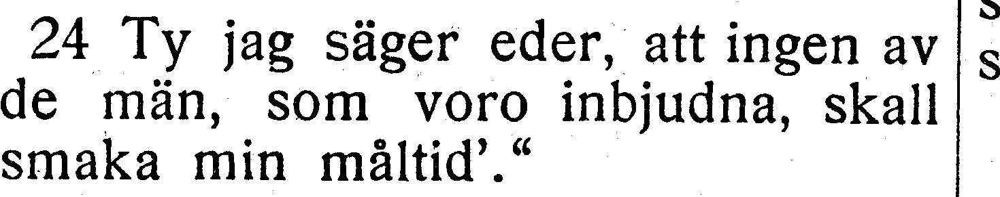
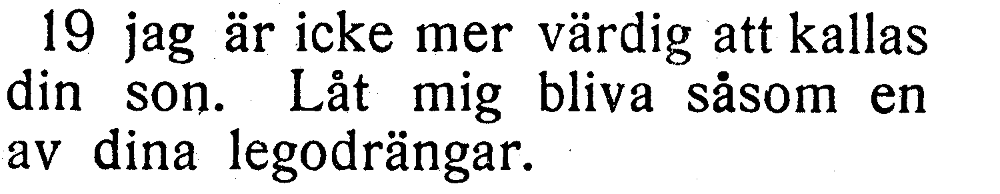
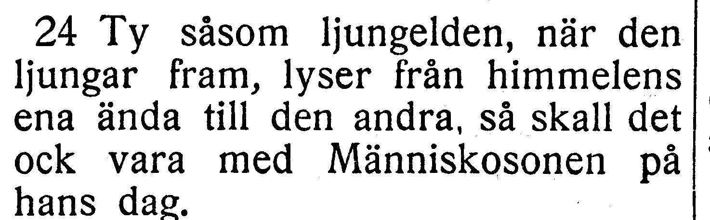
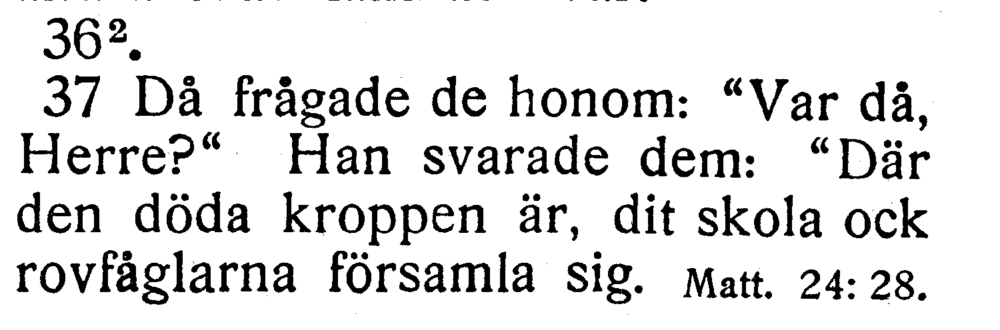
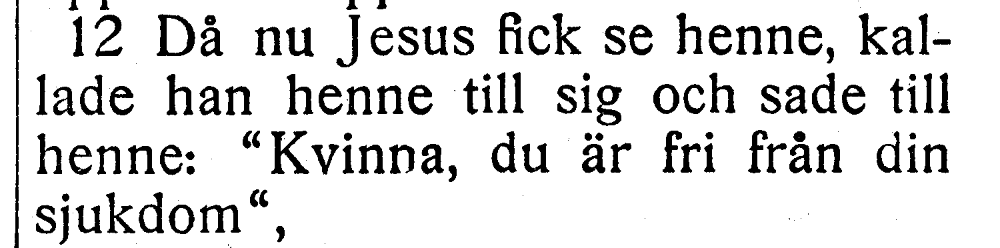

# Fotobunt 7: Lukas 13–17 till senare boktillgång

**Alla frågor i denna bunt avgjorda 2026-10-27 mot [EFS 1926](../sv1917-efs1926-witnesses/README.md). Ingen fotobegäran återstår här.** Hela Lukas är nu verifierad. V061–V079 ger sju ordrättelser och en nummerändring R383–R390 samt elva behållna läsningar. Tabellen visar jämförelsen före besluten; korpusverser nedan är uppdaterade. Stabilt V-ID, ursprungliga scanutsnitt och exakta hashvärden bevaras. R079 och R099 bevaras i samma versbundna ersättningar.

| Fråga | Vers | Korpus / EFS 1927 |
| --- | --- | --- |
| [V067](#v067), löst | Luk. 14:7 | framställde han för dem / framställde han |
| [V068](#v068), löst | Luk. 14:24 | bjudna / inbjudna |
| [V069](#v069), löst | Luk. 15:19 | värd / värdig |
| [V070](#v070), löst | Luk. 17:24 | så skall det vara / så skall det ock vara |
| [V071](#v071), löst | Luk. 17:36 | versnummer 17:36 / tryckets 17:37 |
| [V072](#v072), löst | Luk. 13:12 | fri ifrån / fri från |

## V067

**Lukas 14:7 — framställde han för dem / framställde han.**

**Korpustext:** Då han nu märkte huru gästerna utvalde åt sig de främsta platserna, framställde han för dem en liknelse; han sade till dem:

**Komplettering:** hela berörda versen visuellt jämförd i EFS 1926; ingen fotobegäran återstår.

[Full sida, NT s. 121](https://runeberg.org/bibeln/efs1927/nt/0121.html). TIFF: `https://runeberg.org/img/bibeln/efs1927/nt/0121.1.tif`; SHA-256 `c0212253af1aadc700907271cf9fe657dc4b0c9d1b5e617fd537c19984784d33`. Utsnittets SHA-256 `e6c0ab31bf6dd70920ad140d88cb688f43993bd108a5943aed4a5ea0bee6db52`.

**Beslut:** löst 2026-10-27. EFS 1926 bekräftar framställde han för dem, som i korpusen, mot EFS 1927 utan för dem. Läsningen behålls.

[Bevarad full originalbild, EFS 1926 NT s. 108](../sv1917-efs1926-witnesses/nt0108.jpg), SHA-256 `ba2559bb60ddaf979aa592787e0e05c03bf21a60e67f0a49efa6cd1d53f1aa47`. [Hämtningsadress](https://archive.org/download/bibelnellerdenhe0000unse/page/n1317.jpg).

## V068

**Lukas 14:24 — bjudna / inbjudna.**

**Korpustext:** Ty jag säger eder att ingen av de män som voro bjudna skall smaka min måltid.'»

**Komplettering:** hela berörda versen visuellt jämförd i EFS 1926; ingen fotobegäran återstår.

[Full sida, NT s. 122](https://runeberg.org/bibeln/efs1927/nt/0122.html). TIFF: `https://runeberg.org/img/bibeln/efs1927/nt/0122.1.tif`; SHA-256 `4b78d98d89c3f6474ce2eb5576e1353161eb1e83b4fc967f5c6b3c2472704386`. Utsnittets SHA-256 `aaca9f0fd5cf0a1ef3e1491e75eadc2bb8fcb245ef578c3147501a4fd3ec53d5`.

**Beslut:** löst 2026-10-27. EFS 1926 bekräftar voro bjudna mot EFS 1927:s voro inbjudna. Korpusens bjudna och den tidigare rättade min måltid behålls.

[Bevarad full originalbild, EFS 1926 NT s. 109](../sv1917-efs1926-witnesses/nt0109.jpg), SHA-256 `618ef9d101b301533132342836eaf0c627420f9bd06f4c72376cbd0ca77fc9f6`. [Hämtningsadress](https://archive.org/download/bibelnellerdenhe0000unse/page/n1318.jpg).

## V069

**Lukas 15:19 — värd / värdig.**

**Korpustext:** jag är icke mer värd att kallas din son. Låt mig bliva såsom en av dina legodrängar.'

**Komplettering:** hela berörda versen visuellt jämförd i EFS 1926; ingen fotobegäran återstår.

[Full sida, NT s. 123](https://runeberg.org/bibeln/efs1927/nt/0123.html). TIFF: `https://runeberg.org/img/bibeln/efs1927/nt/0123.1.tif`; SHA-256 `22a46650cb217af8d8310e63611acd55e4decfb01b97f38ba00a074002abd1d7`. Utsnittets SHA-256 `1c581eb6db5c4524a3833bfbae3244fe3243ff140e691abb89b5f8fbf8c5d0ea`.

**Beslut:** löst 2026-10-27. EFS 1926 bekräftar värd att kallas din son mot EFS 1927:s värdig. Befintlig läsning behålls.

[Bevarad full originalbild, EFS 1926 NT s. 110](../sv1917-efs1926-witnesses/nt0110.jpg), SHA-256 `e245ee05f683373c948ad799f41e7d3fa0f89932fa9004ca33b80b17cf1cccb0`. [Hämtningsadress](https://archive.org/download/bibelnellerdenhe0000unse/page/n1319.jpg).

## V070

**Lukas 17:24 — så skall det vara / så skall det ock vara.**

**Korpustext:** Ty såsom ljungelden, när den ljungar fram, lyser från himmelens ena ända till den andra, så skall det vara med Människosonen på hans dag.

**Komplettering:** hela berörda versen visuellt jämförd i EFS 1926; ingen fotobegäran återstår.

[Full sida, NT s. 127](https://runeberg.org/bibeln/efs1927/nt/0127.html). TIFF: `https://runeberg.org/img/bibeln/efs1927/nt/0127.1.tif`; SHA-256 `1137bebb97da57858fc67a4a79ca014d512d7bdbee9e2988241558e3d44bb99f`. Utsnittets SHA-256 `f53ecc8f840fc19f0ad49f039e4dc5a3d8e6a22d068c60f075c55f9bac6ff48c`.

**Beslut:** löst 2026-10-27. EFS 1926 bekräftar så skall det vara, utan ock, som i korpusen. Befintlig läsning och den tidigare rättade hans dag behålls.

[Bevarad full originalbild, EFS 1926 NT s. 114](../sv1917-efs1926-witnesses/nt0114.jpg), SHA-256 `a1d81f05f8703a2d6fb1cbb96c73467abe7b1b2fcaeb251396a44dda8305b3c0`. [Hämtningsadress](https://archive.org/download/bibelnellerdenhe0000unse/page/n1323.jpg).

## V071

**Lukas 17:36 — versnummer 17:36 / tryckets 17:37.**

**Korpustext 17:37:** Då frågade de honom: »Var då, Herre?» Han svarade dem: »Där den döda kroppen är, dit skola ock rovfåglarna församla sig.»

**Komplettering:** hela berörda versen visuellt jämförd i EFS 1926; ingen fotobegäran återstår.

[Full sida, NT s. 127](https://runeberg.org/bibeln/efs1927/nt/0127.html). TIFF: `https://runeberg.org/img/bibeln/efs1927/nt/0127.1.tif`; SHA-256 `1137bebb97da57858fc67a4a79ca014d512d7bdbee9e2988241558e3d44bb99f`. Utsnittets SHA-256 `d040aa9ad4636fb3e9bf989e0b6aee921f4aa2ab8f1565d17305a97c073b5a37`.

**Beslut:** löst 2026-10-27. Både EFS 1926 och 1927 numrerar den avslutande frågan som 17:37; 36 är endast en nothänvisning. R387 flyttar den oförändrade textposten från 17:36 till 17:37 och rättar sex parallellmappningar i båda riktningar. Ingen löptext för vers 36 skapas. Grekisk/KJV 17:36 förblir utan svensk motsvarighet.

[Bevarad full originalbild, EFS 1926 NT s. 114](../sv1917-efs1926-witnesses/nt0114.jpg), SHA-256 `a1d81f05f8703a2d6fb1cbb96c73467abe7b1b2fcaeb251396a44dda8305b3c0`. [Hämtningsadress](https://archive.org/download/bibelnellerdenhe0000unse/page/n1323.jpg).

## V072

**Lukas 13:12 — fri ifrån / fri från.**

**Korpustext:** Då nu Jesus fick se henne, kallade han henne till sig och sade till henne: »Kvinna, du är fri ifrån din sjukdom»,

**Komplettering:** hela berörda versen visuellt jämförd i EFS 1926; ingen fotobegäran återstår.

[Full sida, NT s. 119](https://runeberg.org/bibeln/efs1927/nt/0119.html). TIFF: `https://runeberg.org/img/bibeln/efs1927/nt/0119.1.tif`; SHA-256 `af7f9e0ea5c106525b79d0a289d765e6740acbf05e34b88b7a1b024e8408952d`. Utsnittets SHA-256 `cd21e4002a9587c6b14cf227e9a2034ffbe9a2edaea537750a722ac466b400fb`.

**Beslut:** löst 2026-10-27. EFS 1926 bekräftar fri ifrån din sjukdom mot EFS 1927:s från. Hela versen jämförd över båda spalterna på s. 107. Korpusens ifrån och tidigare interpunktions-/ordmellanrumsrättelser behålls.

[Bevarad full originalbild, EFS 1926 NT s. 107](../sv1917-efs1926-witnesses/nt0107.jpg), SHA-256 `724de9297e15464ccc04633630cbd36ed3554bb7282e7c763b6c08da71887262`. [Hämtningsadress](https://archive.org/download/bibelnellerdenhe0000unse/page/n1316.jpg).
