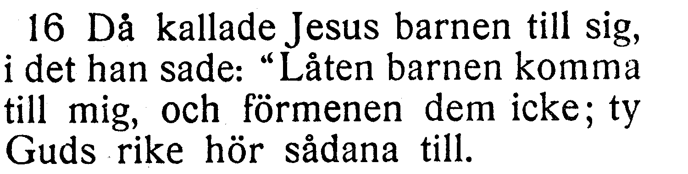
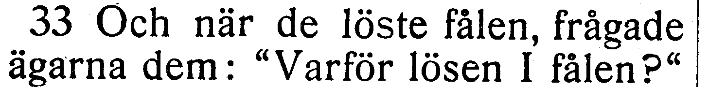
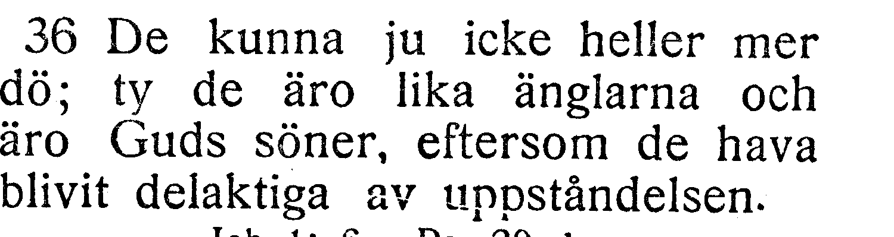
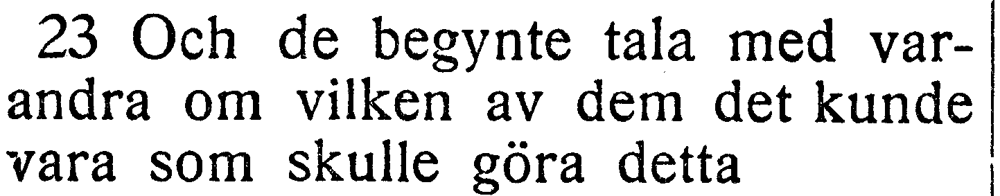
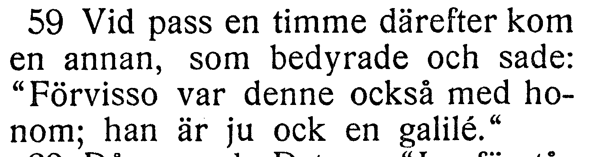
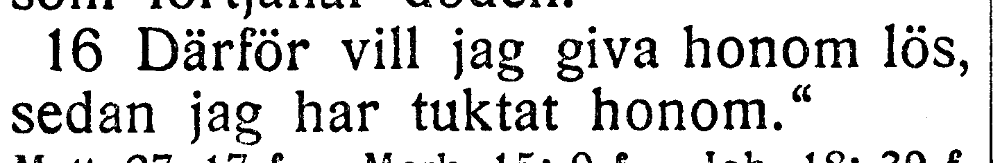
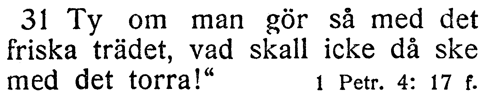

# Fotobunt 8: Lukas 18–24 till senare boktillgång

**Sparad 2026-10-26. Ingen åtgärd behövs nu.** Hela Lukas har bildjämförts. I detta block lämnas sju frågor öppna tills ett annat tryck har jämförts. Detta är frågor, inte sju fastställda fel. Kapitel 21 och 24 är verifierade; 18–20 och 22–23 står som `needs-review`. Tidigare [fotofrågor](README.md) återstår också.

När boken finns till hands räcker foton av hela verserna, utan transkription eller egen diagnos. Codex tolkar bilderna och frågar bara om osäkerheten kvarstår. 22:23/59 och 23:16/31 kan ibland samlas per uppslag, men ingen särskild gruppering krävs. Johannes granskas medan frågorna väntar.

I 20:36 rättas ett saknat semikolon och ett främmande komma, medan ej/icke behålls som en öppen ordfråga. Korpustexten nedan visar aktuellt läge efter rättelserna. Utsnitten är direkt beskurna originalbilder, utan OCR eller rekonstruerade bokstäver.

| Fråga | Vers | Korpus / EFS 1927 |
| --- | --- | --- |
| [V073](#v073) | Luk. 18:16 | förmenen dem det icke / förmenen dem icke |
| [V074](#v074) | Luk. 19:33 | ägaren / ägarna |
| [V075](#v075) | Luk. 20:36 | ej heller / icke heller |
| [V076](#v076) | Luk. 22:23 | väl kunde vara / kunde vara |
| [V077](#v077) | Luk. 22:59 | också denne / denne också |
| [V078](#v078) | Luk. 23:16 | medan jag har tuktat / sedan jag har tuktat |
| [V079](#v079) | Luk. 23:31 | om han gör så / om man gör så |

## V073

**Lukas 18:16 — förmenen dem det icke / förmenen dem icke.**

**Korpustext:** Då kallade Jesus barnen till sig, i det han sade: »Låten barnen komma till mig, och förmenen dem det icke; ty Guds rike hör sådana till.

**Foto till senare:** hela 18:16. Korpusens ord och versnummer behålls tills ett kompletterande tryckvittne har bedömts.

[Full sida, NT s. 128](https://runeberg.org/bibeln/efs1927/nt/0128.html). TIFF: `https://runeberg.org/img/bibeln/efs1927/nt/0128.1.tif`; SHA-256 `a8ea26b47860a168a3371612ae246ec01af016b7f098c5029c9c6b485a7cef15`. Utsnittets SHA-256 `83b94e7eb26dda3f239cf722f03471c865d19e3cec2a1bb8fdaeedf268a56fcc`.

**Beslut:** öppet; inget rättelse-ID för frågan.

## V074

**Lukas 19:33 — ägaren / ägarna.**

**Korpustext:** Och när de löste fålen, frågade ägaren dem: »Varför lösen I fålen?»

**Foto till senare:** hela 19:33. Korpusens ord och versnummer behålls tills ett kompletterande tryckvittne har bedömts.

[Full sida, NT s. 131](https://runeberg.org/bibeln/efs1927/nt/0131.html). TIFF: `https://runeberg.org/img/bibeln/efs1927/nt/0131.1.tif`; SHA-256 `6878a80e170cedb5097a425fe701e940f7cc028cc626dc8654fc09e093936f8b`. Utsnittets SHA-256 `2a8b667481d7da70de571c3a5db8036e34808465651c3ecb8c0c58599b26f1b4`.

**Beslut:** öppet; inget rättelse-ID för frågan.

## V075

**Lukas 20:36 — ej heller / icke heller.**

**Korpustext:** De kunna ju ej heller mer dö; ty de äro lika änglarna och äro Guds söner, eftersom de hava blivit delaktiga av uppståndelsen.

**Foto till senare:** hela 20:36. Korpusens ord och versnummer behålls tills ett kompletterande tryckvittne har bedömts.

[Full sida, NT s. 133](https://runeberg.org/bibeln/efs1927/nt/0133.html). TIFF: `https://runeberg.org/img/bibeln/efs1927/nt/0133.1.tif`; SHA-256 `bec7a01e5ad6fbea49abf9d824f910edd90b7085bbf2d012154de19a705d03cb`. Utsnittets SHA-256 `3ef45b20609be25f8ce3a1fa3d5eaec40ef3354ebdcc03f5483a8984740091a4`.

**Beslut:** öppet; inget rättelse-ID för frågan.

## V076

**Lukas 22:23 — väl kunde vara / kunde vara.**

**Korpustext:** Och de begynte tala med varandra om vilken av dem det väl kunde vara som skulle göra detta.

**Foto till senare:** hela 22:23. Korpusens ord och versnummer behålls tills ett kompletterande tryckvittne har bedömts.

[Full sida, NT s. 137](https://runeberg.org/bibeln/efs1927/nt/0137.html). TIFF: `https://runeberg.org/img/bibeln/efs1927/nt/0137.1.tif`; SHA-256 `c4bbb8ffd8b181f5c37b5e73ecedfb192df7d8d51232ae28dff38a034b8b6865`. Utsnittets SHA-256 `de9e1683d2bac7ecdced9b49cb18ec3312467267a2d4ee89d9d0b9699797c41f`.

**Beslut:** öppet; inget rättelse-ID för frågan.

## V077

**Lukas 22:59 — också denne / denne också.**

**Korpustext:** Vid pass en timme därefter kom en annan som bedyrade och sade: »Förvisso var också denne med honom; han är ju ock en galilé.»

**Foto till senare:** hela 22:59. Korpusens ord och versnummer behålls tills ett kompletterande tryckvittne har bedömts.

[Full sida, NT s. 138](https://runeberg.org/bibeln/efs1927/nt/0138.html). TIFF: `https://runeberg.org/img/bibeln/efs1927/nt/0138.1.tif`; SHA-256 `dcc56800c421a06e0fa9be4e8a1234317ee8bed3efad0c5404ae0dfa4119f6b1`. Utsnittets SHA-256 `c554fd091963029b2ef9d3cb034f8c9cfafe524d2ee3b04a7383c8eb3849687e`.

**Beslut:** öppet; inget rättelse-ID för frågan.

## V078

**Lukas 23:16 — medan jag har tuktat / sedan jag har tuktat.**

**Korpustext:** Därför vill jag giva honom lös, medan jag har tuktat honom.»

**Foto till senare:** hela 23:16. Korpusens ord och versnummer behålls tills ett kompletterande tryckvittne har bedömts.

[Full sida, NT s. 140](https://runeberg.org/bibeln/efs1927/nt/0140.html). TIFF: `https://runeberg.org/img/bibeln/efs1927/nt/0140.1.tif`; SHA-256 `8b225251e53602c4c41c4669f41b27990da0fde5632e3cfbed89a57a2fdd46dd`. Utsnittets SHA-256 `1c0b540261b0be1b9a9d24258ede003b4209e4a176fb5e929371df82b0b395c7`.

**Beslut:** öppet; inget rättelse-ID för frågan.

## V079

**Lukas 23:31 — om han gör så / om man gör så.**

**Korpustext:** Ty om han gör så med det friska trädet, vad skall icke då ske med det torra!»

**Foto till senare:** hela 23:31. Korpusens ord och versnummer behålls tills ett kompletterande tryckvittne har bedömts.

[Full sida, NT s. 140](https://runeberg.org/bibeln/efs1927/nt/0140.html). TIFF: `https://runeberg.org/img/bibeln/efs1927/nt/0140.1.tif`; SHA-256 `8b225251e53602c4c41c4669f41b27990da0fde5632e3cfbed89a57a2fdd46dd`. Utsnittets SHA-256 `f1a05f9b8c7ed531ce494a8973ba46db269496bfefa8e0ffe54fc8ca18ed8bac`.

**Beslut:** öppet; inget rättelse-ID för frågan.
