# Fotobunt 9: Johannes 1–8 till senare boktillgång

**Sparad 2026-10-26. Ingen åtgärd behövs nu.** Johannes 1–8 har bildjämförts. Tjugotvå frågor lämnas öppna tills ett annat tryck har jämförts. Detta är frågor, inte tjugotvå fastställda fel. Alla åtta kapitel står som `needs-review`; tidigare [fotofrågor](README.md) återstår också.

När boken finns till hands räcker foton av hela verserna, utan transkription eller egen diagnos. Codex tolkar bilderna och frågar bara om osäkerheten kvarstår. Samla gärna närliggande verser på samma foto eller uppslag: 2:10/14/21; 3:15/29; 4:6/12/24/33 respektive 4:52; 6:2/10 respektive 6:35; 7:12/17/23 respektive 7:42/46; 8:7/39. Ingen särskild gruppering krävs. Nästa kapitel granskas medan frågorna väntar.

Korpustexten nedan visar aktuellt läge efter separata säkra rättelser. Frågornas ord ändras inte. Även uppenbara tryckmisstankar hans förstå i 7:17 och rättsinig i 7:12 sparas för kompletterande stöd; de kopieras inte till korpusen. Utsnitten är direkt beskurna originalbilder, utan OCR eller rekonstruerade bokstäver.

| Fråga | Vers | Korpus / EFS 1927 |
| --- | --- | --- |
| [V080](#v080) | Joh. 1:39 | vid den tionde timmen / vid tionde timmen |
| [V081](#v081) | Joh. 2:10 | alltid sätta fram / alltid först sätta fram |
| [V082](#v082) | Joh. 2:14 | Och när han fick / Och han fick |
| [V083](#v083) | Joh. 2:21 | tempel han talade / tempel som han talade |
| [V084](#v084) | Joh. 3:15 | så att / för att |
| [V085](#v085) | Joh. 3:29 | hör honom / hör på honom |
| [V086](#v086) | Joh. 4:6 | vid den sjätte timmen / vid sjätte timmen |
| [V087](#v087) | Joh. 4:12 | Icke är du väl / Icke är väl du |
| [V088](#v088) | Joh. 4:24 | Gud är ande; de som tillbedja / Gud är en ande; de som tillbedja honom |
| [V089](#v089) | Joh. 4:33 | lärjungarna / hans lärjungar |
| [V090](#v090) | Joh. 4:52 | vid den sjunde timmen / vid sjunde timmen |
| [V091](#v091) | Joh. 5:21 | uppväcker döda / uppväcker de döda |
| [V092](#v092) | Joh. 6:2 | följde efter honom / följde honom |
| [V093](#v093) | Joh. 6:10 | lägga sig här / lägra sig här |
| [V094](#v094) | Joh. 6:35 | aldrig törsta / aldrig någonsin törsta |
| [V095](#v095) | Joh. 7:17 | så skall han förstå / så skall hans förstå |
| [V096](#v096) | Joh. 7:23 | hel och frisk / hel och hållen frisk |
| [V097](#v097) | Joh. 7:42 | av Davids säd / från Davids säd |
| [V098](#v098) | Joh. 7:46 | människa talat / människa så talat |
| [V099](#v099) | Joh. 8:39 | Jesus svarade till dem / Jesus sade till dem |
| [V100](#v100) | Joh. 8:7 | första stenen / den första stenen |
| [V101](#v101) | Joh. 7:12 | rättsinnig / rättsinig |

## V080

**Johannes 1:39 — vid den tionde timmen / vid tionde timmen.**

**Korpustext:** Han sade till dem: »Kommen och sen.» Då gingo de med honom och sågo var han bodde; och de stannade den dagen hos honom. – Detta skedde vid den tionde timmen.

**Foto till senare:** hela 1:39. Korpusens ord och versnummer behålls tills ett kompletterande tryckvittne har bedömts.

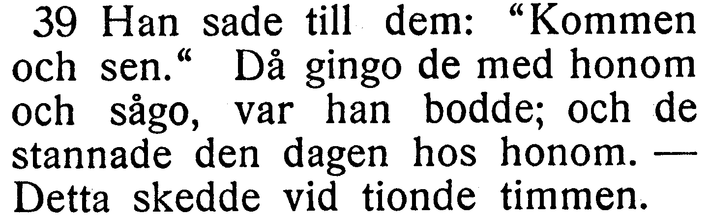

[Full sida, NT s. 146](https://runeberg.org/bibeln/efs1927/nt/0146.html). TIFF: `https://runeberg.org/img/bibeln/efs1927/nt/0146.1.tif`; SHA-256 `dcac0e4ae583c6ba223938a93dae7ed34a66802ea9c9820c50d613d53fd84943`. Utsnittets SHA-256 `85229324c9eb1c19b3d6d7fbca80ab2f3302782633562cd0f2fdea35d2abde47`.

**Beslut:** öppet; inget rättelse-ID för frågan.

## V081

**Johannes 2:10 — alltid sätta fram / alltid först sätta fram.**

**Korpustext:** och sade till honom: »Man brukar eljest alltid sätta fram det goda vinet, och sedan, när gästerna hava fått för mycket, det som är sämre. Du har gömt det goda vinet ända tills nu.»

**Foto till senare:** hela 2:10. Korpusens ord och versnummer behålls tills ett kompletterande tryckvittne har bedömts.

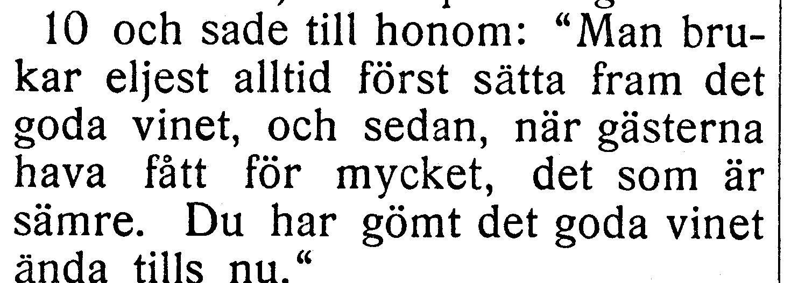

[Full sida, NT s. 147](https://runeberg.org/bibeln/efs1927/nt/0147.html). TIFF: `https://runeberg.org/img/bibeln/efs1927/nt/0147.1.tif`; SHA-256 `43d8997131ac0c2ace4d2f9fd0f4433f475970a27ae46ddabdef3507b0090378`. Utsnittets SHA-256 `75f41925a34b3ced5267be4f87bd45186465c8f7a6a4a3eedcf54cf6378acee0`.

**Beslut:** öppet; inget rättelse-ID för frågan.

## V082

**Johannes 2:14 — Och när han fick / Och han fick.**

**Korpustext:** Och när han fick i helgedomen se huru där sutto män som sålde fäkreatur och får och duvor, och huru växlare sutto där.

**Foto till senare:** hela 2:14. Korpusens ord och versnummer behålls tills ett kompletterande tryckvittne har bedömts.

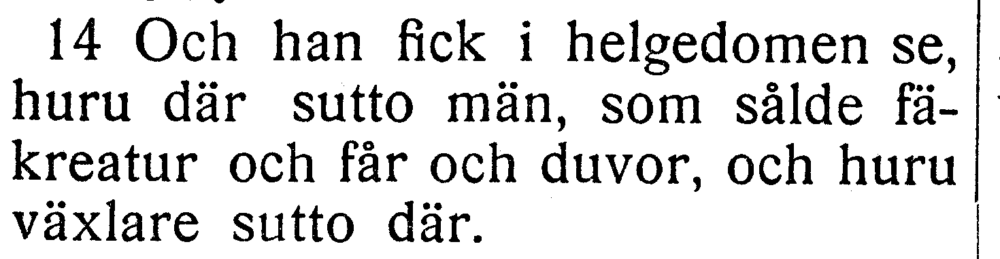

[Full sida, NT s. 147](https://runeberg.org/bibeln/efs1927/nt/0147.html). TIFF: `https://runeberg.org/img/bibeln/efs1927/nt/0147.1.tif`; SHA-256 `43d8997131ac0c2ace4d2f9fd0f4433f475970a27ae46ddabdef3507b0090378`. Utsnittets SHA-256 `3f4436ebd811d13acd3375bce382d9a46956bcb3b084a21eebe883ad2abc96fa`.

**Beslut:** öppet; inget rättelse-ID för frågan.

## V083

**Johannes 2:21 — tempel han talade / tempel som han talade.**

**Korpustext:** Men det var om sin kropps tempel han talade.

**Foto till senare:** hela 2:21. Korpusens ord och versnummer behålls tills ett kompletterande tryckvittne har bedömts.

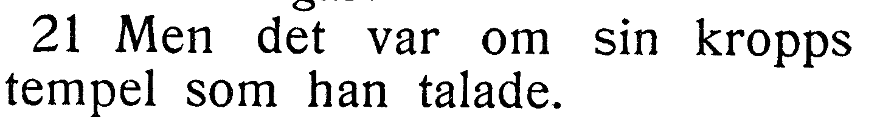

[Full sida, NT s. 147](https://runeberg.org/bibeln/efs1927/nt/0147.html). TIFF: `https://runeberg.org/img/bibeln/efs1927/nt/0147.1.tif`; SHA-256 `43d8997131ac0c2ace4d2f9fd0f4433f475970a27ae46ddabdef3507b0090378`. Utsnittets SHA-256 `86112a13e37bb2b46328bfcb900a043d8e95034c9aec704d2c87fcce74279431`.

**Beslut:** öppet; inget rättelse-ID för frågan.

## V084

**Johannes 3:15 — så att / för att.**

**Korpustext:** så att var och en som tror skall i honom hava evigt liv.

**Foto till senare:** hela 3:15. Korpusens ord och versnummer behålls tills ett kompletterande tryckvittne har bedömts.

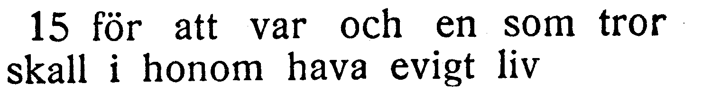

[Full sida, NT s. 148](https://runeberg.org/bibeln/efs1927/nt/0148.html). TIFF: `https://runeberg.org/img/bibeln/efs1927/nt/0148.1.tif`; SHA-256 `60b0c147f763b7200c433e2af81b815077dcf8235a1da08cee8967dff0245ebe`. Utsnittets SHA-256 `6f18083f5252aab1543b549e19cc2e121a25a2916ff4b5100865335026237d86`.

**Beslut:** öppet; inget rättelse-ID för frågan.

## V085

**Johannes 3:29 — hör honom / hör på honom.**

**Korpustext:** Brudgum är den som har bruden; men brudgummens vän, som står där och hör honom, han gläder sig storligen åt brudgummens röst. Den glädjen är mig nu given i fullt mått.

**Foto till senare:** hela 3:29. Korpusens ord och versnummer behålls tills ett kompletterande tryckvittne har bedömts.

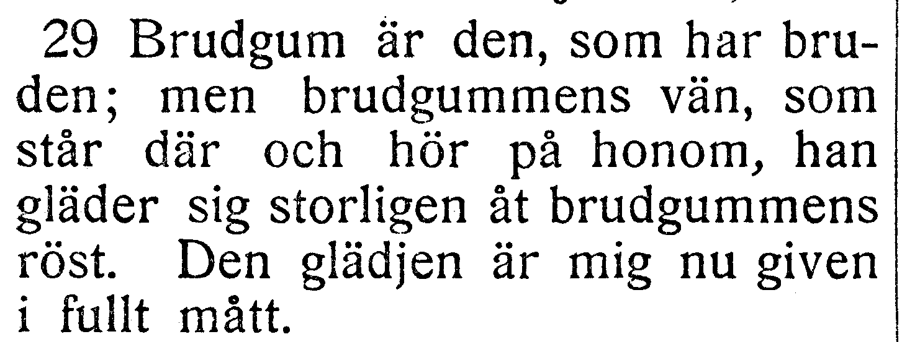

[Full sida, NT s. 149](https://runeberg.org/bibeln/efs1927/nt/0149.html). TIFF: `https://runeberg.org/img/bibeln/efs1927/nt/0149.1.tif`; SHA-256 `315b11801303d9b8078c4bebd737f6260f24b962a528e2212b18fda44e4edf52`. Utsnittets SHA-256 `2a62410cd41f1fef5482703f8615014330e60a127c172d19cb8150d49dc8d093`.

**Beslut:** öppet; inget rättelse-ID för frågan.

## V086

**Johannes 4:6 — vid den sjätte timmen / vid sjätte timmen.**

**Korpustext:** Och där var Jakobs brunn. Eftersom nu Jesus var trött av vandringen, satte han sig strax ned vid brunnen. Det var vid den sjätte timmen.

**Foto till senare:** hela 4:6. Korpusens ord och versnummer behålls tills ett kompletterande tryckvittne har bedömts.

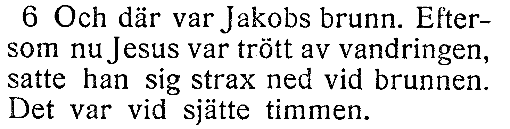

[Full sida, NT s. 149](https://runeberg.org/bibeln/efs1927/nt/0149.html). TIFF: `https://runeberg.org/img/bibeln/efs1927/nt/0149.1.tif`; SHA-256 `315b11801303d9b8078c4bebd737f6260f24b962a528e2212b18fda44e4edf52`. Utsnittets SHA-256 `6037a4b093ac68bce662da8669b32293964b4c5a375ef1836ae14ace8ea9a951`.

**Beslut:** öppet; inget rättelse-ID för frågan.

## V087

**Johannes 4:12 — Icke är du väl / Icke är väl du.**

**Korpustext:** Icke är du väl förmer än vår fader Jakob, som gav oss brunnen och själv med sina barn och sin boskap drack ur den?»

**Foto till senare:** hela 4:12. Korpusens ord och versnummer behålls tills ett kompletterande tryckvittne har bedömts.

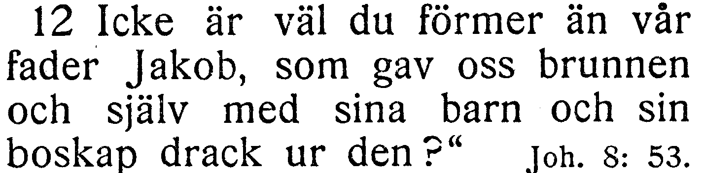

[Full sida, NT s. 150](https://runeberg.org/bibeln/efs1927/nt/0150.html). TIFF: `https://runeberg.org/img/bibeln/efs1927/nt/0150.1.tif`; SHA-256 `f9528ad198d0b7fd406bc14072537d7ac63b1c32d24625c30edcd2b5aae4176c`. Utsnittets SHA-256 `137caa18db6eb9a367854560586fb61c099425dcc8381533e1473e2dc2315f29`.

**Beslut:** öppet; inget rättelse-ID för frågan.

## V088

**Johannes 4:24 — Gud är ande; de som tillbedja / Gud är en ande; de som tillbedja honom.**

**Korpustext:** Gud är ande, och de som tillbedja måste tillbedja i ande och sanning.»

**Foto till senare:** hela 4:24. Korpusens ord och versnummer behålls tills ett kompletterande tryckvittne har bedömts.

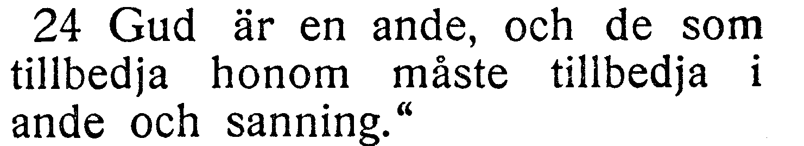

[Full sida, NT s. 150](https://runeberg.org/bibeln/efs1927/nt/0150.html). TIFF: `https://runeberg.org/img/bibeln/efs1927/nt/0150.1.tif`; SHA-256 `f9528ad198d0b7fd406bc14072537d7ac63b1c32d24625c30edcd2b5aae4176c`. Utsnittets SHA-256 `1f7005cfb96b7e8a21f532e3392bbc7704e3f01511a874f972281f00fd7a0d50`.

**Beslut:** öppet; inget rättelse-ID för frågan.

## V089

**Johannes 4:33 — lärjungarna / hans lärjungar.**

**Korpustext:** Då sade lärjungarna till varandra: »Kan väl någon hava burit mat till honom?»

**Foto till senare:** hela 4:33. Korpusens ord och versnummer behålls tills ett kompletterande tryckvittne har bedömts.

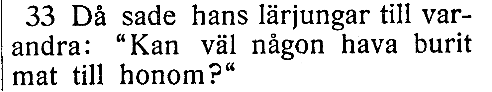

[Full sida, NT s. 150](https://runeberg.org/bibeln/efs1927/nt/0150.html). TIFF: `https://runeberg.org/img/bibeln/efs1927/nt/0150.1.tif`; SHA-256 `f9528ad198d0b7fd406bc14072537d7ac63b1c32d24625c30edcd2b5aae4176c`. Utsnittets SHA-256 `e75617e70b112149b5ceba137a83f1920428f5d7b6df1f51d41c20c9951a5e2d`.

**Beslut:** öppet; inget rättelse-ID för frågan.

## V090

**Johannes 4:52 — vid den sjunde timmen / vid sjunde timmen.**

**Korpustext:** Då frågade han dem vid vilken timme det hade blivit bättre med honom. De svarade honom: »I går vid den sjunde timmen lämnade febern honom.»

**Foto till senare:** hela 4:52. Korpusens ord och versnummer behålls tills ett kompletterande tryckvittne har bedömts.

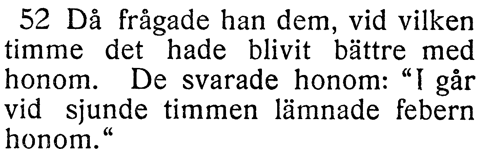

[Full sida, NT s. 151](https://runeberg.org/bibeln/efs1927/nt/0151.html). TIFF: `https://runeberg.org/img/bibeln/efs1927/nt/0151.1.tif`; SHA-256 `e325a4c7015b2ea85660625499a9d51c526c67462dcbb8831595a67f7356ba07`. Utsnittets SHA-256 `163505e93fa79ed73012485401ae01deeb3b3de8d3b378f60c6fdaa4c1bc3e0a`.

**Beslut:** öppet; inget rättelse-ID för frågan.

## V091

**Johannes 5:21 — uppväcker döda / uppväcker de döda.**

**Korpustext:** Ty såsom Fadern uppväcker döda och gör dem levande, så gör ock Sonen levande vilka han vill.

**Foto till senare:** hela 5:21. Korpusens ord och versnummer behålls tills ett kompletterande tryckvittne har bedömts.

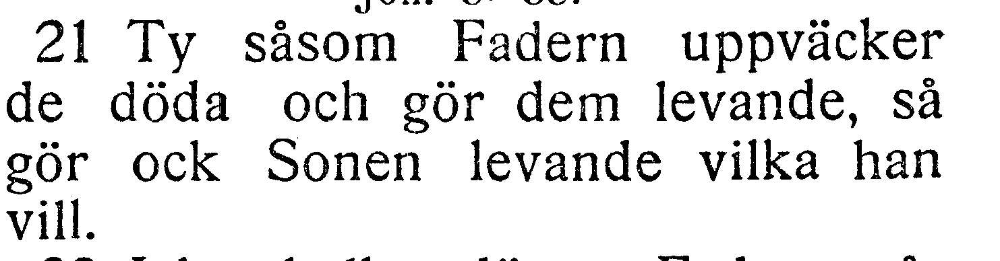

[Full sida, NT s. 152](https://runeberg.org/bibeln/efs1927/nt/0152.html). TIFF: `https://runeberg.org/img/bibeln/efs1927/nt/0152.1.tif`; SHA-256 `e33cd89b4c0c1d16b4e9004ee288689e6aaec4f140cf7c6b793e79ec418ea1e5`. Utsnittets SHA-256 `0a9263f099a854b76c2748d931ba24d41d8c8f8b0ce1c680ff7044182a4fceee`.

**Beslut:** öppet; inget rättelse-ID för frågan.

## V092

**Johannes 6:2 — följde efter honom / följde honom.**

**Korpustext:** Och mycket folk följde efter honom, därför att de sågo de tecken som han gjorde med de sjuka.

**Foto till senare:** hela 6:2. Korpusens ord och versnummer behålls tills ett kompletterande tryckvittne har bedömts.

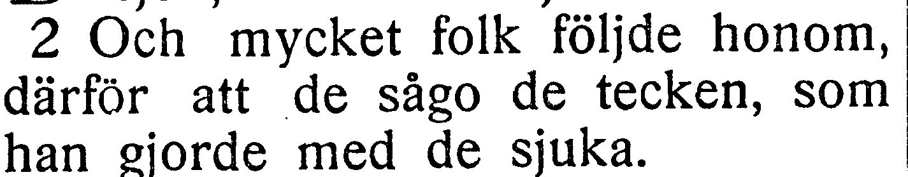

[Full sida, NT s. 154](https://runeberg.org/bibeln/efs1927/nt/0154.html). TIFF: `https://runeberg.org/img/bibeln/efs1927/nt/0154.1.tif`; SHA-256 `6f6ff549fafcac25a764099489d41479fc578af40aa0617a35a90bad7e584573`. Utsnittets SHA-256 `6f014f2a893676257f6a32d1e6293479d32deee74f6365cbe797c293edce96e8`.

**Beslut:** öppet; inget rättelse-ID för frågan.

## V093

**Johannes 6:10 — lägga sig här / lägra sig här.**

**Korpustext:** Jesus sade: »Låten folket lägga sig här.» Och på det stället var mycket gräs. Då lägrade sig männen där, och deras antal var vid pass fem tusen.

**Foto till senare:** hela 6:10. Korpusens ord och versnummer behålls tills ett kompletterande tryckvittne har bedömts.

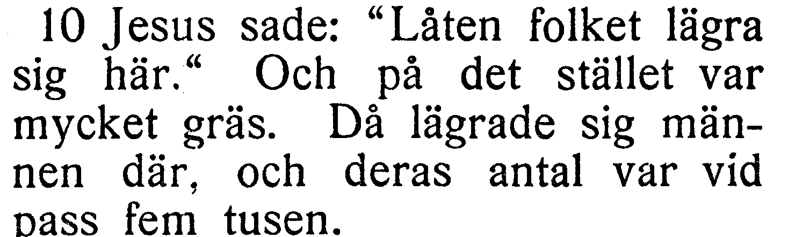

[Full sida, NT s. 154](https://runeberg.org/bibeln/efs1927/nt/0154.html). TIFF: `https://runeberg.org/img/bibeln/efs1927/nt/0154.1.tif`; SHA-256 `6f6ff549fafcac25a764099489d41479fc578af40aa0617a35a90bad7e584573`. Utsnittets SHA-256 `bf5ae7e53bd98298417c572408b5069b89bc116a72fac3e8e26b7bd5b8400886`.

**Beslut:** öppet; inget rättelse-ID för frågan.

## V094

**Johannes 6:35 — aldrig törsta / aldrig någonsin törsta.**

**Korpustext:** Jesus svarade: »Jag är livets bröd. Den som kommer till mig, han skall aldrig hungra, och den som tror på mig, han skall aldrig törsta.

**Foto till senare:** hela 6:35. Korpusens ord och versnummer behålls tills ett kompletterande tryckvittne har bedömts.

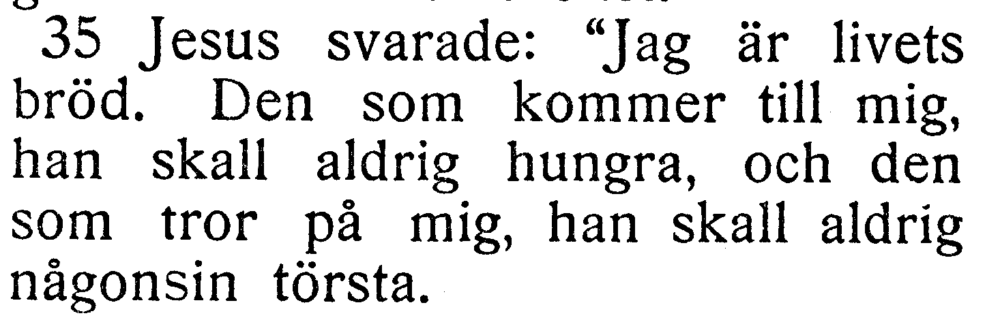

[Full sida, NT s. 155](https://runeberg.org/bibeln/efs1927/nt/0155.html). TIFF: `https://runeberg.org/img/bibeln/efs1927/nt/0155.1.tif`; SHA-256 `34789f2b0120888bb2dd4622627a616d277ad3a61aec98438f7618d51a11ab99`. Utsnittets SHA-256 `81accdd9b8949f4d737376370b94f2e5bc9c46201abe8a33969aa10b3bf013e1`.

**Beslut:** öppet; inget rättelse-ID för frågan.

## V095

**Johannes 7:17 — så skall han förstå / så skall hans förstå.**

**Korpustext:** Om någon vill göra hans vilja, så skall han förstå om denna lära är från Gud, eller om jag talar av mig själv.

**Foto till senare:** hela 7:17. Korpusens ord och versnummer behålls tills ett kompletterande tryckvittne har bedömts.

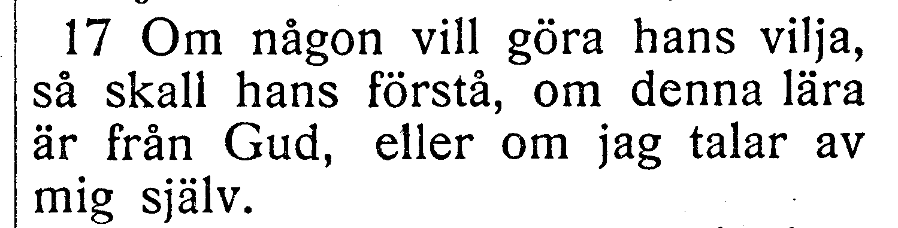

[Full sida, NT s. 157](https://runeberg.org/bibeln/efs1927/nt/0157.html). TIFF: `https://runeberg.org/img/bibeln/efs1927/nt/0157.1.tif`; SHA-256 `e3dae1ecf4e4832af3b2b27256e2c05fda49b2ea06c3d46824e8f109aaa28e96`. Utsnittets SHA-256 `fcad942a3db9339d2ee5985e05f333594a183af4127de25cf4daa2a5256e088b`.

**Beslut:** öppet; inget rättelse-ID för frågan.

## V096

**Johannes 7:23 — hel och frisk / hel och hållen frisk.**

**Korpustext:** Om nu en människa undfår omskärelsen på en sabbat, för att Moses' lag icke skall göras om intet, huru kunnen I då vredgas på mig, därför att jag på en sabbat gjorde en människa hel och frisk?

**Foto till senare:** hela 7:23. Korpusens ord och versnummer behålls tills ett kompletterande tryckvittne har bedömts.

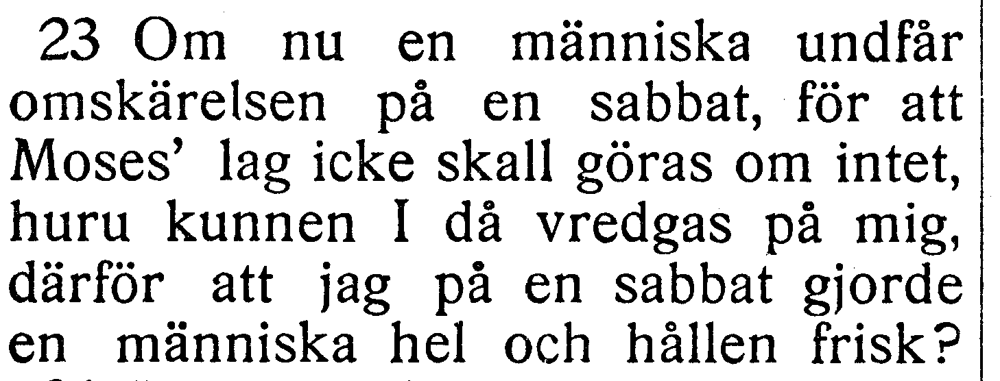

[Full sida, NT s. 158](https://runeberg.org/bibeln/efs1927/nt/0158.html). TIFF: `https://runeberg.org/img/bibeln/efs1927/nt/0158.1.tif`; SHA-256 `7623b547e5dd68f8dcb4c6eae6abcae588aabd38063573155fda941d1e2b5b2e`. Utsnittets SHA-256 `8bb99427f1b048f40051a2010fccee00be6a0af0cc5a8c0e87997d352812ab4b`.

**Beslut:** öppet; inget rättelse-ID för frågan.

## V097

**Johannes 7:42 — av Davids säd / från Davids säd.**

**Korpustext:** Säger icke skriften att Messias skall komma av Davids säd och från den lilla staden Betlehem, där David bodde?

**Foto till senare:** hela 7:42. Korpusens ord och versnummer behålls tills ett kompletterande tryckvittne har bedömts.

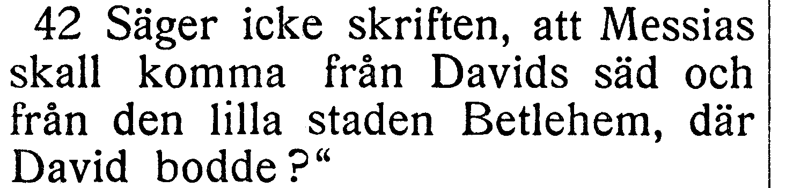

[Full sida, NT s. 159](https://runeberg.org/bibeln/efs1927/nt/0159.html). TIFF: `https://runeberg.org/img/bibeln/efs1927/nt/0159.1.tif`; SHA-256 `b15ba86f3be94efd0c48b715f8c5d0c26584c61a4209412830023e0458723956`. Utsnittets SHA-256 `5f144c1f553ddf27ba807027a6b3450f52cd589a2ab3daeda9fb9212a6a2287d`.

**Beslut:** öppet; inget rättelse-ID för frågan.

## V098

**Johannes 7:46 — människa talat / människa så talat.**

**Korpustext:** Tjänarna svarade: »Aldrig har någon människa talat, som den mannen talar.»

**Foto till senare:** hela 7:46. Korpusens ord och versnummer behålls tills ett kompletterande tryckvittne har bedömts.

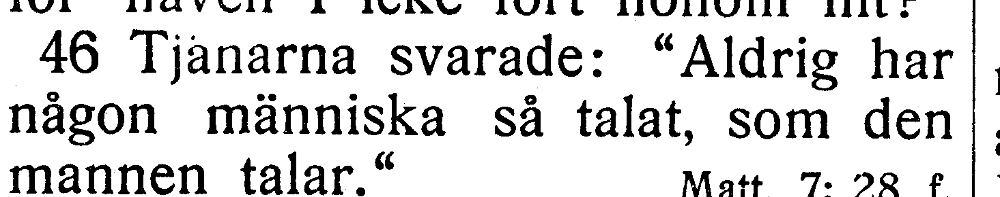

[Full sida, NT s. 159](https://runeberg.org/bibeln/efs1927/nt/0159.html). TIFF: `https://runeberg.org/img/bibeln/efs1927/nt/0159.1.tif`; SHA-256 `b15ba86f3be94efd0c48b715f8c5d0c26584c61a4209412830023e0458723956`. Utsnittets SHA-256 `54266c7b9c82b97e3c5d5510b8807cee13e0166b9c8136e94bbc03173bde715b`.

**Beslut:** öppet; inget rättelse-ID för frågan.

## V099

**Johannes 8:39 — Jesus svarade till dem / Jesus sade till dem.**

**Korpustext:** De svarade och sade till honom: »Vår fader är ju Abraham.» Jesus svarade till dem: »Ären I Abrahams barn, så gören ock Abrahams gärningar.

**Foto till senare:** hela 8:39. Korpusens ord och versnummer behålls tills ett kompletterande tryckvittne har bedömts.

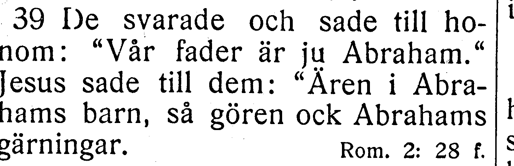

[Full sida, NT s. 161](https://runeberg.org/bibeln/efs1927/nt/0161.html). TIFF: `https://runeberg.org/img/bibeln/efs1927/nt/0161.1.tif`; SHA-256 `a5a638cccc14627903bb123614a61052f6cf2bcd9afa9dc2ee8c69b784981237`. Utsnittets SHA-256 `f592a5d3a7e0cbbadf592ddaa7f3758c39a9e44890f43366853cd31a3997b510`.

**Beslut:** öppet; inget rättelse-ID för frågan.

## V100

**Johannes 8:7 — första stenen / den första stenen.**

**Korpustext:** Men när de stodo fast vid sin fråga, reste han sig upp och sade till dem: »Den av eder som är utan synd, han kaste första stenen på henne.»

**Foto till senare:** hela 8:7. Korpusens ord och versnummer behålls tills ett kompletterande tryckvittne har bedömts.

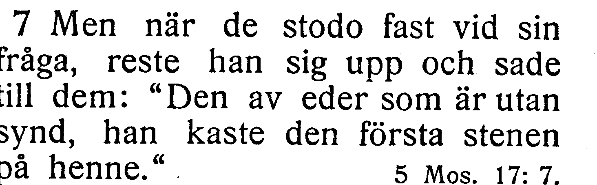

[Full sida, NT s. 159](https://runeberg.org/bibeln/efs1927/nt/0159.html). TIFF: `https://runeberg.org/img/bibeln/efs1927/nt/0159.1.tif`; SHA-256 `b15ba86f3be94efd0c48b715f8c5d0c26584c61a4209412830023e0458723956`. Utsnittets SHA-256 `54c654c59d66edafbe7076923833b864cf504e5cbd9946d21ef2fe56e3e3a2ea`.

**Beslut:** öppet; inget rättelse-ID för frågan.

## V101

**Johannes 7:12 — rättsinnig / rättsinig.**

**Korpustext:** Och bland folket talades i tysthet mycket om honom. Somliga sade: »Han är en rättsinnig man», men andra sade: »Nej, han förvillar folket.»

**Foto till senare:** hela 7:12. Korpusens ord och versnummer behålls tills ett kompletterande tryckvittne har bedömts.

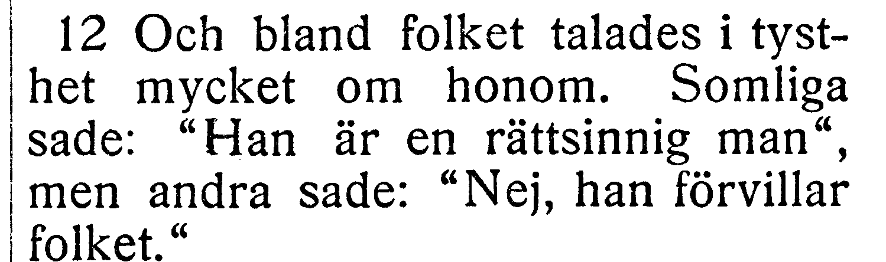

[Full sida, NT s. 157](https://runeberg.org/bibeln/efs1927/nt/0157.html). TIFF: `https://runeberg.org/img/bibeln/efs1927/nt/0157.1.tif`; SHA-256 `e3dae1ecf4e4832af3b2b27256e2c05fda49b2ea06c3d46824e8f109aaa28e96`. Utsnittets SHA-256 `5af9bea80fa13ac02c1db916bdc4dde24b54c321047d60bb94eb301e7eace702`.

**Beslut:** öppet; inget rättelse-ID för frågan.
