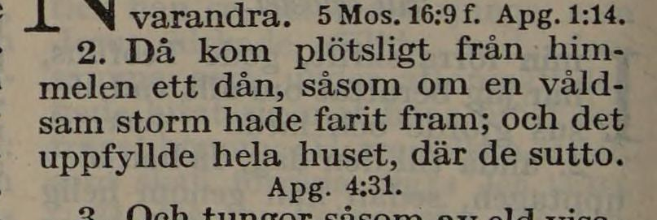
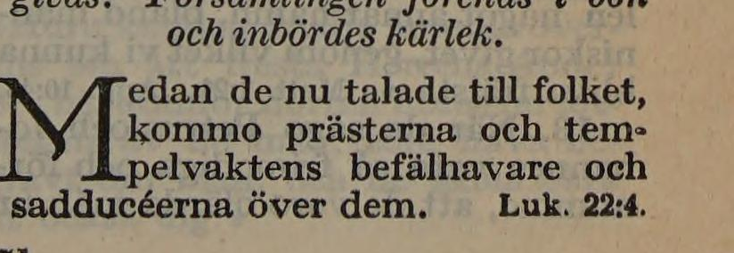
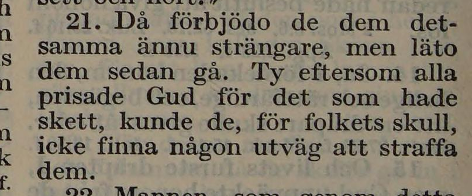
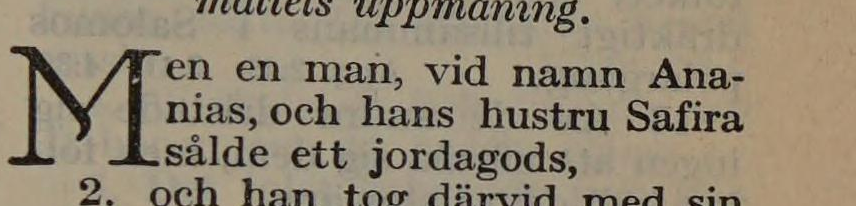
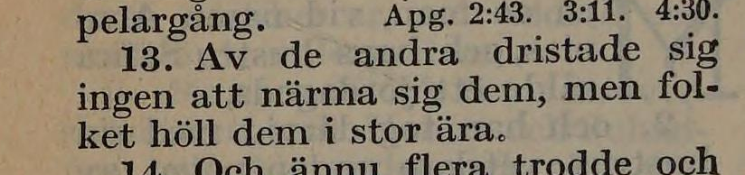

# NT-fotobunt 1: Apostlagärningarna 1–12

**Alla fem frågor avgjorda 2026-10-26 mot [EFS 1926](../sv1917-efs1926-witnesses/README.md). Inga foton behövs för denna bunt.** Fem rättelser R321–R325 stöds av båda trycken; kapitel 2, 4 och 5 är nu verifierade.

Tabellens jämförelse visar korpusen **före** besluten mot EFS 1927. De fulla korpusverserna nedan är uppdaterade efter rättelserna. Båda tryckens underlag och stabila V-ID bevaras för återkontroll.

| Fråga | Vers | Korpus / EFS 1927 |
| --- | --- | --- |
| [V123](#v123) | Apg. 2:2 | hade dragit fram / hade farit fram |
| [V124](#v124) | Apg. 4:1 | Medan de ännu talade / Medan de nu talade |
| [V125](#v125) | Apg. 4:21 | utväg genom att straffa / utväg att straffa |
| [V126](#v126) | Apg. 5:1 | Men en ung man / Men en man |
| [V127](#v127) | Apg. 5:13 | folket höll dem i ära / folket höll dem i stor ära |

## V123

**Apostlagärningarna 2:2 — hade dragit fram / hade farit fram.**

**Korpustext:** Då kom plötsligt från himmelen ett dån, såsom om en våldsam storm hade farit fram; och det uppfyllde hela huset där de sutto.

**Komplettering:** hela den berörda versen visuellt kontrollerad i EFS 1926. Ingen fotobegäran återstår.

[Full sida, NT s. 187](https://runeberg.org/bibeln/efs1927/nt/0187.html). TIFF: `https://runeberg.org/img/bibeln/efs1927/nt/0187.1.tif`; SHA-256 `67637f583ce03512304f200354b9e02d2608228e2f1ea407bf2fe39c006b96e0`. Utsnittets SHA-256 `d10336dad1096d1bab5602a1b5bebfd33cef5150ca7b1b74327224fd996e2610`.

**Beslut:** löst 2026-10-26. EFS 1926 och 1927 har båda hade farit fram; dragit ersätts med farit. Endast det belagda ordet ändras. Införd rättelse R321.

[Full EFS 1926-sida, NT s. 168](https://archive.org/download/bibelnellerdenhe0000unse/page/n1377.jpg). Utsnittets SHA-256 `13d1338efb65415e55dd5020e3c8291334fff6598d65901e97e2a0ab6e241924`; originalbildens hash och beskärning i [vittnesöversikten](../sv1917-efs1926-witnesses/README.md).

## V124

**Apostlagärningarna 4:1 — Medan de ännu talade / Medan de nu talade.**

**Korpustext:** Medan de nu talade till folket, kommo prästerna och tempelvaktens befälhavare och sadducéerna över dem.

**Komplettering:** hela den berörda versen visuellt kontrollerad i EFS 1926. Ingen fotobegäran återstår.

[Full sida, NT s. 191](https://runeberg.org/bibeln/efs1927/nt/0191.html). TIFF: `https://runeberg.org/img/bibeln/efs1927/nt/0191.1.tif`; SHA-256 `18e2a4db6915efc85104b7586fbf39407eb717f8c50b37b54d25f9d636d074f7`. Utsnittets SHA-256 `0ff931a162afa164234e575af98181ae2e9ee3a5f515062cd313b5c8a7cc2c89`.

**Beslut:** löst 2026-10-26. Båda trycken har Medan de nu talade; ännu ersätts med nu. Införd rättelse R322.

[Full EFS 1926-sida, NT s. 171](https://archive.org/download/bibelnellerdenhe0000unse/page/n1380.jpg). Utsnittets SHA-256 `f60b0ba270d30b38a4408617240576fb793995cb17996a34bd1992b128458126`; originalbildens hash och beskärning i [vittnesöversikten](../sv1917-efs1926-witnesses/README.md).

## V125

**Apostlagärningarna 4:21 — utväg genom att straffa / utväg att straffa.**

**Korpustext:** Då förbjödo de dem detsamma ännu strängare, men läto dem sedan gå. Ty eftersom alla prisade Gud för det som hade skett, kunde de, för folkets skull, icke finna någon utväg att straffa dem.

**Komplettering:** hela den berörda versen visuellt kontrollerad i EFS 1926. Ingen fotobegäran återstår.

[Full sida, NT s. 192](https://runeberg.org/bibeln/efs1927/nt/0192.html). TIFF: `https://runeberg.org/img/bibeln/efs1927/nt/0192.1.tif`; SHA-256 `9b46ef671b7708a993ddf46583b8d773cd1c18b64157718e5aeafeaaa32be917`. Utsnittets SHA-256 `8623c117b6c934ebbbb3adb8b0b8cc098f08818d21df6af3f6e234832ad160f5`.

**Beslut:** löst 2026-10-26. Båda trycken har utväg att straffa; det främmande genom tas bort. Införd rättelse R323.

[Full EFS 1926-sida, NT s. 172](https://archive.org/download/bibelnellerdenhe0000unse/page/n1381.jpg). Utsnittets SHA-256 `919a1132f69b1e4ab5dc2fa94290c2f4590a9a39964e889254681406c9dbfdf1`; originalbildens hash och beskärning i [vittnesöversikten](../sv1917-efs1926-witnesses/README.md).

## V126

**Apostlagärningarna 5:1 — Men en ung man / Men en man.**

**Korpustext:** Men en man vid namn Ananias och hans hustru Safira sålde ett jordagods,

**Komplettering:** hela den berörda versen visuellt kontrollerad i EFS 1926. Ingen fotobegäran återstår.

[Full sida, NT s. 192](https://runeberg.org/bibeln/efs1927/nt/0192.html). TIFF: `https://runeberg.org/img/bibeln/efs1927/nt/0192.1.tif`; SHA-256 `9b46ef671b7708a993ddf46583b8d773cd1c18b64157718e5aeafeaaa32be917`. Utsnittets SHA-256 `c2813d3bdc8d98d17b998685a0708a9c8c2b91e99216b3367e346e716726590d`.

**Beslut:** löst 2026-10-26. Båda trycken har Men en man; det främmande ung tas bort. Införd rättelse R324.

[Full EFS 1926-sida, NT s. 173](https://archive.org/download/bibelnellerdenhe0000unse/page/n1382.jpg). Utsnittets SHA-256 `5cf21f0fa3bce9f9c3da80b85f5119b9814ddc1ac9ecd2565dce3772781f846f`; originalbildens hash och beskärning i [vittnesöversikten](../sv1917-efs1926-witnesses/README.md).

## V127

**Apostlagärningarna 5:13 — folket höll dem i ära / folket höll dem i stor ära.**

**Korpustext:** Av de andra dristade sig ingen att närma sig dem, men folket höll dem i stor ära.

**Komplettering:** hela den berörda versen visuellt kontrollerad i EFS 1926. Ingen fotobegäran återstår.

[Full sida, NT s. 193](https://runeberg.org/bibeln/efs1927/nt/0193.html). TIFF: `https://runeberg.org/img/bibeln/efs1927/nt/0193.1.tif`; SHA-256 `dec9314dc7801a7f7562d742b1821aa6acbb6f695da11d204cdc849b2a2434a0`. Utsnittets SHA-256 `803798dff19c2d11bf3905dce15dfa0d6a3dc036c872ba4023b9946cfb2eb1bb`.

**Beslut:** löst 2026-10-26. Båda trycken har folket höll dem i stor ära; det saknade stor återställs. Införd rättelse R325.

[Full EFS 1926-sida, NT s. 174](https://archive.org/download/bibelnellerdenhe0000unse/page/n1383.jpg). Utsnittets SHA-256 `76a9b87675eea58d2bdb5ed8060c3931687e5922c636e5e44f7701fea4561d4f`; originalbildens hash och beskärning i [vittnesöversikten](../sv1917-efs1926-witnesses/README.md).
