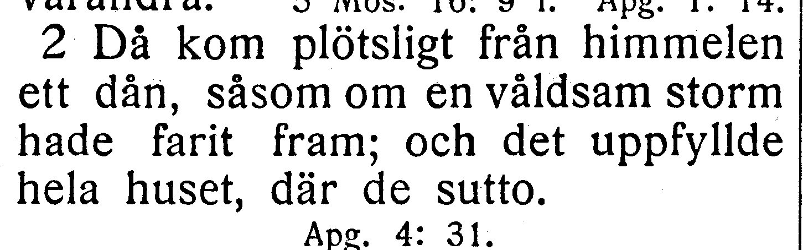
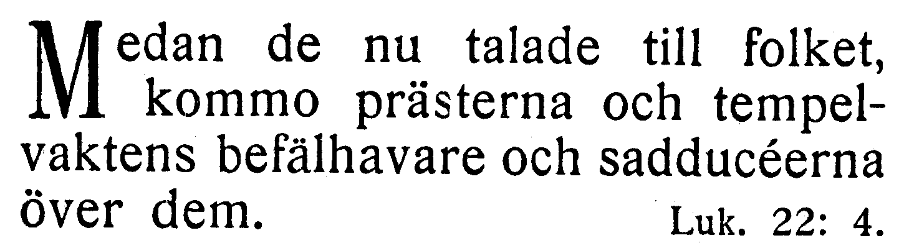
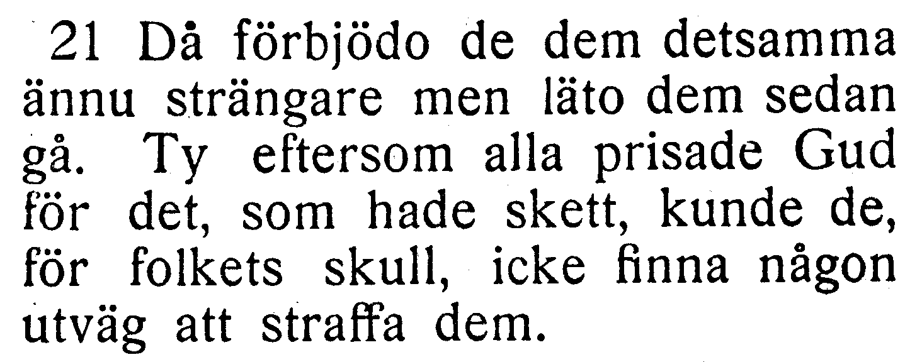
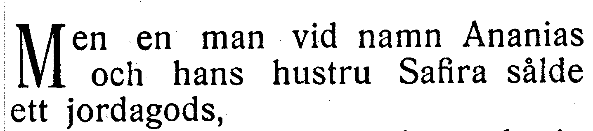
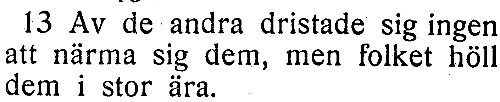

# NT-fotobunt 1: Apostlagärningarna 1–12

**Sparad 2026-10-26. Ingen åtgärd behövs nu.** Fem frågor i tre helt bildlästa kapitel väntar på ett annat tryck. Detta är inte fem fastställda fel. Kapitel 2, 4 och 5 står som `needs-review`; övriga nio kapitel i blocket är verifierade efter separata säkra rättelser.

När boken finns till hands räcker foton av hela verserna med synliga versnummer. Ingen transkription eller egen diagnos behövs. Codex tolkar bilderna och frågar bara om osäkerheten kvarstår. Närliggande verser får samlas i samma foto; inget visst fotoformat krävs. Originalupplösningen har redan kontrollerats för alla fem frågor.

Korpustexten nedan är aktuell efter separata rättelser. Frågornas ord och alla verskoordinater behålls tills ytterligare tryck har bedömts. Utsnitten är direkt beskurna originalbilder, utan OCR eller rekonstruerade bokstäver.

| Fråga | Vers | Korpus / EFS 1927 |
| --- | --- | --- |
| [V123](#v123) | Apg. 2:2 | hade dragit fram / hade farit fram |
| [V124](#v124) | Apg. 4:1 | Medan de ännu talade / Medan de nu talade |
| [V125](#v125) | Apg. 4:21 | utväg genom att straffa / utväg att straffa |
| [V126](#v126) | Apg. 5:1 | Men en ung man / Men en man |
| [V127](#v127) | Apg. 5:13 | folket höll dem i ära / folket höll dem i stor ära |

## V123

**Apostlagärningarna 2:2 — hade dragit fram / hade farit fram.**

**Korpustext:** Då kom plötsligt från himmelen ett dån, såsom om en våldsam storm hade dragit fram; och det uppfyllde hela huset där de sutto.

**Foto till senare:** hela 2:2. Båda läsningarna är språkligt möjliga; inget rättelsebeslut fattas enbart från skillnaden mot EFS 1927.

[Full sida, NT s. 187](https://runeberg.org/bibeln/efs1927/nt/0187.html). TIFF: `https://runeberg.org/img/bibeln/efs1927/nt/0187.1.tif`; SHA-256 `67637f583ce03512304f200354b9e02d2608228e2f1ea407bf2fe39c006b96e0`. Utsnittets SHA-256 `d10336dad1096d1bab5602a1b5bebfd33cef5150ca7b1b74327224fd996e2610`.

**Beslut:** öppet; inget rättelse-ID för frågan.

## V124

**Apostlagärningarna 4:1 — Medan de ännu talade / Medan de nu talade.**

**Korpustext:** Medan de ännu talade till folket, kommo prästerna och tempelvaktens befälhavare och sadducéerna över dem.

**Foto till senare:** hela 4:1. Båda läsningarna är språkligt möjliga; inget rättelsebeslut fattas enbart från skillnaden mot EFS 1927.

[Full sida, NT s. 191](https://runeberg.org/bibeln/efs1927/nt/0191.html). TIFF: `https://runeberg.org/img/bibeln/efs1927/nt/0191.1.tif`; SHA-256 `18e2a4db6915efc85104b7586fbf39407eb717f8c50b37b54d25f9d636d074f7`. Utsnittets SHA-256 `0ff931a162afa164234e575af98181ae2e9ee3a5f515062cd313b5c8a7cc2c89`.

**Beslut:** öppet; inget rättelse-ID för frågan.

## V125

**Apostlagärningarna 4:21 — utväg genom att straffa / utväg att straffa.**

**Korpustext:** Då förbjödo de dem detsamma ännu strängare, men läto dem sedan gå. Ty eftersom alla prisade Gud för det som hade skett, kunde de, för folkets skull, icke finna någon utväg genom att straffa dem.

**Foto till senare:** hela 4:21. Båda läsningarna är språkligt möjliga; inget rättelsebeslut fattas enbart från skillnaden mot EFS 1927.

[Full sida, NT s. 192](https://runeberg.org/bibeln/efs1927/nt/0192.html). TIFF: `https://runeberg.org/img/bibeln/efs1927/nt/0192.1.tif`; SHA-256 `9b46ef671b7708a993ddf46583b8d773cd1c18b64157718e5aeafeaaa32be917`. Utsnittets SHA-256 `8623c117b6c934ebbbb3adb8b0b8cc098f08818d21df6af3f6e234832ad160f5`.

**Beslut:** öppet; inget rättelse-ID för frågan.

## V126

**Apostlagärningarna 5:1 — Men en ung man / Men en man.**

**Korpustext:** Men en ung man vid namn Ananias och hans hustru Safira sålde ett jordagods,

**Foto till senare:** hela 5:1. Båda läsningarna är språkligt möjliga; inget rättelsebeslut fattas enbart från skillnaden mot EFS 1927.

[Full sida, NT s. 192](https://runeberg.org/bibeln/efs1927/nt/0192.html). TIFF: `https://runeberg.org/img/bibeln/efs1927/nt/0192.1.tif`; SHA-256 `9b46ef671b7708a993ddf46583b8d773cd1c18b64157718e5aeafeaaa32be917`. Utsnittets SHA-256 `c2813d3bdc8d98d17b998685a0708a9c8c2b91e99216b3367e346e716726590d`.

**Beslut:** öppet; inget rättelse-ID för frågan.

## V127

**Apostlagärningarna 5:13 — folket höll dem i ära / folket höll dem i stor ära.**

**Korpustext:** Av de andra dristade sig ingen att närma sig dem, men folket höll dem i ära.

**Foto till senare:** hela 5:13. Båda läsningarna är språkligt möjliga; inget rättelsebeslut fattas enbart från skillnaden mot EFS 1927.

[Full sida, NT s. 193](https://runeberg.org/bibeln/efs1927/nt/0193.html). TIFF: `https://runeberg.org/img/bibeln/efs1927/nt/0193.1.tif`; SHA-256 `dec9314dc7801a7f7562d742b1821aa6acbb6f695da11d204cdc849b2a2434a0`. Utsnittets SHA-256 `803798dff19c2d11bf3905dce15dfa0d6a3dc036c872ba4023b9946cfb2eb1bb`.

**Beslut:** öppet; inget rättelse-ID för frågan.
