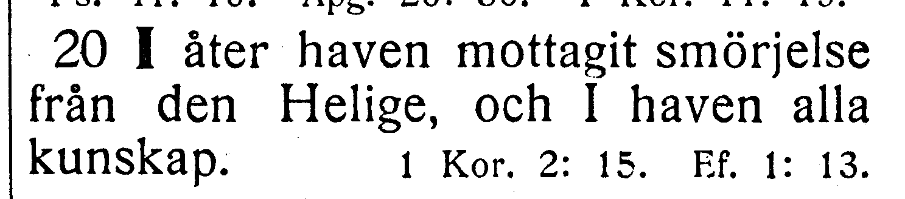

# NT-fotobunt 10: Petrusbreven, Johannesbreven och Judas brev

**Sparad 2026-10-26. Ingen åtgärd behövs nu.** Samtliga sex böcker är helt bildlästa: 16 kapitel och 324 versposter. Elva säkra rättelser R278–R288 införda i Petrus- och Johannesbreven. Femton kapitel är verifierade; ett kapitel väntar på frågan nedan. Andra och Tredje Johannesbrevet samt Judas brev har inga nya rättelser eller frågor. De sparade frågorna från tidigare böcker kvarstår separat.

När boken finns till hands räcker ett foto av hela versen med synligt versnummer. Ingen transkription eller egen diagnos behövs. Codex tolkar bilden och frågar bara om osäkerheten kvarstår. Utsnittet är direkt beskuret ur originalbilden, utan OCR eller rekonstruerade bokstäver.

| Fråga | Vers | Korpus / EFS 1927 |
| --- | --- | --- |
| [V152](#v152) | 1 Joh. 2:20 | I haven all kunskap / I haven alla kunskap |

## V152

**Första Johannesbrevet 2:20 — all / alla kunskap.**

**Korpustext:**

**2:20:** I åter haven mottagit smörjelse från den Helige, och I haven all kunskap.

Originalförstoringen visar tydligt **alla** i EFS 1927. Både ”I haven all kunskap” och ”I haven alla kunskap” är språkligt möjliga: allt vetande respektive alla mottagarna. Skillnaden kan därför inte avgöras som ett säkert OCR-fel från detta tryck ensamt.

**Foto till senare:** hela 2:20 med synligt versnummer. Orden och koordinaterna behålls tills ytterligare tryckstöd finns.

[Full sida, NT s. 379](https://runeberg.org/bibeln/efs1927/nt/0379.html). TIFF: `https://runeberg.org/img/bibeln/efs1927/nt/0379.1.tif`; SHA-256 `6e9603e3fec65eb2c59b3dce9aea45712c5f5d02029197e2ca33ace9302ae966`. Utsnittets SHA-256 `f7f9eeb16328cc5d4df46ede674b99b3d1317749f659b36b934a7ca4917c59cf`.

**Beslut:** öppet; inget rättelse-ID för frågan.
