# NT-fotobunt 11: Uppenbarelseboken

**Alla 25 frågor V153–V177 avgjorda 2026-10-27 mot [EFS 1926](../sv1917-efs1926-witnesses/README.md). Ingen fotobegäran återstår i denna bunt.** Hela Uppenbarelseboken är verifierad: 22 kapitel och 405 versposter. R333–R353 tillför 21 rättelser till tidigare R289–R320; fyra läsningar/gränser behålls. Tabellen visar jämförelsen före besluten; korpusverserna nedan är uppdaterade. Originalutsnitt, stabila V-ID och den tidigare osäkerhetens motivering bevaras. Fulla originalbilder från 1926 har visuellt jämförts; ingen OCR eller rekonstruerad bild används som läsningsbevis. V171 är kontrollerad med alla tre versnummer 18:22–24, V177 över båda sidorna 388–389. Evangeliernas frågor är separat arbete.

| Fråga | Vers | Korpus / EFS 1927 |
| --- | --- | --- |
| [V153](#v153), löst | Upp. 1:4 | frid från honom / frid ifrån honom |
| [V154](#v154), löst | Upp. 2:14 | en stötesten för Israels barn / en stötesten till fall för Israels barn |
| [V155](#v155), löst | Upp. 4:3 | såsom en smaragd / såsom smaragd |
| [V156](#v156), löst | Upp. 4:9 | och tillbedja honom som lever / och som lever |
| [V157](#v157), löst | Upp. 5:4 | befanns vara värdig / befanns värdig |
| [V158](#v158), löst | Upp. 6:4 | friden bort från jorden / friden bort ifrån jorden |
| [V159](#v159), löst | Upp. 6:11 | och åt dem blev tillsagt; giva sig till ro / och dem blev tillsagt; giva sig ro |
| [V160](#v160), löst | Upp. 6:12 | svart som en sorgdräkt / svart såsom en sorgdräkt |
| [V161](#v161), löst | Upp. 6:15 | och alla de rika / och de rika |
| [V162](#v162), löst | Upp. 7:8 | av Sabulons stam / av Sebulons stam |
| [V163](#v163), löst | Upp. 7:14 | du vet själv det / du själv vet det |
| [V164](#v164), löst | Upp. 8:3 | rökelse var given åt honom / rökelse blev given åt honom |
| [V165](#v165), löst | Upp. 8:10 | Då föll från himmelen / Då föll ifrån himmelen |
| [V166](#v166), löst | Upp. 9:17 | tedde sig för min syn / tedde sig för mig i min syn |
| [V167](#v167), löst | Upp. 14:1 | på Sions berg jämte det / på Sions berg och jämte det |
| [V168](#v168), löst | Upp. 15:8 | hade fått sin fullbordan / hade nått sin fullbordan |
| [V169](#v169), löst | Upp. 16:17 | ut från tronen i templet / ut ifrån tronen i templet |
| [V170](#v170), löst | Upp. 17:1 | kom och talade med mig / kom och talade till mig |
| [V171](#v171), löst | Upp. 18:22–24 | bullret i 18:22; trolldom i 18:23 / bullret börjar 18:23; trolldom börjar 18:24 |
| [V172](#v172), löst | Upp. 20:4 | och icke heller tagit dess märke / och icke hade tagit dess märke |
| [V173](#v173), löst | Upp. 20:8 | bo vid jordens fyra hörn / bo i jordens fyra hörn |
| [V174](#v174), löst | Upp. 21:5 | dessa ord äro visa och sanna / dessa ord äro vissa och sanna |
| [V175](#v175), löst | Upp. 21:15 | talade till mig / skadat tryck i talade till mig |
| [V176](#v176), löst | Upp. 22:1 | en ström med vatten / en ström med levande vatten |
| [V177](#v177), löst | Upp. 22:15 | de måste alla stanna därutanför / de måste stanna därutanför |

## V153

**Uppenbarelseboken 1:4 — frid från honom / frid ifrån honom.**

**Korpustext:**

**1:4:** Johannes hälsar de sju församlingarna i provinsen Asien. Nåd vare med eder och frid ifrån honom som är, och som var, och som skall komma, så ock från de sju andar, som stå inför hans tron,

**Komplettering:** hela berörda versen visuellt jämförd i EFS 1926; ingen fotobegäran återstår.

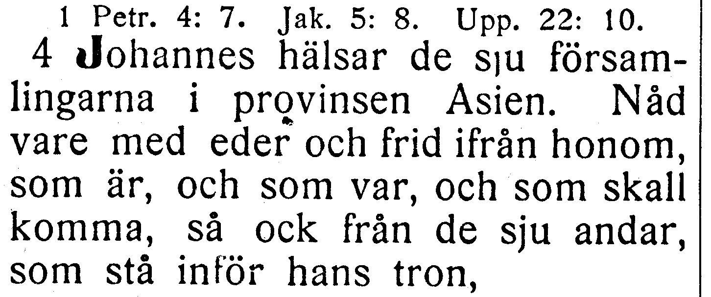

[Full sida, NT s. 393](https://runeberg.org/bibeln/efs1927/nt/0393.html). TIFF: `https://runeberg.org/img/bibeln/efs1927/nt/0393.1.tif`; SHA-256 `2f95f9bdbf39891ba82e1223876d820a3f8e2e30964c9b6d9d8379a7f829565c`. Utsnittets SHA-256 `b3a9976dba4303d3416b5ea4496ac85ec3126ee14366da716614cae7e0f97a49`.

**Beslut:** löst 2026-10-27. EFS 1926 och 1927 har båda frid ifrån honom. R333 rättar frid från honom till frid ifrån honom. Hela den berörda versen visuellt jämförd; övriga ord och koordinater behålls.

[Bevarad full originalbild från EFS 1926, NT s. 367](../sv1917-efs1926-witnesses/nt0367.jpg), SHA-256 `545a55335e286d96485a3cc25314aa9897c0c81af2308c35b056975f207982f2`. [Hämtningsadress](https://archive.org/download/bibelnellerdenhe0000unse/page/n1576.jpg).

## V154

**Uppenbarelseboken 2:14 — en stötesten för Israels barn / en stötesten till fall för Israels barn.**

**Korpustext:**

**2:14:** Men jag har något litet emot dig: du har hos dig några som hålla fast vid Balaams lära, hans som lärde Balak huru han skulle lägga en stötesten till fall för Israels barn, så att de skulle äta kött från avgudaoffer och bedriva otukt.

**Komplettering:** hela berörda versen visuellt jämförd i EFS 1926; ingen fotobegäran återstår.

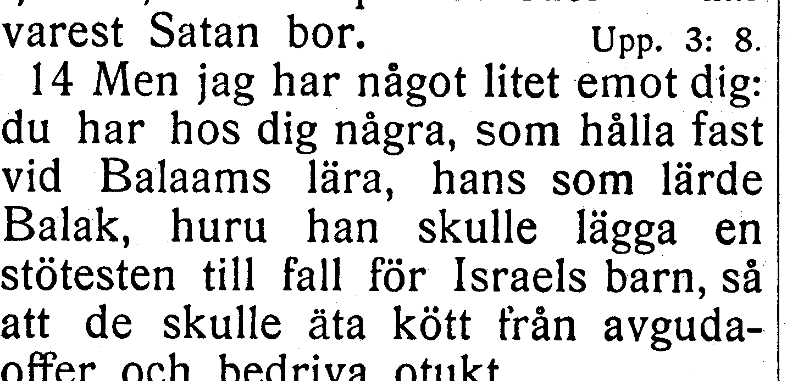

[Full sida, NT s. 395](https://runeberg.org/bibeln/efs1927/nt/0395.html). TIFF: `https://runeberg.org/img/bibeln/efs1927/nt/0395.1.tif`; SHA-256 `f3b4ba4292967e811c754b578a82094dc22feba0fdd7aeedbc9f07a43c581e8e`. Utsnittets SHA-256 `ba66cc074a02fe7253891955e0205a1501e121ef1b783247507a82af4473ac35`.

**Beslut:** löst 2026-10-27. EFS 1926 och 1927 har båda en stötesten till fall för Israels barn. R334 rättar en stötesten för Israels barn till en stötesten till fall för Israels barn. Hela den berörda versen visuellt jämförd; övriga ord och koordinater behålls.

[Bevarad full originalbild från EFS 1926, NT s. 369](../sv1917-efs1926-witnesses/nt0369.jpg), SHA-256 `5f533a6aa2da75cb1e494a07bac6fb41f2ecc63f2c9f25a343f972df344bac2a`. [Hämtningsadress](https://archive.org/download/bibelnellerdenhe0000unse/page/n1578.jpg).

## V155

**Uppenbarelseboken 4:3 — såsom en smaragd / såsom smaragd.**

**Korpustext:**

**4:3:** och han som satt därpå var till utseendet såsom jaspissten och karneol. Och runt omkring tronen gick en regnbåge, som till utseendet var såsom smaragd.

**Komplettering:** hela berörda versen visuellt jämförd i EFS 1926; ingen fotobegäran återstår.

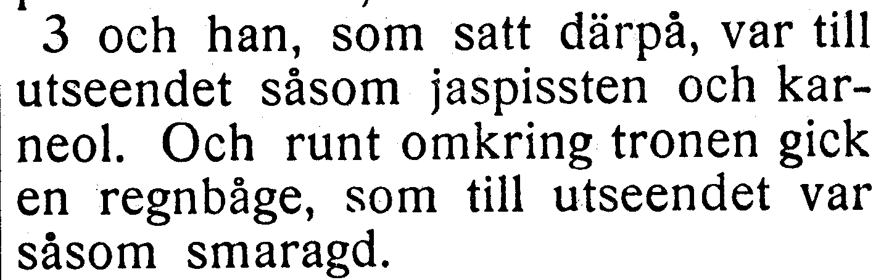

[Full sida, NT s. 397](https://runeberg.org/bibeln/efs1927/nt/0397.html). TIFF: `https://runeberg.org/img/bibeln/efs1927/nt/0397.1.tif`; SHA-256 `f8faf08abc6fbf1200d062d00a7a31357a1a73be2c5c9e846f91df1c0b504c1a`. Utsnittets SHA-256 `0a49032f758dd7231196b46cac5a842e5f933033ac64babbab893f21966acfe5`.

**Beslut:** löst 2026-10-27. EFS 1926 och 1927 har båda såsom smaragd. R335 rättar såsom en smaragd till såsom smaragd. Hela den berörda versen visuellt jämförd; övriga ord och koordinater behålls.

[Bevarad full originalbild från EFS 1926, NT s. 371](../sv1917-efs1926-witnesses/nt0371.jpg), SHA-256 `d552b4b6d0fc2238ee6c6703dd8aa1005ed2d21d579b8ee0a3c7f686c5804291`. [Hämtningsadress](https://archive.org/download/bibelnellerdenhe0000unse/page/n1580.jpg).

## V156

**Uppenbarelseboken 4:9 — och tillbedja honom som lever / och som lever.**

**Korpustext:**

**4:9:** Och när väsendena hembära pris och ära och tack åt honom som sitter på tronen och som lever i evigheternas evigheter,

**Komplettering:** hela berörda versen visuellt jämförd i EFS 1926; ingen fotobegäran återstår.

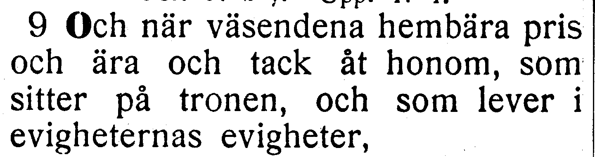

[Full sida, NT s. 398](https://runeberg.org/bibeln/efs1927/nt/0398.html). TIFF: `https://runeberg.org/img/bibeln/efs1927/nt/0398.1.tif`; SHA-256 `4321a4323923a76ab6bc67296e1e852ed275d7f7e988012d238777b571ce6e04`. Utsnittets SHA-256 `2309ec2fce804a606b9f3c9641c5442e7ba9926161cb813dc6e5df7801782df0`.

**Beslut:** löst 2026-10-27. EFS 1926 och 1927 har båda och som lever. R336 rättar och tillbedja honom som lever till och som lever. 1926 skiljer tydligt på 4:9, och som lever, och 4:10, och tillbedja honom som lever. Endast de extra orden i 4:9 tas bort; 4:10 behålls.

[Bevarad full originalbild från EFS 1926, NT s. 371](../sv1917-efs1926-witnesses/nt0371.jpg), SHA-256 `d552b4b6d0fc2238ee6c6703dd8aa1005ed2d21d579b8ee0a3c7f686c5804291`. [Hämtningsadress](https://archive.org/download/bibelnellerdenhe0000unse/page/n1580.jpg).

## V157

**Uppenbarelseboken 5:4 — befanns vara värdig / befanns värdig.**

**Korpustext:**

**5:4:** Och jag grät bittert över att ingen befanns värdig att öppna bokrullen eller se, vad som stod däri.

**Komplettering:** hela berörda versen visuellt jämförd i EFS 1926; ingen fotobegäran återstår.

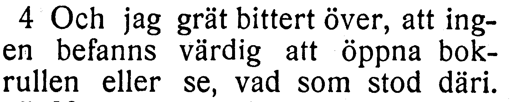

[Full sida, NT s. 398](https://runeberg.org/bibeln/efs1927/nt/0398.html). TIFF: `https://runeberg.org/img/bibeln/efs1927/nt/0398.1.tif`; SHA-256 `4321a4323923a76ab6bc67296e1e852ed275d7f7e988012d238777b571ce6e04`. Utsnittets SHA-256 `ac46df3189e5134814bf66ecfb6fc6f254a91d2cc73a584d4303274be7323c2d`.

**Beslut:** löst 2026-10-27. EFS 1926 och 1927 har båda befanns värdig. R337 rättar befanns vara värdig till befanns värdig. Hela den berörda versen visuellt jämförd; övriga ord och koordinater behålls.

[Bevarad full originalbild från EFS 1926, NT s. 372](../sv1917-efs1926-witnesses/nt0372.jpg), SHA-256 `9dd89f84c754991ef7607ea62dee6fc930c1931fb11f1cb588796f733100477b`. [Hämtningsadress](https://archive.org/download/bibelnellerdenhe0000unse/page/n1581.jpg).

## V158

**Uppenbarelseboken 6:4 — friden bort från jorden / friden bort ifrån jorden.**

**Korpustext:**

**6:4:** Då kom en annan häst fram, en som var röd; och åt mannen som satt på den blev givet att taga friden bort ifrån jorden, så att människorna skulle slakta varandra. Och ett stort svärd blev honom givet.

**Komplettering:** hela berörda versen visuellt jämförd i EFS 1926; ingen fotobegäran återstår.

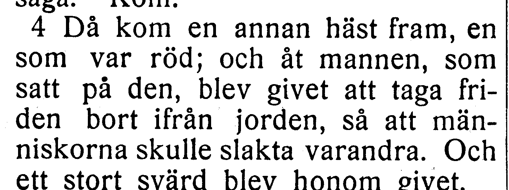

[Full sida, NT s. 399](https://runeberg.org/bibeln/efs1927/nt/0399.html). TIFF: `https://runeberg.org/img/bibeln/efs1927/nt/0399.1.tif`; SHA-256 `4245e13f007675bbe92073255e19812ca4d5bf7ea79ae281b38483ca0e1757be`. Utsnittets SHA-256 `d595ba6f4ff47356dda11e269375a5db7d615ee70eab4ba2d2ee6a903972c13a`.

**Beslut:** löst 2026-10-27. EFS 1926 och 1927 har båda friden bort ifrån jorden. R338 rättar friden bort från jorden till friden bort ifrån jorden. Hela den berörda versen visuellt jämförd; övriga ord och koordinater behålls.

[Bevarad full originalbild från EFS 1926, NT s. 372](../sv1917-efs1926-witnesses/nt0372.jpg), SHA-256 `9dd89f84c754991ef7607ea62dee6fc930c1931fb11f1cb588796f733100477b`. [Hämtningsadress](https://archive.org/download/bibelnellerdenhe0000unse/page/n1581.jpg).

## V159

**Uppenbarelseboken 6:11 — och åt dem blev tillsagt; giva sig till ro / och dem blev tillsagt; giva sig ro.**

**Korpustext:**

**6:11:** Och åt var och en av dem gavs en vit, fotsid klädnad, och dem blev tillsagt att de ännu en liten tid skulle giva sig ro, till dess jämväl skaran av deras medtjänare och bröder, som skulle bliva dräpta likasom de själva, hade blivit fulltalig.

Trycket saknar både åt före dem och till före ro. Båda korpusens fraser är språkligt möjliga; detta motiverade den första fotofrågan. Nu har även hela versen i EFS 1926 jämförts.

**Komplettering:** hela berörda versen visuellt jämförd i EFS 1926; ingen fotobegäran återstår.

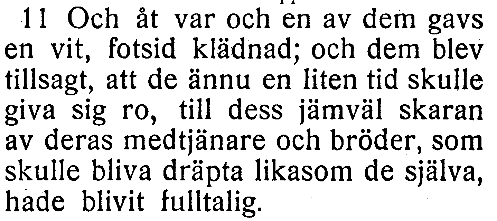

[Full sida, NT s. 399](https://runeberg.org/bibeln/efs1927/nt/0399.html). TIFF: `https://runeberg.org/img/bibeln/efs1927/nt/0399.1.tif`; SHA-256 `4245e13f007675bbe92073255e19812ca4d5bf7ea79ae281b38483ca0e1757be`. Utsnittets SHA-256 `44a10614163c7710b01bbe52288578c43714f83546c6fd0d968ab6e0aa2cda67`.

**Beslut:** löst 2026-10-27. EFS 1926 och 1927 har båda och dem blev tillsagt att de ännu en liten tid skulle giva sig ro. R339 rättar och åt dem blev tillsagt att de ännu en liten tid skulle giva sig till ro till och dem blev tillsagt att de ännu en liten tid skulle giva sig ro. Båda trycken saknar åt före dem och till före ro. Båda främmande orden tas bort i samma versbundna ersättning. Vanlig kommatering harmoniseras inte.

[Bevarad full originalbild från EFS 1926, NT s. 373](../sv1917-efs1926-witnesses/nt0373.jpg), SHA-256 `9847b752069c30bef2662cd1d26fb28f743025dd8e7765475987ab76e3409016`. [Hämtningsadress](https://archive.org/download/bibelnellerdenhe0000unse/page/n1582.jpg).

## V160

**Uppenbarelseboken 6:12 — svart som en sorgdräkt / svart såsom en sorgdräkt.**

**Korpustext:**

**6:12:** Och jag såg Lammet bryta det sjätte inseglet. Då blev det en stor jordbävning, och solen blev svart såsom en sorgdräkt, och månen blev hel och hållen såsom blod;

**Komplettering:** hela berörda versen visuellt jämförd i EFS 1926; ingen fotobegäran återstår.

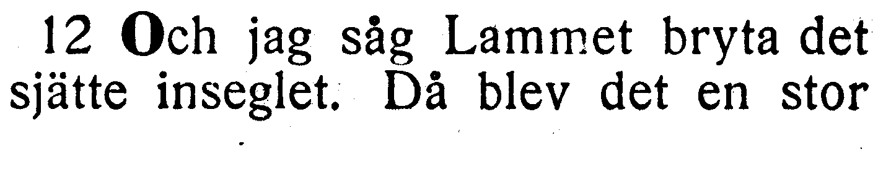

[Full sida, NT s. 399](https://runeberg.org/bibeln/efs1927/nt/0399.html). TIFF: `https://runeberg.org/img/bibeln/efs1927/nt/0399.1.tif`; SHA-256 `4245e13f007675bbe92073255e19812ca4d5bf7ea79ae281b38483ca0e1757be`. Utsnittets SHA-256 `b9ba6c1f6f2d2bacc28201a2791cda96c4577a3045f49c085412b5e409b5e392`.

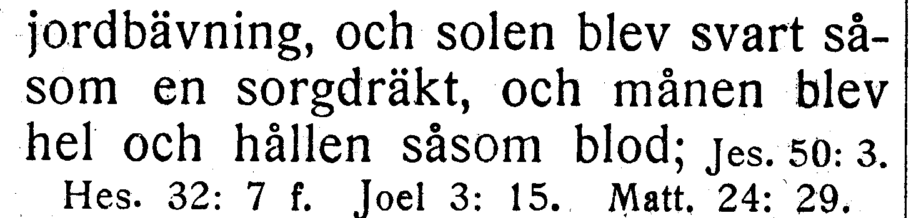

[Full sida, NT s. 400](https://runeberg.org/bibeln/efs1927/nt/0400.html). TIFF: `https://runeberg.org/img/bibeln/efs1927/nt/0400.1.tif`; SHA-256 `3124e17b52f708522dbecb3d2a8e9655492e79ca5fc93998a8fc4166c7c053e6`. Utsnittets SHA-256 `cbc86121bb3134eda844f06387f45586026388253c630cdc0d5b5100b5ab6432`.

**Beslut:** löst 2026-10-27. EFS 1926 och 1927 har båda svart såsom en sorgdräkt. R340 rättar svart som en sorgdräkt till svart såsom en sorgdräkt. Hela den berörda versen visuellt jämförd; övriga ord och koordinater behålls.

[Bevarad full originalbild från EFS 1926, NT s. 373](../sv1917-efs1926-witnesses/nt0373.jpg), SHA-256 `9847b752069c30bef2662cd1d26fb28f743025dd8e7765475987ab76e3409016`. [Hämtningsadress](https://archive.org/download/bibelnellerdenhe0000unse/page/n1582.jpg).

## V161

**Uppenbarelseboken 6:15 — och alla de rika / och de rika.**

**Korpustext:**

**6:15:** Och konungarna på jorden och stormännen och krigsöverstarna och de rika och de väldiga, ja, alla, både trälar och fria, dolde sig i hålor och bland bergsklippor.

**Komplettering:** hela berörda versen visuellt jämförd i EFS 1926; ingen fotobegäran återstår.

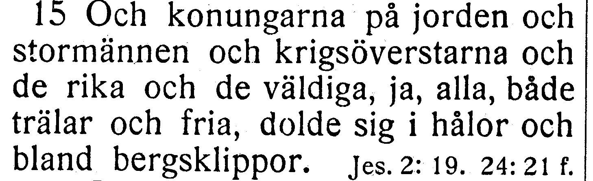

[Full sida, NT s. 400](https://runeberg.org/bibeln/efs1927/nt/0400.html). TIFF: `https://runeberg.org/img/bibeln/efs1927/nt/0400.1.tif`; SHA-256 `3124e17b52f708522dbecb3d2a8e9655492e79ca5fc93998a8fc4166c7c053e6`. Utsnittets SHA-256 `d6fbe9cbe9699dbc5695457a4f64907ea761fa9610063892a7968b7c7bf4e3b3`.

**Beslut:** löst 2026-10-27. EFS 1926 och 1927 har båda och de rika. R341 rättar och alla de rika till och de rika. Hela den berörda versen visuellt jämförd; övriga ord och koordinater behålls.

[Bevarad full originalbild från EFS 1926, NT s. 373](../sv1917-efs1926-witnesses/nt0373.jpg), SHA-256 `9847b752069c30bef2662cd1d26fb28f743025dd8e7765475987ab76e3409016`. [Hämtningsadress](https://archive.org/download/bibelnellerdenhe0000unse/page/n1582.jpg).

## V162

**Uppenbarelseboken 7:8 — av Sabulons stam / av Sebulons stam.**

**Korpustext:**

**7:8:** av Sabulons stam tolv tusen, av Josefs stam tolv tusen, av Benjamins stam tolv tusen tecknade.

**Komplettering:** hela berörda versen visuellt jämförd i EFS 1926; ingen fotobegäran återstår.

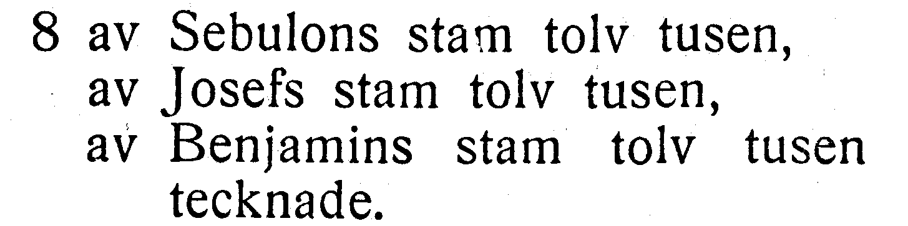

[Full sida, NT s. 400](https://runeberg.org/bibeln/efs1927/nt/0400.html). TIFF: `https://runeberg.org/img/bibeln/efs1927/nt/0400.1.tif`; SHA-256 `3124e17b52f708522dbecb3d2a8e9655492e79ca5fc93998a8fc4166c7c053e6`. Utsnittets SHA-256 `85402a3c6f94d28d874f8b8b66ce0bea40bb1c2a7b07ccbdcce418f06885bbb7`.

**Beslut:** löst 2026-10-27. EFS 1926 bekräftar Sabulons i korpusen mot EFS 1927:s Sebulons. Befintlig text behålls som belagd tryckvariant; inget rättelse-ID.

[Bevarad full originalbild från EFS 1926, NT s. 374](../sv1917-efs1926-witnesses/nt0374.jpg), SHA-256 `1dee566376d74fa66113f06bfca6879c8dd518b2dabce4320eaa790aeb924452`. [Hämtningsadress](https://archive.org/download/bibelnellerdenhe0000unse/page/n1583.jpg).

## V163

**Uppenbarelseboken 7:14 — du vet själv det / du själv vet det.**

**Korpustext:**

**7:14:** Jag svarade honom: »Min herre, du själv vet det.» Då sade han till mig: »Dessa äro de som komma ur den stora bedrövelsen, och som hava tvagit sina kläder och gjort dem vita i Lammets blod.

**Komplettering:** hela berörda versen visuellt jämförd i EFS 1926; ingen fotobegäran återstår.

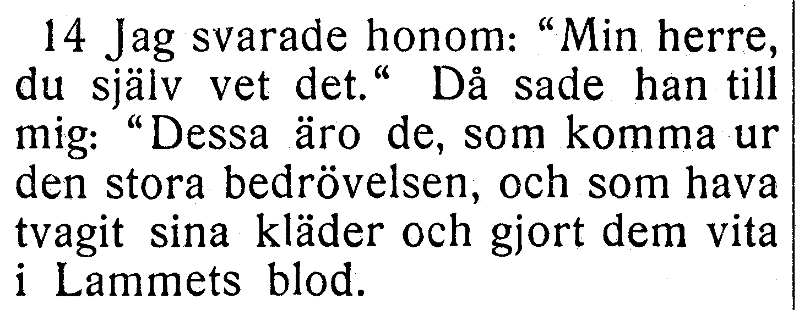

[Full sida, NT s. 401](https://runeberg.org/bibeln/efs1927/nt/0401.html). TIFF: `https://runeberg.org/img/bibeln/efs1927/nt/0401.1.tif`; SHA-256 `eeb96cda47153c626507d367a91c5e3fbd910c194cc6d2d9f27be318658e6f85`. Utsnittets SHA-256 `a623e6569ad4ce0e37396db17d3e3f790ecbf7ff69b013dae2fdfebb891db1e2`.

**Beslut:** löst 2026-10-27. EFS 1926 och 1927 har båda du själv vet det. R342 rättar du vet själv det till du själv vet det. Hela den berörda versen visuellt jämförd; övriga ord och koordinater behålls.

[Bevarad full originalbild från EFS 1926, NT s. 374](../sv1917-efs1926-witnesses/nt0374.jpg), SHA-256 `1dee566376d74fa66113f06bfca6879c8dd518b2dabce4320eaa790aeb924452`. [Hämtningsadress](https://archive.org/download/bibelnellerdenhe0000unse/page/n1583.jpg).

## V164

**Uppenbarelseboken 8:3 — rökelse var given åt honom / rökelse blev given åt honom.**

**Korpustext:**

**8:3:** Och en annan ängel kom och ställde sig vid altaret, och han hade ett gyllene rökelsekar; och mycken rökelse blev given åt honom, för att han skulle lägga den till alla de heligas böner på det gyllene altare som stod framför tronen.

**Komplettering:** hela berörda versen visuellt jämförd i EFS 1926; ingen fotobegäran återstår.

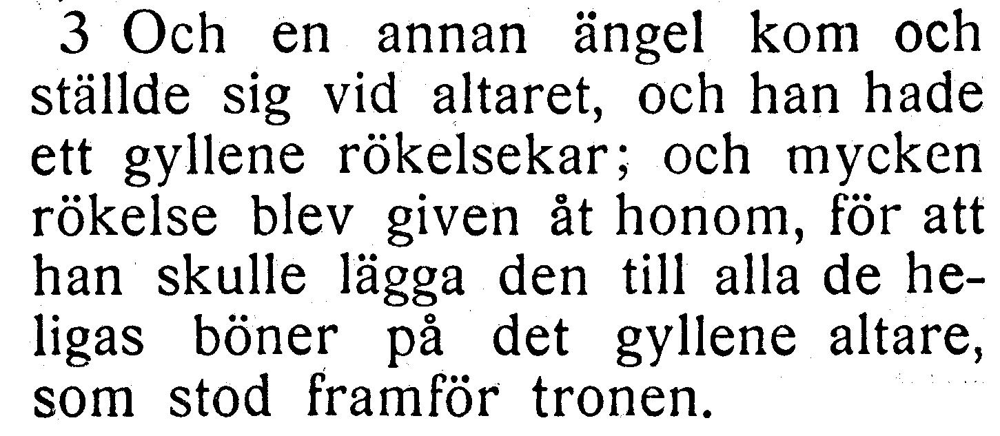

[Full sida, NT s. 401](https://runeberg.org/bibeln/efs1927/nt/0401.html). TIFF: `https://runeberg.org/img/bibeln/efs1927/nt/0401.1.tif`; SHA-256 `eeb96cda47153c626507d367a91c5e3fbd910c194cc6d2d9f27be318658e6f85`. Utsnittets SHA-256 `31e54c6e7e4ff18bfd90b31f4d9c7793f7f4513b8945b3ea6febe5be0c0227a3`.

**Beslut:** löst 2026-10-27. EFS 1926 och 1927 har båda rökelse blev given åt honom. R343 rättar rökelse var given åt honom till rökelse blev given åt honom. Hela den berörda versen visuellt jämförd; övriga ord och koordinater behålls.

[Bevarad full originalbild från EFS 1926, NT s. 374](../sv1917-efs1926-witnesses/nt0374.jpg), SHA-256 `1dee566376d74fa66113f06bfca6879c8dd518b2dabce4320eaa790aeb924452`. [Hämtningsadress](https://archive.org/download/bibelnellerdenhe0000unse/page/n1583.jpg).

## V165

**Uppenbarelseboken 8:10 — Då föll från himmelen / Då föll ifrån himmelen.**

**Korpustext:**

**8:10:** Och den tredje ängeln stötte i sin basun. Då föll ifrån himmelen en stor stjärna, brinnande såsom ett bloss; och den föll ned över tredjedelen av strömmarna och över vattenkällorna.

**Komplettering:** hela berörda versen visuellt jämförd i EFS 1926; ingen fotobegäran återstår.

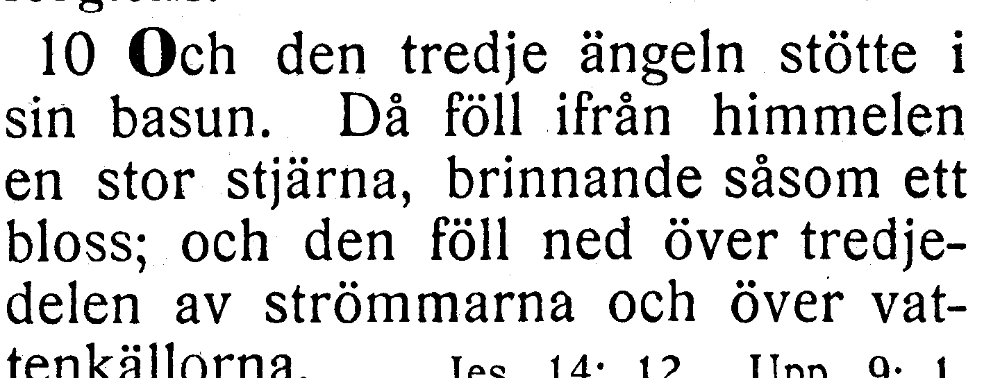

[Full sida, NT s. 401](https://runeberg.org/bibeln/efs1927/nt/0401.html). TIFF: `https://runeberg.org/img/bibeln/efs1927/nt/0401.1.tif`; SHA-256 `eeb96cda47153c626507d367a91c5e3fbd910c194cc6d2d9f27be318658e6f85`. Utsnittets SHA-256 `e44dc2bb1c7eac95fc3fd4c9c7edd3857baa0d37ac3be5ffdc1837ee8a47db97`.

**Beslut:** löst 2026-10-27. EFS 1926 och 1927 har båda Då föll ifrån himmelen. R344 rättar Då föll från himmelen till Då föll ifrån himmelen. Hela den berörda versen visuellt jämförd; övriga ord och koordinater behålls.

[Bevarad full originalbild från EFS 1926, NT s. 375](../sv1917-efs1926-witnesses/nt0375.jpg), SHA-256 `f5514bc9517e709462d7540d3d5ceb54bd8d23d71232380bf703d2f3497a4527`. [Hämtningsadress](https://archive.org/download/bibelnellerdenhe0000unse/page/n1584.jpg).

## V166

**Uppenbarelseboken 9:17 — tedde sig för min syn / tedde sig för mig i min syn.**

**Korpustext:**

**9:17:** Och hästarna och männen som sutto på dem tedde sig för mig i min syn på detta sätt: männen hade eldröda och mörkblå och svavelgula pansar; och hästarna hade huvuden såsom lejon, och ur deras gap gick ut eld och rök och svavel.

**Komplettering:** hela berörda versen visuellt jämförd i EFS 1926; ingen fotobegäran återstår.

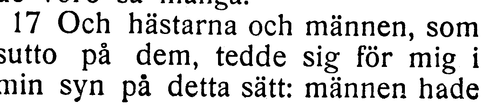

[Full sida, NT s. 402](https://runeberg.org/bibeln/efs1927/nt/0402.html). TIFF: `https://runeberg.org/img/bibeln/efs1927/nt/0402.1.tif`; SHA-256 `095e5bffe75181f96fb154110f19431d01f386970af17d6c26bf14fc4c0dd557`. Utsnittets SHA-256 `2a237d3556671238737f1c270cb74146d0495c6d618f15f3d3bd795fcd216c27`.

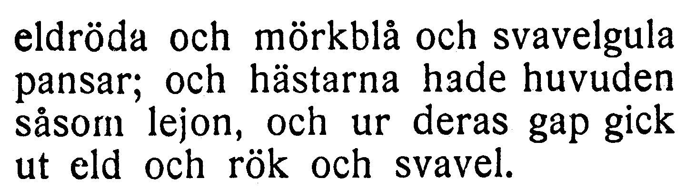

[Full sida, NT s. 403](https://runeberg.org/bibeln/efs1927/nt/0403.html). TIFF: `https://runeberg.org/img/bibeln/efs1927/nt/0403.1.tif`; SHA-256 `06194d9700a4a3a2d7ce32dfb029d1723fafed35f7e767a125119808bd032a8a`. Utsnittets SHA-256 `84c08a85a13966c47af17f44decd2b2b5295b70e907f930e878bdf79267422a3`.

**Beslut:** löst 2026-10-27. EFS 1926 och 1927 har båda tedde sig för mig i min syn. R345 rättar tedde sig för min syn till tedde sig för mig i min syn. Hela den berörda versen visuellt jämförd; övriga ord och koordinater behålls.

[Bevarad full originalbild från EFS 1926, NT s. 376](../sv1917-efs1926-witnesses/nt0376.jpg), SHA-256 `93eba43b4c372c16223b03292da805e448d89cfeb38b4855d4f71d77dfc9c36c`. [Hämtningsadress](https://archive.org/download/bibelnellerdenhe0000unse/page/n1585.jpg).

## V167

**Uppenbarelseboken 14:1 — på Sions berg jämte det / på Sions berg och jämte det.**

**Korpustext:**

**14:1:** Och jag fick se Lammet stå på Sions berg och jämte det ett hundra fyrtiofyra tusen som hade dess namn och dess Faders namn skrivna på sina pannor.

**Komplettering:** hela berörda versen visuellt jämförd i EFS 1926; ingen fotobegäran återstår.

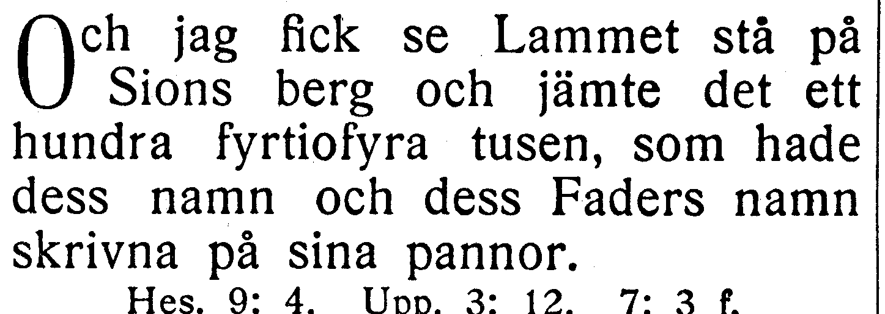

[Full sida, NT s. 407](https://runeberg.org/bibeln/efs1927/nt/0407.html). TIFF: `https://runeberg.org/img/bibeln/efs1927/nt/0407.1.tif`; SHA-256 `d6352cba096ce3c11b4f09cc6b4922b9670220898e9c19ccef3fd12604b80ec8`. Utsnittets SHA-256 `688d1ad939e20eb83729f51bc8108a8b86f1b02f6234ab855a42a24aa5f16c1d`.

**Beslut:** löst 2026-10-27. EFS 1926 och 1927 har båda på Sions berg och jämte det. R346 rättar på Sions berg jämte det till på Sions berg och jämte det. Hela den berörda versen visuellt jämförd; övriga ord och koordinater behålls.

[Bevarad full originalbild från EFS 1926, NT s. 379](../sv1917-efs1926-witnesses/nt0379.jpg), SHA-256 `379ae1080047b3ec126da1405dc03f1ad07f2f29b8a056aad59e83f15d56eed7`. [Hämtningsadress](https://archive.org/download/bibelnellerdenhe0000unse/page/n1588.jpg).

## V168

**Uppenbarelseboken 15:8 — hade fått sin fullbordan / hade nått sin fullbordan.**

**Korpustext:**

**15:8:** Och templet blev uppfyllt av rök från Guds härlighet och från hans makt, och ingen kunde gå in i templet, förrän de sju änglarnas sju plågor hade nått sin fullbordan.

**Komplettering:** hela berörda versen visuellt jämförd i EFS 1926; ingen fotobegäran återstår.

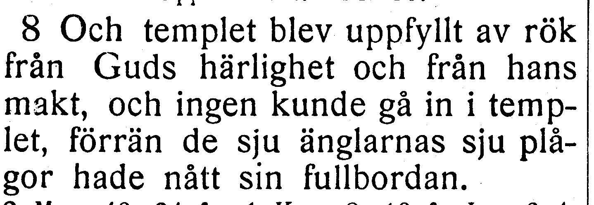

[Full sida, NT s. 409](https://runeberg.org/bibeln/efs1927/nt/0409.html). TIFF: `https://runeberg.org/img/bibeln/efs1927/nt/0409.1.tif`; SHA-256 `a9450fe2616638a4ce0dbc2fbb6ffc1bc61e485d5dd771a8edfd35fbcba35477`. Utsnittets SHA-256 `0454a02eb0d631d2ed0067206ddad25d45793ed0da5d984434adff56ccec01d7`.

**Beslut:** löst 2026-10-27. EFS 1926 och 1927 har båda hade nått sin fullbordan. R347 rättar hade fått sin fullbordan till hade nått sin fullbordan. Hela den berörda versen visuellt jämförd; övriga ord och koordinater behålls.

[Bevarad full originalbild från EFS 1926, NT s. 381](../sv1917-efs1926-witnesses/nt0381.jpg), SHA-256 `2d276a6432caa4ece3f69f3d50534cab3bafe29e830f072afa160045f4662fe7`. [Hämtningsadress](https://archive.org/download/bibelnellerdenhe0000unse/page/n1590.jpg).

## V169

**Uppenbarelseboken 16:17 — ut från tronen i templet / ut ifrån tronen i templet.**

**Korpustext:**

**16:17:** Och den sjunde göt ut sin skål i luften. Då gick en stark röst ut ifrån tronen i templet och sade: »Det är gjort.»

**Komplettering:** hela berörda versen visuellt jämförd i EFS 1926; ingen fotobegäran återstår.

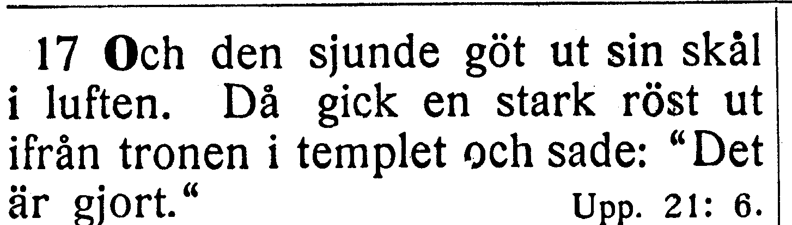

[Full sida, NT s. 410](https://runeberg.org/bibeln/efs1927/nt/0410.html). TIFF: `https://runeberg.org/img/bibeln/efs1927/nt/0410.1.tif`; SHA-256 `e9c5da17af82d2a62bb4f0634ced58598f9d47fcb0ba19d2db35c067d64af2a0`. Utsnittets SHA-256 `e8e9e13bb263056c80e0e41c1dd0a706ccc3274237a22b546b4742ee956ab754`.

**Beslut:** löst 2026-10-27. EFS 1926 och 1927 har båda ut ifrån tronen i templet. R348 rättar ut från tronen i templet till ut ifrån tronen i templet. Den tidigare R311, kolon före Det är gjort, bevaras i samma versbundna ersättning.

[Bevarad full originalbild från EFS 1926, NT s. 382](../sv1917-efs1926-witnesses/nt0382.jpg), SHA-256 `8a3a4fecb578b279f4c78558e76892b07ec16c55581ffb34f43dfb2836e5ecaa`. [Hämtningsadress](https://archive.org/download/bibelnellerdenhe0000unse/page/n1591.jpg).

## V170

**Uppenbarelseboken 17:1 — kom och talade med mig / kom och talade till mig.**

**Korpustext:**

**17:1:** Och en av de sju änglarna med de sju skålarna kom och talade till mig och sade: »Kom hit, så skall jag visa dig, huru den stora skökan får sin dom, hon som tronar vid stora vatten,

**Komplettering:** hela berörda versen visuellt jämförd i EFS 1926; ingen fotobegäran återstår.

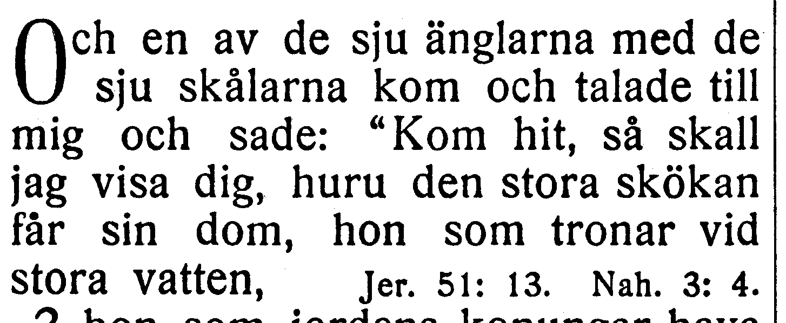

[Full sida, NT s. 410](https://runeberg.org/bibeln/efs1927/nt/0410.html). TIFF: `https://runeberg.org/img/bibeln/efs1927/nt/0410.1.tif`; SHA-256 `e9c5da17af82d2a62bb4f0634ced58598f9d47fcb0ba19d2db35c067d64af2a0`. Utsnittets SHA-256 `016efa0bfc02952c0905cf9284bd02b7db8c932cd7cf1359f5c29f8a36b60a85`.

**Beslut:** löst 2026-10-27. EFS 1926 och 1927 har båda kom och talade till mig. R349 rättar kom och talade med mig till kom och talade till mig. Hela den berörda versen visuellt jämförd; övriga ord och koordinater behålls.

[Bevarad full originalbild från EFS 1926, NT s. 382](../sv1917-efs1926-witnesses/nt0382.jpg), SHA-256 `8a3a4fecb578b279f4c78558e76892b07ec16c55581ffb34f43dfb2836e5ecaa`. [Hämtningsadress](https://archive.org/download/bibelnellerdenhe0000unse/page/n1591.jpg).

## V171

**Uppenbarelseboken 18:22–24 — bullret i 18:22; trolldom i 18:23 / bullret börjar 18:23; trolldom börjar 18:24.**

**Korpustext:**

**18:22:** Av harpospelare och sångare, av flöjtblåsare och basunblåsare skall aldrig mer något ljud bliva hört i dig; aldrig mer skall någon konstförfaren man av något slags yrke finnas i dig; bullret av en kvarn skall aldrig mer höras i dig;

**18:23:** en lampas sken skall aldrig mer lysa i dig; rop för brudgum och brud skall aldrig mer höras i dig – du vars köpmän voro stormän på jorden, du genom vars trolldom alla folk blevo förvillade,

**18:24:** och i vilken man såg profeters och heliga mäns blod, ja, alla de människors blod, som hade blivit slaktade på jorden.»

Tryckets 18:23 börjar med bullret av en kvarn och 18:24 med du genom vars trolldom. Korpusen placerar dessa fraser sist i föregående vers. Ingen text flyttas och inga mappningar ändras före bedömning av ett annat tryck.

**Komplettering:** hela berörda versen visuellt jämförd i EFS 1926; ingen fotobegäran återstår.

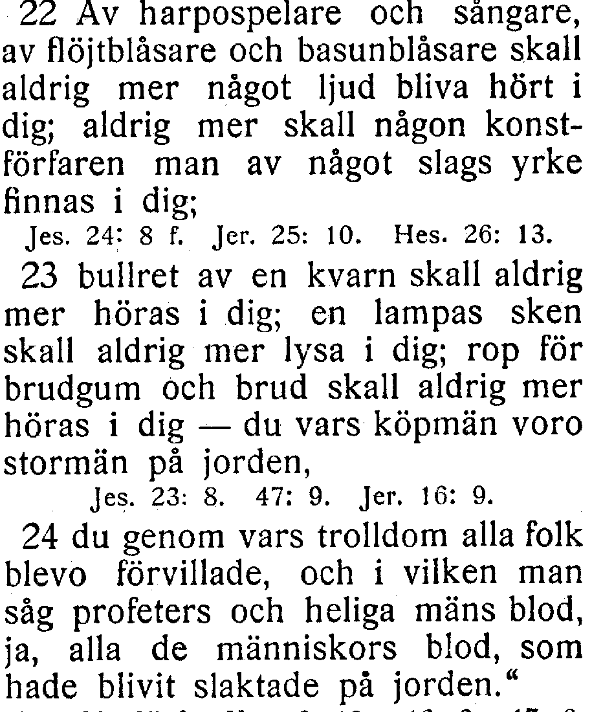

[Full sida, NT s. 412](https://runeberg.org/bibeln/efs1927/nt/0412.html). TIFF: `https://runeberg.org/img/bibeln/efs1927/nt/0412.1.tif`; SHA-256 `20167442da925ac5c1f1f7fd8d34717cf6b25329dcfa1b0eeaeb5bf7d55d6e7e`. Utsnittets SHA-256 `c2bbb6bd37b26845525a006804ec5a0a2697f8db335a10eb3ca5dfa85df4e49d`.

**Beslut:** löst 2026-10-27. Hela 18:22–24, med alla tre versnummer, jämförd på EFS 1926 NT s. 384. Bullret av en kvarn ligger i 18:22 och du genom vars trolldom i 18:23, som i korpusen. EFS 1927 flyttar båda gränserna. Samtliga ord och koordinater behålls som belagd tryckvariant. Vershashen avser 18:22; kapitelhashen låser även 18:23–24.

[Bevarad full originalbild från EFS 1926, NT s. 384](../sv1917-efs1926-witnesses/nt0384.jpg), SHA-256 `c1a6b2b7b9da8d1922cb19ee02f7fbbafdbce869a7eb3a674d5af1cf16fbb3fd`. [Hämtningsadress](https://archive.org/download/bibelnellerdenhe0000unse/page/n1593.jpg).

## V172

**Uppenbarelseboken 20:4 — och icke heller tagit dess märke / och icke hade tagit dess märke.**

**Korpustext:**

**20:4:** Och jag såg troner stå där, och de satte sig på dem, de åt vilka gavs makt att hålla dom. Och jag såg de människors själar, som hade blivit halshuggna för Jesu vittnesbörds och Guds Ords skull, och som icke hade tillbett vilddjuret eller dess bild, och icke hade tagit dess märke på sina pannor och sina händer; dessa blevo nu åter levande och fingo regera med Kristus i tusen år.

**Komplettering:** hela berörda versen visuellt jämförd i EFS 1926; ingen fotobegäran återstår.

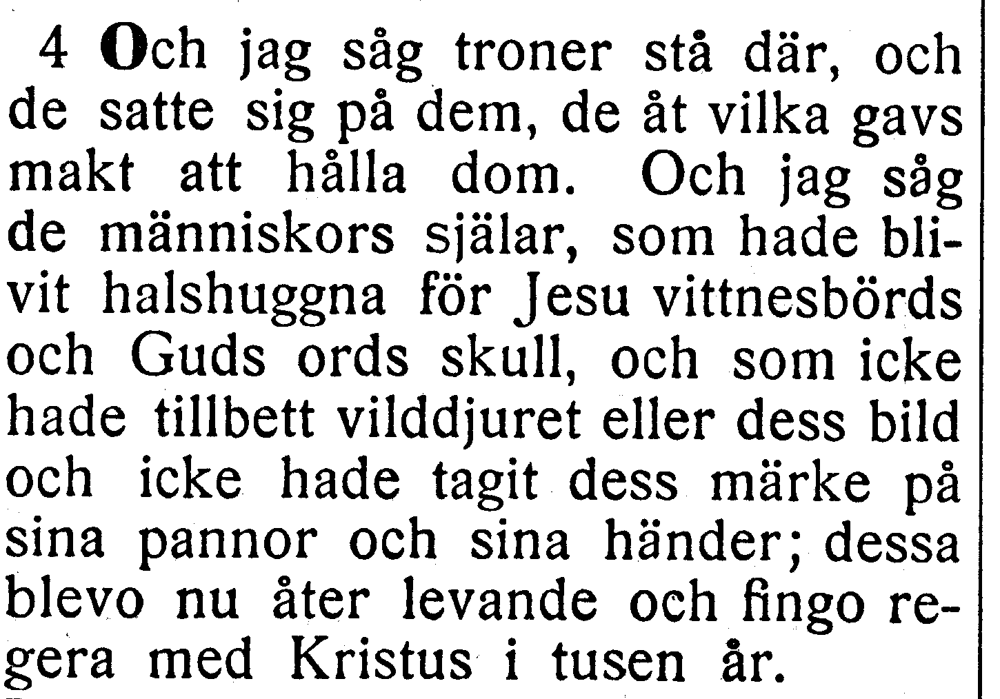

[Full sida, NT s. 414](https://runeberg.org/bibeln/efs1927/nt/0414.html). TIFF: `https://runeberg.org/img/bibeln/efs1927/nt/0414.1.tif`; SHA-256 `8795e78479e4d96c29546563c13c90a9737dd7d31ad5f747257bf4f1daacb762`. Utsnittets SHA-256 `41fe3d496c9c411cc447695c0898a4499a1cc223b59f778aae9a2df2b4e3d504`.

**Beslut:** löst 2026-10-27. EFS 1926 och 1927 har båda och icke hade tagit dess märke. R350 rättar och icke heller tagit dess märke till och icke hade tagit dess märke. Hela den berörda versen visuellt jämförd; övriga ord och koordinater behålls.

[Bevarad full originalbild från EFS 1926, NT s. 386](../sv1917-efs1926-witnesses/nt0386.jpg), SHA-256 `40d2e6a8fe54b464d93e2b4bb84b4f0c1f61c45ba75b465c44673c9b0d8da7c9`. [Hämtningsadress](https://archive.org/download/bibelnellerdenhe0000unse/page/n1595.jpg).

## V173

**Uppenbarelseboken 20:8 — bo vid jordens fyra hörn / bo i jordens fyra hörn.**

**Korpustext:**

**20:8:** Han skall då gå ut för att förvilla de folk som bo vid jordens fyra hörn, Gog och Magog, och samla dem till den stundande striden; och de äro till antalet såsom sanden i havet.

**Komplettering:** hela berörda versen visuellt jämförd i EFS 1926; ingen fotobegäran återstår.

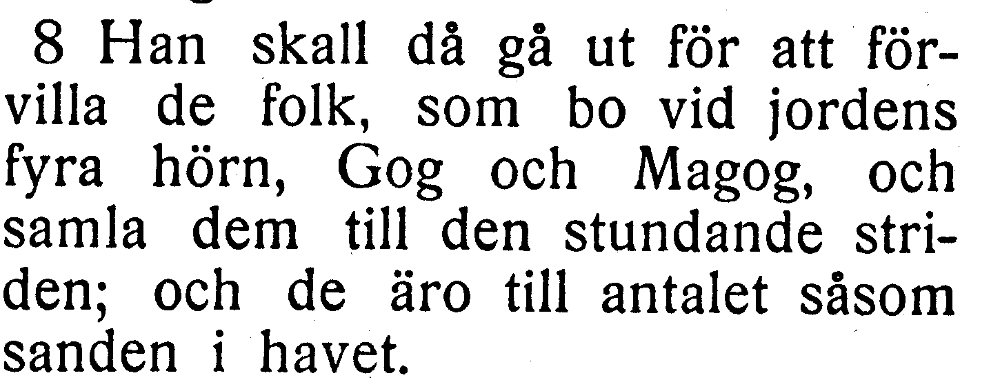

[Full sida, NT s. 414](https://runeberg.org/bibeln/efs1927/nt/0414.html). TIFF: `https://runeberg.org/img/bibeln/efs1927/nt/0414.1.tif`; SHA-256 `8795e78479e4d96c29546563c13c90a9737dd7d31ad5f747257bf4f1daacb762`. Utsnittets SHA-256 `190f0b198a320eb2771e9bd2432abdaf27b9aef6ff074a383fdf551316ecd51c`.

**Beslut:** löst 2026-10-27. EFS 1926 bekräftar korpusens bo vid jordens fyra hörn mot EFS 1927:s bo i jordens fyra hörn. Texten behålls som belagd tryckvariant; inget rättelse-ID.

[Bevarad full originalbild från EFS 1926, NT s. 386](../sv1917-efs1926-witnesses/nt0386.jpg), SHA-256 `40d2e6a8fe54b464d93e2b4bb84b4f0c1f61c45ba75b465c44673c9b0d8da7c9`. [Hämtningsadress](https://archive.org/download/bibelnellerdenhe0000unse/page/n1595.jpg).

## V174

**Uppenbarelseboken 21:5 — dessa ord äro visa och sanna / dessa ord äro vissa och sanna.**

**Korpustext:**

**21:5:** Och han som satt på tronen sade: »Se, jag gör allting nytt.» Ytterligare sade han: »Skriv: ty dessa ord äro vissa och sanna.»

Originalbilden har vissa, men visa och sanna ord är också språkligt möjligt. Samma trycks vissa i 22:6 avgör inte ensam ordalydelsen i 21:5.

**Komplettering:** hela berörda versen visuellt jämförd i EFS 1926; ingen fotobegäran återstår.

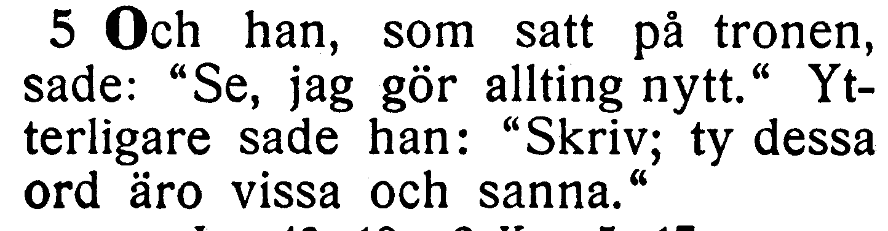

[Full sida, NT s. 415](https://runeberg.org/bibeln/efs1927/nt/0415.html). TIFF: `https://runeberg.org/img/bibeln/efs1927/nt/0415.1.tif`; SHA-256 `f721551b68f673e9f79f845c848bee720c5637528d22590418ea8d5d32259b62`. Utsnittets SHA-256 `063d3baa6a49c497069103d9be98bebf48925fd882b5f34c0b7f2c7828fee7a0`.

**Beslut:** löst 2026-10-27. EFS 1926 och 1927 har båda dessa ord äro vissa och sanna. R351 rättar dessa ord äro visa och sanna till dessa ord äro vissa och sanna. Hela den berörda versen visuellt jämförd; övriga ord och koordinater behålls.

[Bevarad full originalbild från EFS 1926, NT s. 387](../sv1917-efs1926-witnesses/nt0387.jpg), SHA-256 `ceebab5df986cdde2ce48609a1a123960b15618df49817671d5aa82a48a3824a`. [Hämtningsadress](https://archive.org/download/bibelnellerdenhe0000unse/page/n1596.jpg).

## V175

**Uppenbarelseboken 21:15 — talade till mig / skadat tryck i talade till mig.**

**Korpustext:**

**21:15:** Och han som talade till mig hade en gyllene mätstång för att därmed mäta staden och dess portar och dess mur.

Trycksvärtan saknas i delar av talade. Resten av versen går att läsa och stämmer. Detta motiverade den första fotofrågan. Nu bekräftar tydligt tryck i EFS 1926 hela ordet.

**Komplettering:** hela berörda versen visuellt jämförd i EFS 1926; ingen fotobegäran återstår.

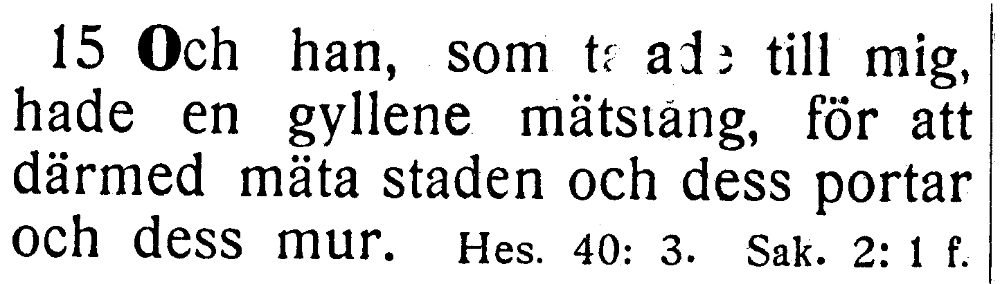

[Full sida, NT s. 416](https://runeberg.org/bibeln/efs1927/nt/0416.html). TIFF: `https://runeberg.org/img/bibeln/efs1927/nt/0416.1.tif`; SHA-256 `7a874d361c79f64908b17b82edf164ac5adea8ae3ebc66ebfc98ba1f70a4025d`. Utsnittets SHA-256 `a881cc1f614c1930bf9ba338c674afe188adc904dd5b127153e1a6d24b1ca725`.

**Beslut:** löst 2026-10-27. EFS 1926 har tydligt hela talade till mig. De skadade bokstavsdelarna i EFS 1927 kräver ingen gissad rekonstruktion. Korpusens text behålls; inget rättelse-ID.

[Bevarad full originalbild från EFS 1926, NT s. 387](../sv1917-efs1926-witnesses/nt0387.jpg), SHA-256 `ceebab5df986cdde2ce48609a1a123960b15618df49817671d5aa82a48a3824a`. [Hämtningsadress](https://archive.org/download/bibelnellerdenhe0000unse/page/n1596.jpg).

## V176

**Uppenbarelseboken 22:1 — en ström med vatten / en ström med levande vatten.**

**Korpustext:**

**22:1:** Och han visade mig en ström med levande vatten, klar som kristall. Den gick ut från Guds och Lammets tron

**Komplettering:** hela berörda versen visuellt jämförd i EFS 1926; ingen fotobegäran återstår.

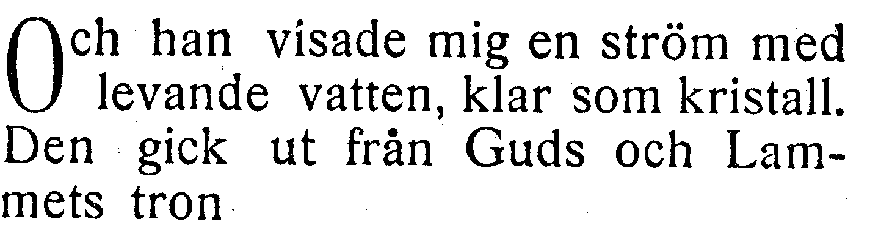

[Full sida, NT s. 416](https://runeberg.org/bibeln/efs1927/nt/0416.html). TIFF: `https://runeberg.org/img/bibeln/efs1927/nt/0416.1.tif`; SHA-256 `7a874d361c79f64908b17b82edf164ac5adea8ae3ebc66ebfc98ba1f70a4025d`. Utsnittets SHA-256 `6e084d9fdad3ccf529dd653d50fbd2ff39a57732bf7466112232e9f2762104ec`.

**Beslut:** löst 2026-10-27. EFS 1926 och 1927 har båda en ström med levande vatten. R352 rättar en ström med vatten till en ström med levande vatten. Hela den berörda versen visuellt jämförd; övriga ord och koordinater behålls.

[Bevarad full originalbild från EFS 1926, NT s. 388](../sv1917-efs1926-witnesses/nt0388.jpg), SHA-256 `06fde2f8ae281aed18c10f3a350f9d2f5d9493497d2f504a2b0fbd27709e6e3d`. [Hämtningsadress](https://archive.org/download/bibelnellerdenhe0000unse/page/n1597.jpg).

## V177

**Uppenbarelseboken 22:15 — de måste alla stanna därutanför / de måste stanna därutanför.**

**Korpustext:**

**22:15:** Men de som äro hundar och trollkarlar och otuktiga och dråpare och avgudadyrkare och alla som älska och göra lögn, de måste stanna därutanför.»

**Komplettering:** hela berörda versen visuellt jämförd i EFS 1926; ingen fotobegäran återstår.

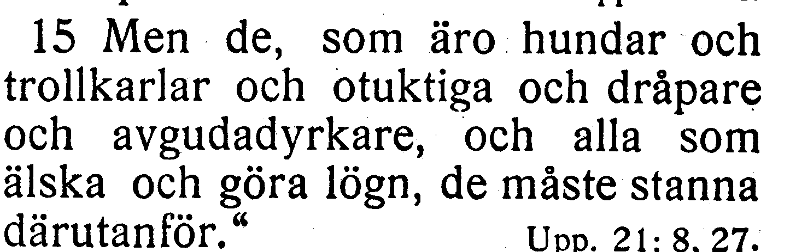

[Full sida, NT s. 417](https://runeberg.org/bibeln/efs1927/nt/0417.html). TIFF: `https://runeberg.org/img/bibeln/efs1927/nt/0417.1.tif`; SHA-256 `b05892239599bfdfcf9ede7bb17db214ebc548dd846816a6f75b9c337a1e65c5`. Utsnittets SHA-256 `a8834e0543ef70d264a57fb21192f87616641b2b375375fd1887ec84a28828ac`.

**Beslut:** löst 2026-10-27. EFS 1926 och 1927 har båda de måste stanna därutanför. R353 rättar de måste alla stanna därutanför till de måste stanna därutanför. Hela 22:15 jämförd över sidgränsen NT s. 388–389; båda fullbilderna bevarade. Det första alla, före som älska, behålls. Endast det extra alla efter de måste tas bort.

[Bevarad full originalbild från EFS 1926, NT s. 389](../sv1917-efs1926-witnesses/nt0389.jpg), SHA-256 `e96cf226d11823b50e0b039be95d74923b923c341e0a6c8c0afd17cf4286a76d`. [Hämtningsadress](https://archive.org/download/bibelnellerdenhe0000unse/page/n1598.jpg). [Versens början på föregående sida, NT s. 388](../sv1917-efs1926-witnesses/nt0388.jpg), med hash i vittnesförteckningen och liggarens källnot.
