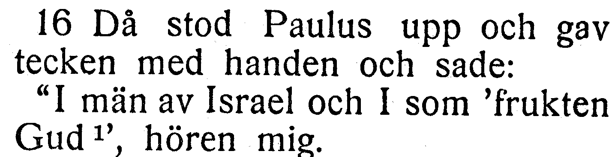
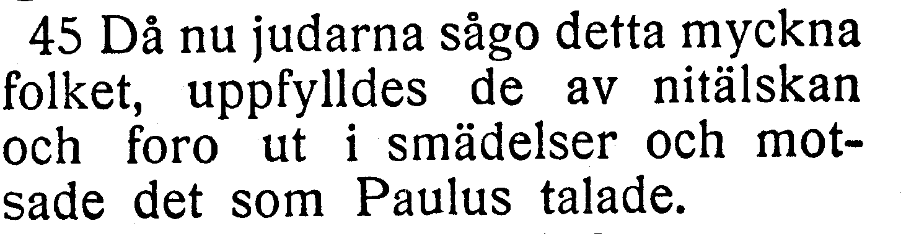
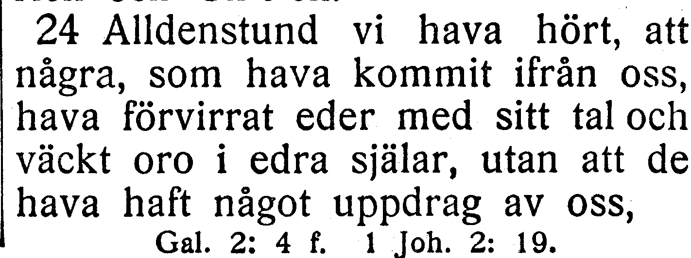
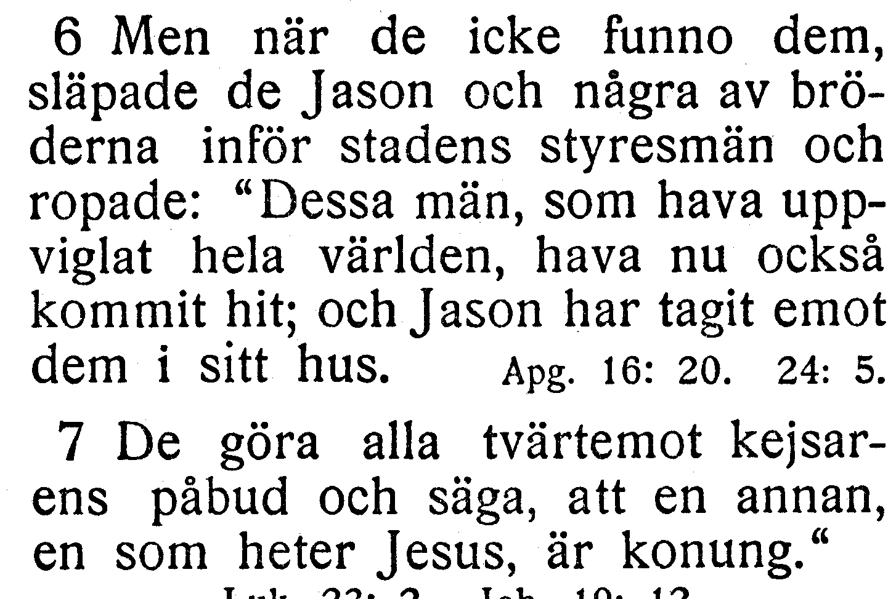
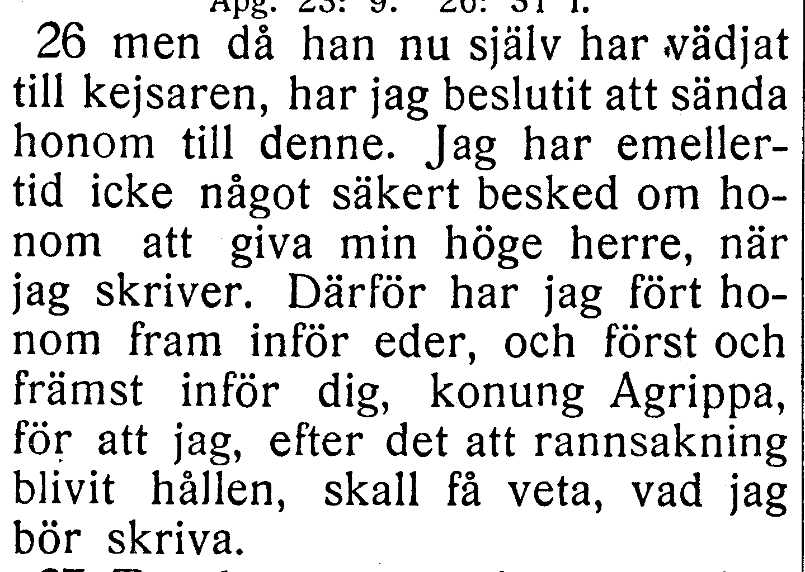

# NT-fotobunt 2: Apostlagärningarna 13–28

**Sparad 2026-10-26. Ingen åtgärd behövs nu.** Fem nya frågor i fyra helt bildlästa kapitel väntar på ett annat tryck. Detta är inte fem fastställda fel. Kapitel 13, 15, 17 och 25 står som `needs-review`; de övriga tolv kapitlen i blocket är verifierade efter separata säkra rättelser. [Tidigare frågor i Apg. 1–12](batch-1.md) återstår också.

När boken finns till hands räcker foton av hela verserna med synliga versnummer. Ingen transkription eller egen diagnos behövs. Codex tolkar bilderna och frågar bara om osäkerheten kvarstår. **V131 behöver både 17:6 och 17:7 med synliga versnummer**, eftersom frågan gäller gränsen mellan dem. Närliggande verser får samlas i samma foto. Originalupplösningen är redan kontrollerad; Myrra i 27:5 och kvar i 24:27 bekräftades där utan ny fotofråga.

Korpustexten nedan är aktuell efter separata rättelser, även R223 (citatavslut i 17:7) och R241 (främmande semikolon i 25:26). Frågornas ord och alla verskoordinater behålls tills ytterligare tryck har bedömts. Utsnitten är direkt beskurna originalbilder, utan OCR eller rekonstruerade bokstäver.

| Fråga | Vers | Korpus / EFS 1927 |
| --- | --- | --- |
| [V128](#v128) | Apg. 13:16 | I män av Israels hus / I män av Israel |
| [V129](#v129) | Apg. 13:45 | det myckna folket / detta myckna folket |
| [V130](#v130) | Apg. 15:24 | kommit från oss / kommit ifrån oss |
| [V131](#v131) | Apg. 17:6–7 | Versgräns: och Jason har tagit emot dem i sitt hus. står i v. 7 / v. 6 |
| [V132](#v132) | Apg. 25:26 | rannsakning har blivit hållen / rannsakning blivit hållen |

## V128

**Apostlagärningarna 13:16 — I män av Israels hus / I män av Israel.**

**Korpustext:**

**13:16:** Då stod Paulus upp och gav tecken med handen och sade: »I män av Israels hus och I som 'frukten Gud', hören mig.

**Foto till senare:** hela 13:16 med synliga versnummer. Ingen rättelse av frågans ord eller versgräns införs enbart från skillnaden mot EFS 1927.

[Full sida, NT s. 209](https://runeberg.org/bibeln/efs1927/nt/0209.html). TIFF: `https://runeberg.org/img/bibeln/efs1927/nt/0209.1.tif`; SHA-256 `a71142b6ce62379846774634b9b732c94afb53f8c225c407b0b0821d09897081`. Utsnittets SHA-256 `168052bc0445ef75103e74698e087a1b998ac476ee97f46cca2c76db6e2cfc32`.

**Beslut:** öppet; inget rättelse-ID för frågan.

## V129

**Apostlagärningarna 13:45 — det myckna folket / detta myckna folket.**

**Korpustext:**

**13:45:** Då nu judarna sågo det myckna folket, uppfylldes de av nitälskan och foro ut i smädelser och motsade det som Paulus talade.

**Foto till senare:** hela 13:45 med synliga versnummer. Ingen rättelse av frågans ord eller versgräns införs enbart från skillnaden mot EFS 1927.

[Full sida, NT s. 210](https://runeberg.org/bibeln/efs1927/nt/0210.html). TIFF: `https://runeberg.org/img/bibeln/efs1927/nt/0210.1.tif`; SHA-256 `bc3067a6167162ed0b3cad0ad5d81b460e32a31655776b8967822e5c0fe63443`. Utsnittets SHA-256 `a4e00384dcb9c41937b8fecabcc6ca5215496e8f30bef5fa05fd31fdd7cb9692`.

**Beslut:** öppet; inget rättelse-ID för frågan.

## V130

**Apostlagärningarna 15:24 — kommit från oss / kommit ifrån oss.**

**Korpustext:**

**15:24:** Alldenstund vi hava hört att några som hava kommit från oss hava förvirrat eder med sitt tal och väckt oro i edra själar, utan att de hava haft något uppdrag av oss,

**Foto till senare:** hela 15:24 med synliga versnummer. Ingen rättelse av frågans ord eller versgräns införs enbart från skillnaden mot EFS 1927.

[Full sida, NT s. 213](https://runeberg.org/bibeln/efs1927/nt/0213.html). TIFF: `https://runeberg.org/img/bibeln/efs1927/nt/0213.1.tif`; SHA-256 `1a37ad57b43436236885353707cce116db5adf4c5087abe065c1fc6d751877ab`. Utsnittets SHA-256 `17a1dfcd3498ee2aec52c3934bd2d99078d36fdd7288bbe469ca7733d702a701`.

**Beslut:** öppet; inget rättelse-ID för frågan.

## V131

**Apostlagärningarna 17:6–7 — Versgräns: och Jason har tagit emot dem i sitt hus. står i v. 7 / v. 6.**

**Korpustext:**

**17:6:** Men när de icke funno dem, släpade de Jason och några av bröderna inför stadens styresmän och ropade: »Dessa män, som hava uppviglat hela världen, hava nu också kommit hit;

**17:7:** och Jason har tagit emot dem i sitt hus. De göra alla tvärtemot kejsarens påbud och säga att en annan, en som heter Jesus, är konung.»

**Foto till senare:** hela 17:6–7 med synliga versnummer. Ingen rättelse av frågans ord eller versgräns införs enbart från skillnaden mot EFS 1927.

[Full sida, NT s. 217](https://runeberg.org/bibeln/efs1927/nt/0217.html). TIFF: `https://runeberg.org/img/bibeln/efs1927/nt/0217.1.tif`; SHA-256 `7e3f81ece98acc4e3f5caa34747af90b75785e044468d6ee41448a47acfdc8df`. Utsnittets SHA-256 `4c988f972fe18977958850566a604fb7ce8c872efb6df73a1fe964ad128785eb`.

**Beslut:** öppet; inget rättelse-ID för frågan.

## V132

**Apostlagärningarna 25:26 — rannsakning har blivit hållen / rannsakning blivit hållen.**

**Korpustext:**

**25:26:** men då han nu själv har vädjat till kejsaren, har jag beslutit att sända honom till denne. Jag har emellertid icke något säkert besked om honom att giva min höge herre, när jag skriver. Därför har jag fört honom fram inför eder, och först och främst inför dig, konung Agrippa, för att jag, efter det att rannsakning har blivit hållen, skall få veta vad jag bör skriva.

**Foto till senare:** hela 25:26 med synliga versnummer. Ingen rättelse av frågans ord eller versgräns införs enbart från skillnaden mot EFS 1927.

[Full sida, NT s. 233](https://runeberg.org/bibeln/efs1927/nt/0233.html). TIFF: `https://runeberg.org/img/bibeln/efs1927/nt/0233.1.tif`; SHA-256 `1f2aa5465b1c65ee1a71418f2b0f915d67913b8c9998fffc45259e1fb08daede`. Utsnittets SHA-256 `d9fce946a2007b814da432c287dbb77ccc2774c52871a0b80e6907f4135bbcf0`.

**Beslut:** öppet; inget rättelse-ID för frågan.
