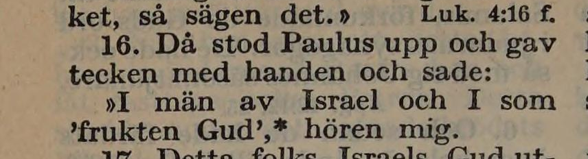
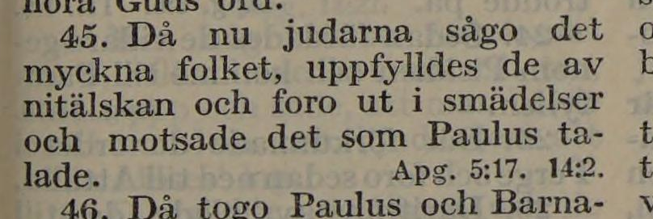
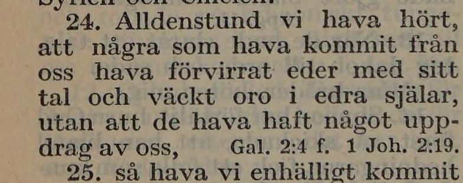
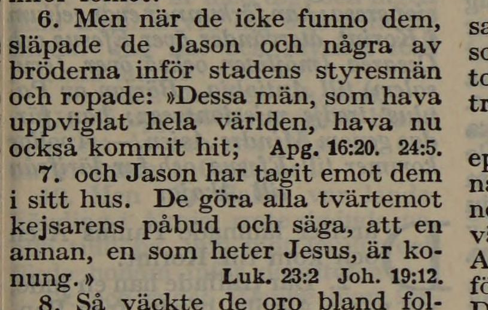
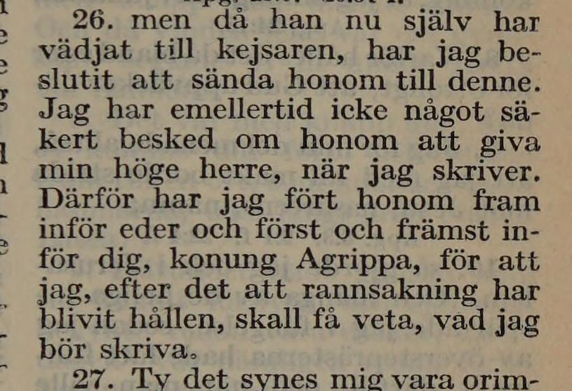

# NT-fotobunt 2: Apostlagärningarna 13–28

**Alla fem frågor avgjorda 2026-10-26 mot [EFS 1926](../sv1917-efs1926-witnesses/README.md). Inga foton behövs för denna bunt.** R326 införs i 13:16; V129–V132 behåller korpusens text eller versgräns som dokumenterade tryckvarianter. Kapitel 13, 15, 17 och 25 är nu verifierade. Hela Apostlagärningarna är verifierad.

Tabellens jämförelse visar korpusen **före** besluten mot EFS 1927. De fulla korpusverserna nedan är uppdaterade efter rättelserna. Båda tryckens underlag och stabila V-ID bevaras för återkontroll.

| Fråga | Vers | Korpus / EFS 1927 |
| --- | --- | --- |
| [V128](#v128) | Apg. 13:16 | I män av Israels hus / I män av Israel |
| [V129](#v129) | Apg. 13:45 | det myckna folket / detta myckna folket |
| [V130](#v130) | Apg. 15:24 | kommit från oss / kommit ifrån oss |
| [V131](#v131) | Apg. 17:6–7 | Versgräns: och Jason har tagit emot dem i sitt hus. står i v. 7 / v. 6 |
| [V132](#v132) | Apg. 25:26 | rannsakning har blivit hållen / rannsakning blivit hållen |

## V128

**Apostlagärningarna 13:16 — I män av Israels hus / I män av Israel.**

**Korpustext:**

**13:16:** Då stod Paulus upp och gav tecken med handen och sade: »I män av Israel och I som 'frukten Gud', hören mig.

**Komplettering:** hela den berörda versen visuellt kontrollerad i EFS 1926. Ingen fotobegäran återstår.

[Full sida, NT s. 209](https://runeberg.org/bibeln/efs1927/nt/0209.html). TIFF: `https://runeberg.org/img/bibeln/efs1927/nt/0209.1.tif`; SHA-256 `a71142b6ce62379846774634b9b732c94afb53f8c225c407b0b0821d09897081`. Utsnittets SHA-256 `168052bc0445ef75103e74698e087a1b998ac476ee97f46cca2c76db6e2cfc32`.

**Beslut:** löst 2026-10-26. Båda trycken har I män av Israel; Israels hus ersätts med Israel. Införd rättelse R326.

[Full EFS 1926-sida, NT s. 188](https://archive.org/download/bibelnellerdenhe0000unse/page/n1397.jpg). Utsnittets SHA-256 `537934fa31970a9607ad59e81723ee762049661943b909ad3dca7a53ed9e594c`; originalbildens hash och beskärning i [vittnesöversikten](../sv1917-efs1926-witnesses/README.md).

## V129

**Apostlagärningarna 13:45 — det myckna folket / detta myckna folket.**

**Korpustext:**

**13:45:** Då nu judarna sågo det myckna folket, uppfylldes de av nitälskan och foro ut i smädelser och motsade det som Paulus talade.

**Komplettering:** hela den berörda versen visuellt kontrollerad i EFS 1926. Ingen fotobegäran återstår.

[Full sida, NT s. 210](https://runeberg.org/bibeln/efs1927/nt/0210.html). TIFF: `https://runeberg.org/img/bibeln/efs1927/nt/0210.1.tif`; SHA-256 `bc3067a6167162ed0b3cad0ad5d81b460e32a31655776b8967822e5c0fe63443`. Utsnittets SHA-256 `a4e00384dcb9c41937b8fecabcc6ca5215496e8f30bef5fa05fd31fdd7cb9692`.

**Beslut:** löst 2026-10-26. EFS 1926 bekräftar korpusens det myckna folket mot EFS 1927:s detta myckna folket. Behållen tryckvariant; inget rättelse-ID.

[Full EFS 1926-sida, NT s. 189](https://archive.org/download/bibelnellerdenhe0000unse/page/n1398.jpg). Utsnittets SHA-256 `0c7385cc3c540b44d628aa2c63e8a3bad58363d4d031bd4f1642d2188afeb095`; originalbildens hash och beskärning i [vittnesöversikten](../sv1917-efs1926-witnesses/README.md).

## V130

**Apostlagärningarna 15:24 — kommit från oss / kommit ifrån oss.**

**Korpustext:**

**15:24:** Alldenstund vi hava hört att några som hava kommit från oss hava förvirrat eder med sitt tal och väckt oro i edra själar, utan att de hava haft något uppdrag av oss,

**Komplettering:** hela den berörda versen visuellt kontrollerad i EFS 1926. Ingen fotobegäran återstår.

[Full sida, NT s. 213](https://runeberg.org/bibeln/efs1927/nt/0213.html). TIFF: `https://runeberg.org/img/bibeln/efs1927/nt/0213.1.tif`; SHA-256 `1a37ad57b43436236885353707cce116db5adf4c5087abe065c1fc6d751877ab`. Utsnittets SHA-256 `17a1dfcd3498ee2aec52c3934bd2d99078d36fdd7288bbe469ca7733d702a701`.

**Beslut:** löst 2026-10-26. EFS 1926 bekräftar korpusens kommit från oss mot EFS 1927:s kommit ifrån oss. Behållen tryckvariant; inget rättelse-ID.

[Full EFS 1926-sida, NT s. 192](https://archive.org/download/bibelnellerdenhe0000unse/page/n1401.jpg). Utsnittets SHA-256 `b590ce9dc2b55b52c89aa6013b72ebf345f63ba58ab551726e63b766920ea859`; originalbildens hash och beskärning i [vittnesöversikten](../sv1917-efs1926-witnesses/README.md).

## V131

**Apostlagärningarna 17:6–7 — Versgräns: och Jason har tagit emot dem i sitt hus. står i v. 7 / v. 6.**

**Korpustext:**

**17:6:** Men när de icke funno dem, släpade de Jason och några av bröderna inför stadens styresmän och ropade: »Dessa män, som hava uppviglat hela världen, hava nu också kommit hit;

**17:7:** och Jason har tagit emot dem i sitt hus. De göra alla tvärtemot kejsarens påbud och säga att en annan, en som heter Jesus, är konung.»

**Komplettering:** hela den berörda versen och föregående vers med båda numren visuellt kontrollerad i EFS 1926. Ingen fotobegäran återstår.

[Full sida, NT s. 217](https://runeberg.org/bibeln/efs1927/nt/0217.html). TIFF: `https://runeberg.org/img/bibeln/efs1927/nt/0217.1.tif`; SHA-256 `7e3f81ece98acc4e3f5caa34747af90b75785e044468d6ee41448a47acfdc8df`. Utsnittets SHA-256 `4c988f972fe18977958850566a604fb7ce8c872efb6df73a1fe964ad128785eb`.

**Beslut:** löst 2026-10-26. Hela 17:6 och 17:7 med båda numren är visuellt jämförda. EFS 1926 börjar v. 7 med och Jason har tagit emot dem i sitt hus., precis som korpusen; EFS 1927 har satsen i v. 6. Både ord och koordinater behålls. Verspostens hash avser 17:7; kapitelhashen skyddar även 17:6 och hela gränsen.

[Full EFS 1926-sida, NT s. 195](https://archive.org/download/bibelnellerdenhe0000unse/page/n1404.jpg). Utsnittets SHA-256 `e1caa4644dbd5911c389ffc19e24307b4e295bb3b059165944b3f03a3641ba3f`; originalbildens hash och beskärning i [vittnesöversikten](../sv1917-efs1926-witnesses/README.md).

## V132

**Apostlagärningarna 25:26 — rannsakning har blivit hållen / rannsakning blivit hållen.**

**Korpustext:**

**25:26:** men då han nu själv har vädjat till kejsaren, har jag beslutit att sända honom till denne. Jag har emellertid icke något säkert besked om honom att giva min höge herre, när jag skriver. Därför har jag fört honom fram inför eder, och först och främst inför dig, konung Agrippa, för att jag, efter det att rannsakning har blivit hållen, skall få veta vad jag bör skriva.

**Komplettering:** hela den berörda versen visuellt kontrollerad i EFS 1926. Ingen fotobegäran återstår.

[Full sida, NT s. 233](https://runeberg.org/bibeln/efs1927/nt/0233.html). TIFF: `https://runeberg.org/img/bibeln/efs1927/nt/0233.1.tif`; SHA-256 `1f2aa5465b1c65ee1a71418f2b0f915d67913b8c9998fffc45259e1fb08daede`. Utsnittets SHA-256 `d9fce946a2007b814da432c287dbb77ccc2774c52871a0b80e6907f4135bbcf0`.

**Beslut:** löst 2026-10-26. EFS 1926 bekräftar korpusens rannsakning har blivit hållen; EFS 1927 saknar har. Behållen tryckvariant; inget rättelse-ID.

[Full EFS 1926-sida, NT s. 209](https://archive.org/download/bibelnellerdenhe0000unse/page/n1418.jpg). Utsnittets SHA-256 `dd33f5535b4d0b292baf4684e29d2efbd1c16ed53b0bad4101b0549fc8429704`; originalbildens hash och beskärning i [vittnesöversikten](../sv1917-efs1926-witnesses/README.md).
