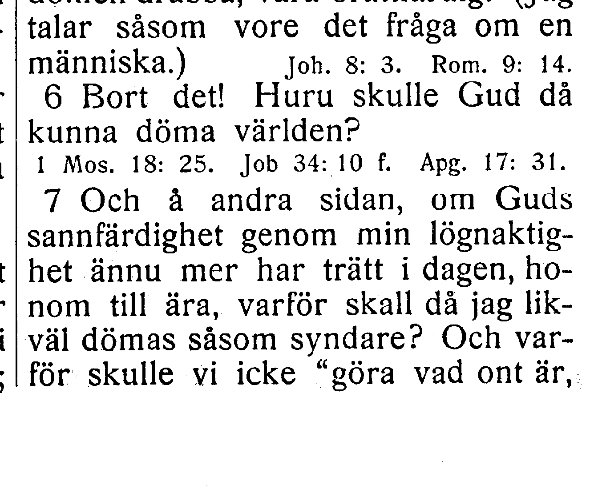
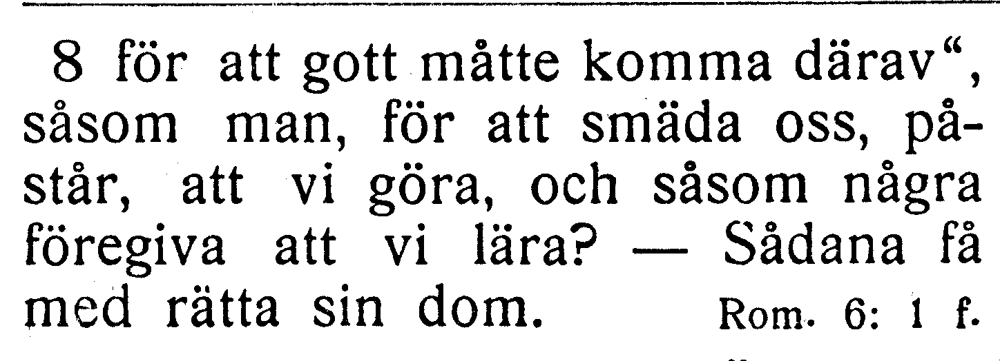
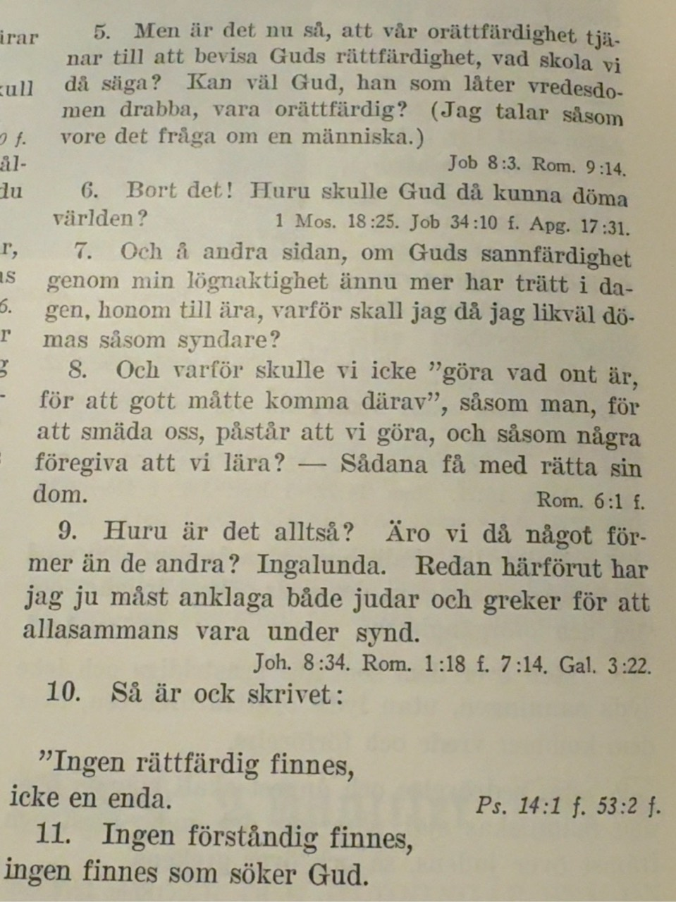
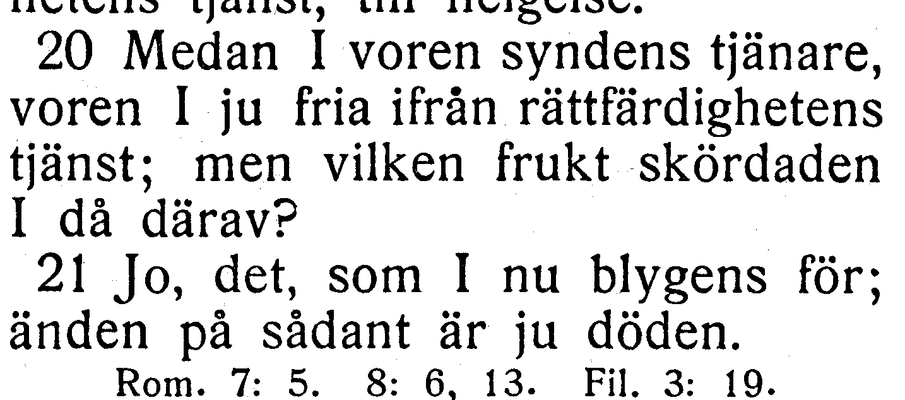
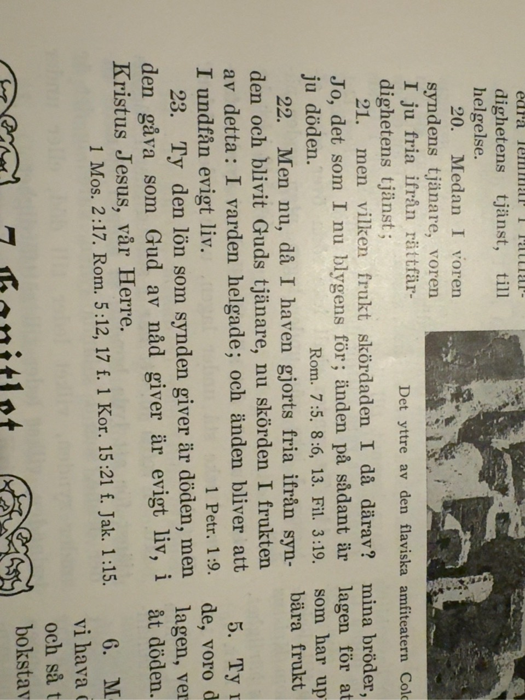
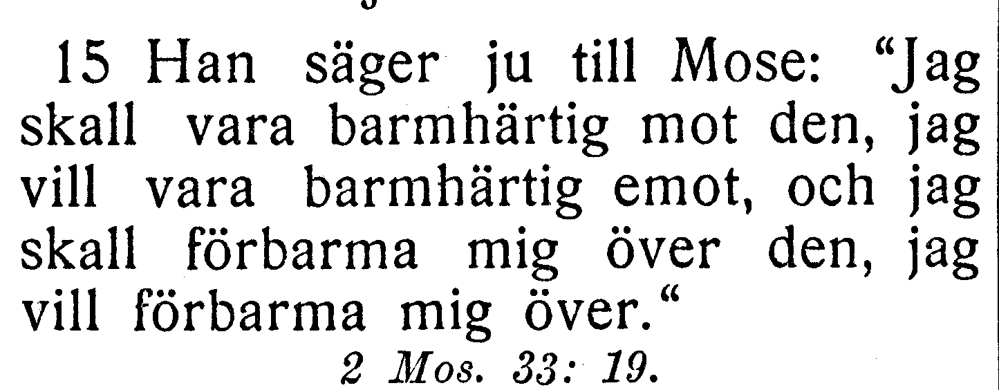
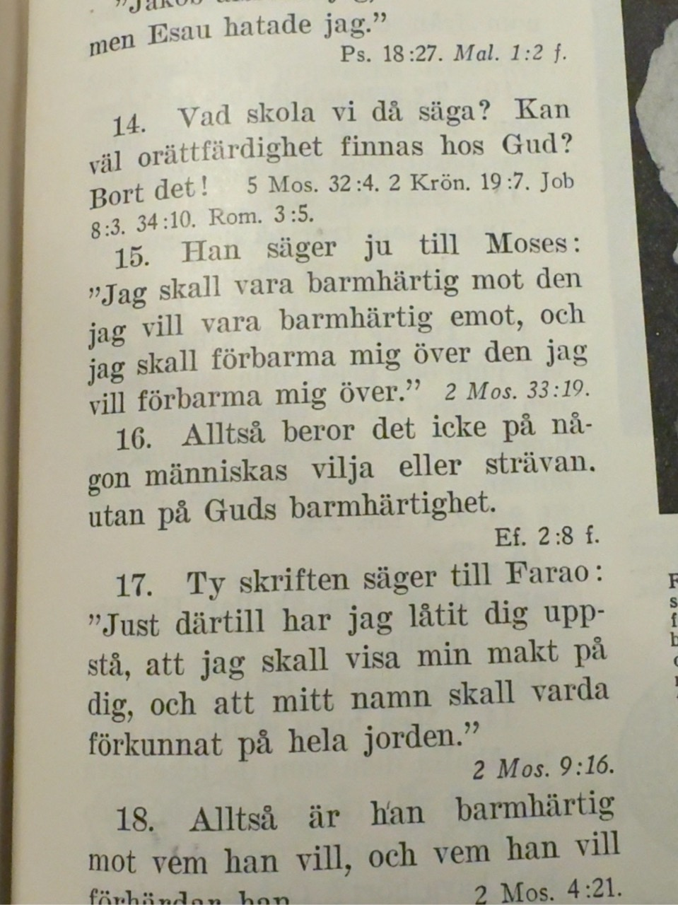
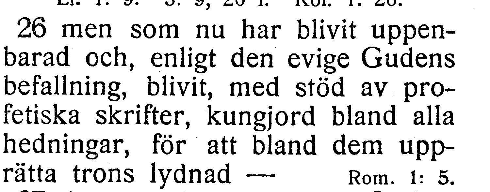

# NT-fotobunt 3: Romarbrevet

**Uppdaterad 2026-10-26.** V133–V135 är lösta mot användarens foton och kapitel 3, 6 och 9 verifierade. Endast V136 i kapitel 16 återstår; frågan är inte ett fastställt fel. Hela Romarbrevet är bildläst och femton kapitel verifierade. Användaren har boken till hands och vill ta en fråga i taget.

När boken finns till hands räcker foton av hela verserna med synliga versnummer. Ingen transkription eller egen diagnos behövs. Codex tolkar bilderna och frågar bara om osäkerheten kvarstår. V133–V134:s versgränser är nu avgjorda; inga fler foton behövs för dem. Frågornas ord och alla koordinater behålls. Originalupplösningen bekräftar båda de i 8:5 och till i 12:7 utan fotofrågor. Utsnitten är direkt beskurna originalbilder, utan OCR eller rekonstruerade bokstäver.

| Fråga | Vers | Korpus / EFS 1927 |
| --- | --- | --- |
| [V133](#v133), löst | Rom. 3:7–8 | Versgräns 3:7–8: Och varför skulle vi icke ligger i v. 8 / Versgräns 3:7–8: Och varför skulle vi icke ligger i v. 7 |
| [V134](#v134), löst | Rom. 6:20–21 | Versgräns 6:20–21: men vilken frukt skördaden I då därav? ligger i v. 21 / Versgräns 6:20–21: men vilken frukt skördaden I då därav? ligger i v. 20 |
| [V135](#v135), löst | Rom. 9:15 | Han säger ju till Moses: / Han säger ju till Mose: |
| [V136](#v136) | Rom. 16:26 | den eviga Gudens befallning / den evige Gudens befallning |

## V133

**Romarbrevet 3:7–8 — Versgräns 3:7–8: Och varför skulle vi icke ligger i v. 8 / Versgräns 3:7–8: Och varför skulle vi icke ligger i v. 7.**

**Korpustext:**

**3:7:** Och å andra sidan, om Guds sannfärdighet genom min lögnaktighet ännu mer har trätt i dagen, honom till ära, varför skall då jag likväl dömas såsom syndare?

**3:8:** Och varför skulle vi icke »göra vad ont är, för att gott måtte komma därav», såsom man, för att smäda oss, påstår att vi göra, och såsom några föregiva att vi lära? – Sådana få med rätta sin dom.

**Kompletterande foto mottaget:** hela 3:7–8 med båda versnumren synliga. Ingen ytterligare bild behövs för V133.

[Full sida, NT s. 242](https://runeberg.org/bibeln/efs1927/nt/0242.html). TIFF: `https://runeberg.org/img/bibeln/efs1927/nt/0242.1.tif`; SHA-256 `88d56693e78c032187c3ef06c7b6488553856f9a3d943e37d53afaf65997beb7`. Utsnittets SHA-256 `3d6060c7c2962bf480c49b4ebf241e3ec4de6a344baf47f7f074fdbfd866bb41`.

[Full sida, NT s. 243](https://runeberg.org/bibeln/efs1927/nt/0243.html). TIFF: `https://runeberg.org/img/bibeln/efs1927/nt/0243.1.tif`; SHA-256 `318719675786823163166b6b2aa5cf7114b4ef75456a719304bb483d29e24f40`. Utsnittets SHA-256 `b65ef6cfebc5bb9a3024d12826abd5ebcc7ac006b12bd77fe0075b54eae055db`.

**Beslut:** löst 2026-10-26. Användarens foto visar hela 3:7 och 3:8 med båda numren. Och varför skulle vi icke börjar uttryckligen v. 8, som i korpusen; EFS 1927 har dessa ord sist i v. 7. Båda versernas text och koordinater behålls som belagd tryckvariant. Verspostens hash låser 3:8; den oförändrade kapitelhashen låser även 3:7 och hela gränsen. Inget rättelse-ID.

Originalfotots SHA-256 `7f6685e73e99ff8c53e7a7667b3bc8554f9a0db503345c6720b557b4d5066b6d`. Exakt vershash och beslut i JSON-liggarens `resolved_readings`.

## V134

**Romarbrevet 6:20–21 — Versgräns 6:20–21: men vilken frukt skördaden I då därav? ligger i v. 21 / Versgräns 6:20–21: men vilken frukt skördaden I då därav? ligger i v. 20.**

**Korpustext:**

**6:20:** Medan I voren syndens tjänare, voren I ju fria ifrån rättfärdighetens tjänst;

**6:21:** men vilken frukt skördaden I då därav? Jo, det som I nu blygens för; änden på sådant är ju döden.

**Kompletterande foto mottaget:** båda verserna och numren synliga. Ingen ytterligare bild behövs för V134.

[Full sida, NT s. 247](https://runeberg.org/bibeln/efs1927/nt/0247.html). TIFF: `https://runeberg.org/img/bibeln/efs1927/nt/0247.1.tif`; SHA-256 `42aa62113b42a8585e2b511148b8ea9448f1fcc9f1dd104db22122b80ad95baf`. Utsnittets SHA-256 `d6fd6d5c6a441394a7463706215ff74c9aa06d69274bac9b47e300dbb59939c6`.

**Beslut:** löst 2026-10-26. Användarens originalfoto visar 6:20 och 6:21 med båda numren, fotograferat sidledes. Bilden kan läsas genom att vrida den 90 grader moturs. men vilken frukt skördaden I då därav? börjar uttryckligen v. 21, som i korpusen; EFS 1927 har dessa ord i v. 20. Text och koordinater behålls som belagd tryckvariant. Verspostens hash låser 6:21; den oförändrade kapitelhashen låser även 6:20 och hela gränsen. Inget rättelse-ID. Bedömningen bygger på originalfotot; en roterad visningsbild används inte som källbevis.

Originalfotots SHA-256 `960938294778add62bf5305a69712718bb30736e5114e7c2070006b83757f5d2`. Exakt vershash och beslut i JSON-liggarens `resolved_readings`.

## V135

**Romarbrevet 9:15 — Han säger ju till Moses: / Han säger ju till Mose:.**

**Korpustext:**

**9:15:** Han säger ju till Moses: »Jag skall vara barmhärtig mot den jag vill vara barmhärtig emot, och jag skall förbarma mig över den jag vill förbarma mig över.»

**Kompletterande foto mottaget:** hela 9:15 med synligt nummer. Ingen ytterligare bild behövs för V135.

[Full sida, NT s. 252](https://runeberg.org/bibeln/efs1927/nt/0252.html). TIFF: `https://runeberg.org/img/bibeln/efs1927/nt/0252.1.tif`; SHA-256 `627caaa2b6629e108f9fb0724c4855194ed175ff94a011d1b9ce458cebdb7cfa`. Utsnittets SHA-256 `352a81c7419e61dda0011ed1c3c3025f19cac72d7ec649199f48d9098ffc53ea`.

**Beslut:** löst 2026-10-26. Användarens originalfoto visar hela 9:15 med synligt versnummer och läsningen Han säger ju till Moses:. Fotot bekräftar korpusens Moses mot EFS 1927:s Mose. Texten behålls som belagd tryckvariant; inget rättelse-ID. Hela versen är visuellt jämförd; citatglyfer harmoniseras inte.

Originalfotots SHA-256 `6a2ca886221e6ece6b382b35a77d36354c7a849a9034f27e6a82ab791bcac706`. Exakt vershash och beslut i JSON-liggarens `resolved_readings`.

## V136

**Romarbrevet 16:26 — den eviga Gudens befallning / den evige Gudens befallning.**

**Korpustext:**

**16:26:** men som nu har blivit uppenbarad och, enligt den eviga Gudens befallning, blivit, med stöd av profetiska skrifter, kungjord bland alla hedningar, för att bland dem upprätta trons lydnad –

**Foto till senare:** hela 16:26 med synliga versnummer. Ingen rättelse införs enbart från skillnaden mot EFS 1927.

[Full sida, NT s. 262](https://runeberg.org/bibeln/efs1927/nt/0262.html). TIFF: `https://runeberg.org/img/bibeln/efs1927/nt/0262.1.tif`; SHA-256 `cff0fb158f9ce3e90bc70b739e3147175165e633f4d7d812ee65d8520a0d4eaa`. Utsnittets SHA-256 `33cd2721341af99e1c78e4ad92e2b806e67e7ddea138840d9055a0aad67bf6f0`.

**Beslut:** öppet; inget rättelse-ID för frågan.
