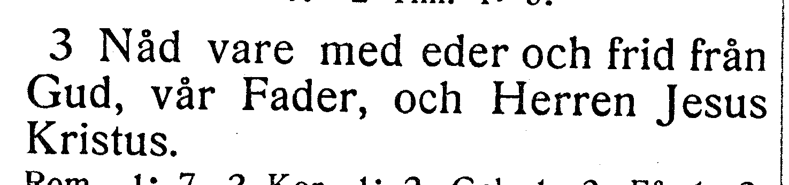
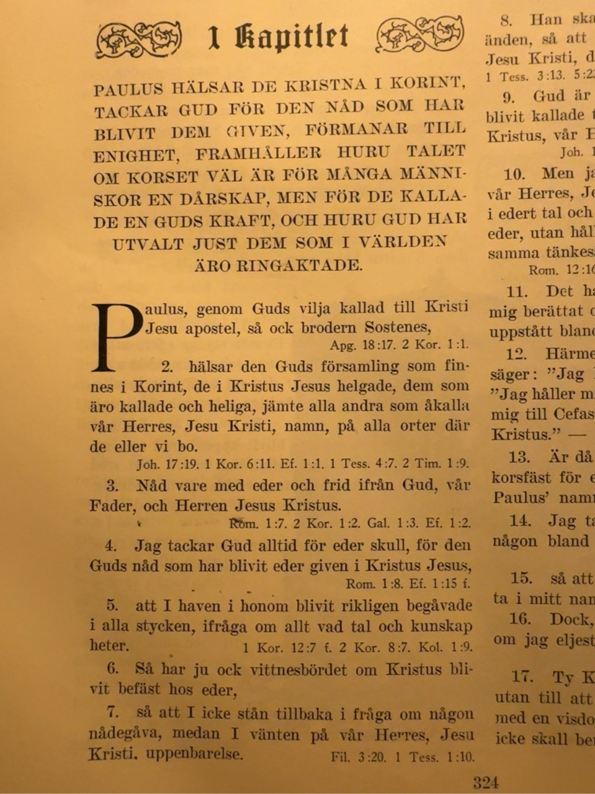
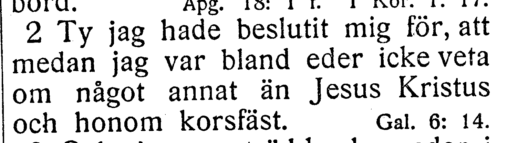
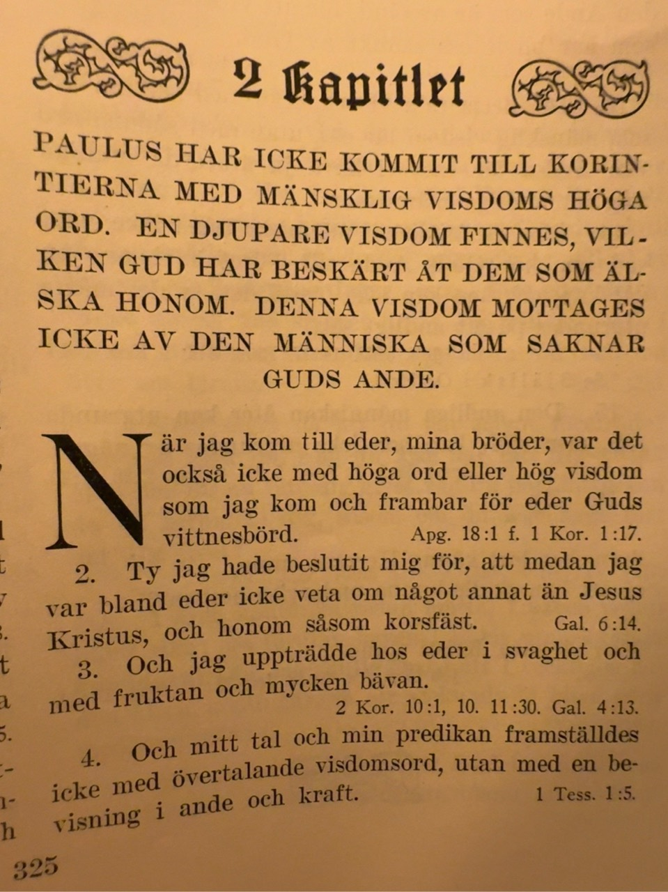
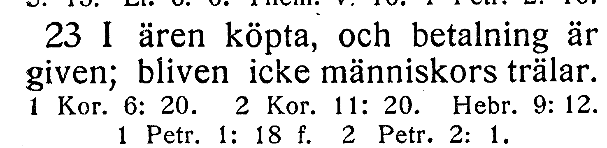
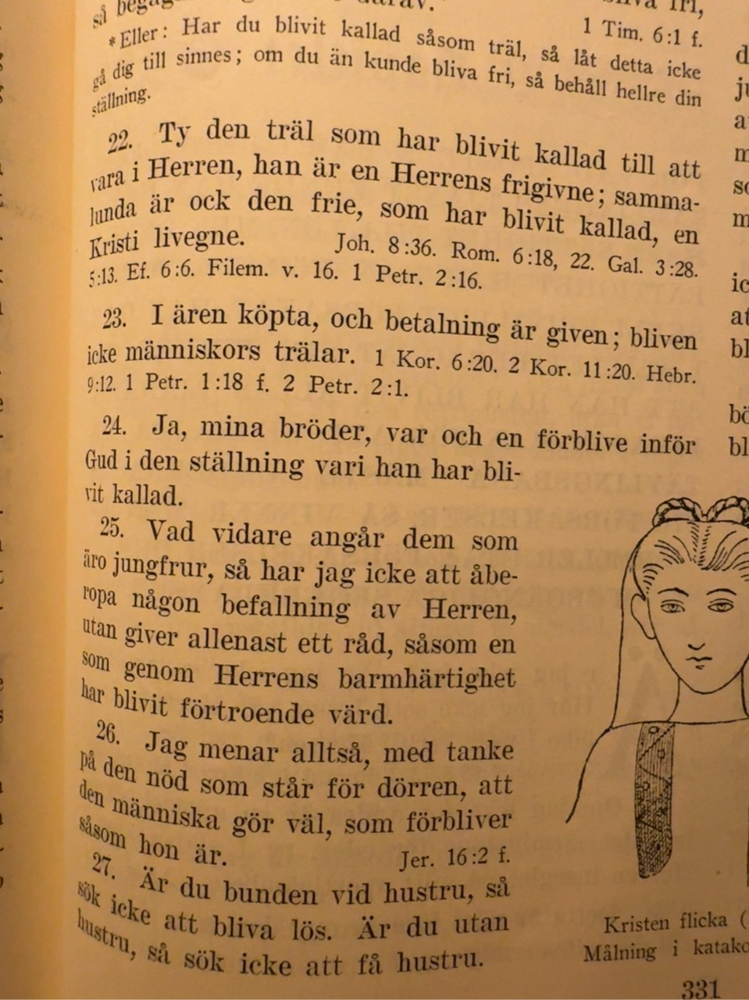
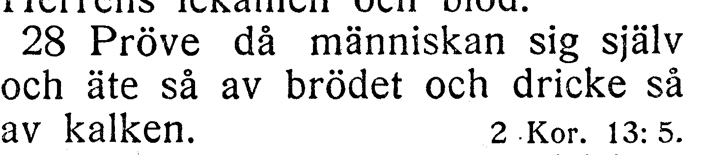
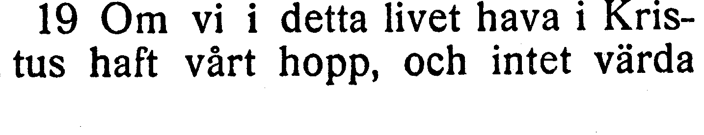
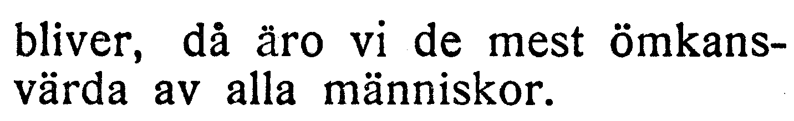

# NT-fotobunt 4: Första Korinthierbrevet

**Uppdaterad 2026-10-27.** V137–V139 är lösta mot användarens foton och kapitel 1, 2 och 7 verifierade. Två frågor V140–V141 i kapitel 11 och 15 återstår; de är inte fastställda fel. Hela Första Korinthierbrevet är bildläst och fjorton kapitel verifierade. Användaren har boken till hands och vill ta en fråga i taget.

När boken finns till hands räcker foton av hela verserna med synliga versnummer. Ingen transkription eller egen diagnos behövs. Codex tolkar bilderna och frågar bara om osäkerheten kvarstår. V141 visar en avvikande, möjligen felsatt sats i 15:19 över två trycksidor. Hela versen från ett annat tryck behövs. Öppna frågors ord och alla koordinater behålls. Tabellen visar jämförelsen före besluten; fulla korpusverser nedan är uppdaterade efter införda rättelser. Utsnitten är direkt beskurna originalbilder, utan OCR eller rekonstruerade bokstäver.

| Fråga | Vers | Korpus / EFS 1927 |
| --- | --- | --- |
| [V137](#v137), löst | 1 Kor. 1:3 | frid ifrån Gud / frid från Gud |
| [V138](#v138), löst | 1 Kor. 2:2 | och honom såsom korsfäst / och honom korsfäst |
| [V139](#v139), löst | 1 Kor. 7:23 | och betalningen är given / och betalning är given |
| [V140](#v140) | 1 Kor. 11:28 | och dricke av kalken / och dricke så av kalken |
| [V141](#v141) | 1 Kor. 15:19 | och därav intet bliver / och intet värda bliver |

## V137

**Första Korinthierbrevet 1:3 — frid ifrån Gud / frid från Gud.**

**Korpustext:**

**1:3:** Nåd vare med eder och frid ifrån Gud, vår Fader, och Herren Jesus Kristus.

**Kompletterande foto mottaget:** hela 1:3 med synligt nummer. Ingen ytterligare bild behövs för V137.

[Full sida, NT s. 263](https://runeberg.org/bibeln/efs1927/nt/0263.html). TIFF: `https://runeberg.org/img/bibeln/efs1927/nt/0263.1.tif`; SHA-256 `8008bd0c2efee679ccade98e36d01a93e09145ff21ac8b919d74d696357fe09f`. Utsnittets SHA-256 `730055a435ca7cc6b94393d65d9a966a94a9121fc8dbc09088b49bbbca0025a0`.

**Beslut:** löst 2026-10-27. Användarens originalfoto visar hela 1:3 med synligt versnummer och läsningen frid ifrån Gud, samma som korpusen. EFS 1927 har frid från Gud. Korpusens ifrån behålls som belagd tryckvariant; inget rättelse-ID. Hela versen är visuellt jämförd; ingen annan ändring behövs.

Originalfotots SHA-256 `681c60d3ad4f7c1bd7727ecf2dcd20596e92cba33b0701dcc9f45ec8d22334bb`. Exakt vershash och beslut i JSON-liggarens `resolved_readings`.

## V138

**Första Korinthierbrevet 2:2 — och honom såsom korsfäst / och honom korsfäst.**

**Korpustext:**

**2:2:** Ty jag hade beslutit mig för, att medan jag var bland eder icke veta om något annat än Jesus Kristus, och honom såsom korsfäst.

**Kompletterande foto mottaget:** hela 2:2 med synligt nummer. Ingen ytterligare bild behövs för V138.

[Full sida, NT s. 264](https://runeberg.org/bibeln/efs1927/nt/0264.html). TIFF: `https://runeberg.org/img/bibeln/efs1927/nt/0264.1.tif`; SHA-256 `62a8a685b36101757b7a66e4eaa16ee3fc29971b4eaf01f8d2779b9f2540ed12`. Utsnittets SHA-256 `067c3dfe1011dfac2d757a65296a47db541bf8f138945fc5b5a9738500035f7b`.

**Beslut:** löst 2026-10-27. Användarens originalfoto visar hela 2:2 med synligt versnummer och läsningen och honom såsom korsfäst, samma som korpusen. EFS 1927 saknar såsom. Korpusens såsom behålls som belagd tryckvariant; inget rättelse-ID. Hela versen är visuellt jämförd; ingen annan ändring behövs.

Originalfotots SHA-256 `2f3efcce57c82400517e48fe5626b7e4f8060e7c796b1a2e75bee0f9062e8dfd`. Exakt vershash och beslut i JSON-liggarens `resolved_readings`.

## V139

**Första Korinthierbrevet 7:23 — och betalningen är given / och betalning är given.**

**Korpustext:**

**7:23:** I ären köpta, och betalning är given; bliven icke människors trälar.

**Kompletterande foto mottaget:** hela 7:23 med synligt nummer. Ingen ytterligare bild behövs för V139.

[Full sida, NT s. 271](https://runeberg.org/bibeln/efs1927/nt/0271.html). TIFF: `https://runeberg.org/img/bibeln/efs1927/nt/0271.1.tif`; SHA-256 `780e1a34a465a686c8cc14162e2a1abf52f9586b0e9c6961aa3bede584213bee`. Utsnittets SHA-256 `372559e221f4c98b4f07c07b648cd8d7a9c5e85c894b4cbedd43983ff2bdf388`.

**Beslut:** löst 2026-10-27. Användarens originalfoto visar hela 7:23 med synligt versnummer och läsningen och betalning är given, samma som EFS 1927. Korpusens betalningen rättas till betalning genom R328. Hela versen är visuellt jämförd; övriga ord och skiljetecken stämmer.

Originalfotots SHA-256 `20ff2a6ea6453dacf4640105b109e6bc179152161e6beaec774bf264726a6f7c`. Exakt vershash och beslut i JSON-liggarens `resolved_readings`.

## V140

**Första Korinthierbrevet 11:28 — och dricke av kalken / och dricke så av kalken.**

**Korpustext:**

**11:28:** Pröve då människan sig själv, och äte så av brödet och dricke av kalken.

**Foto till senare:** hela 11:28 med synliga versnummer. Ingen rättelse införs enbart från skillnaden mot EFS 1927.

[Full sida, NT s. 277](https://runeberg.org/bibeln/efs1927/nt/0277.html). TIFF: `https://runeberg.org/img/bibeln/efs1927/nt/0277.1.tif`; SHA-256 `6e995cce1717991579ba484723392750349b35df7ca2629c0967100e0247bd55`. Utsnittets SHA-256 `c9a3a50b49030c8767205aa8f36f3e367cec6cd5b4a97932b1ffcb70456d6893`.

**Beslut:** öppet; inget rättelse-ID för frågan.

## V141

**Första Korinthierbrevet 15:19 — och därav intet bliver / och intet värda bliver.**

**Korpustext:**

**15:19:** Om vi i detta livet hava i Kristus haft vårt hopp, och därav intet bliver, då äro vi de mest ömkansvärda av alla människor.

**Foto till senare:** hela 15:19 med synliga versnummer. Ingen rättelse införs enbart från skillnaden mot EFS 1927.

[Full sida, NT s. 282](https://runeberg.org/bibeln/efs1927/nt/0282.html). TIFF: `https://runeberg.org/img/bibeln/efs1927/nt/0282.1.tif`; SHA-256 `121511203e6a01814410605d1a9cc1715342889d3f62110891b81b7ecb7ab315`. Utsnittets SHA-256 `630e3c184c9e50bb166abf3bd21fec79469e1e1a14a21ed9b3db5c8f7a96d471`.

[Full sida, NT s. 283](https://runeberg.org/bibeln/efs1927/nt/0283.html). TIFF: `https://runeberg.org/img/bibeln/efs1927/nt/0283.1.tif`; SHA-256 `e9fe78aafc38872c278644e610667942e90ead2cf5abe84b14075e567723c544`. Utsnittets SHA-256 `94fb85fae3819badafe02e2beb625fcdea94dec9b30c9a4de29faee379e6bf36`.

**Beslut:** öppet; inget rättelse-ID för frågan.
