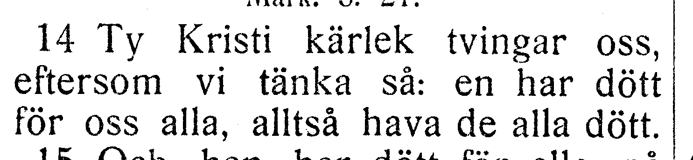
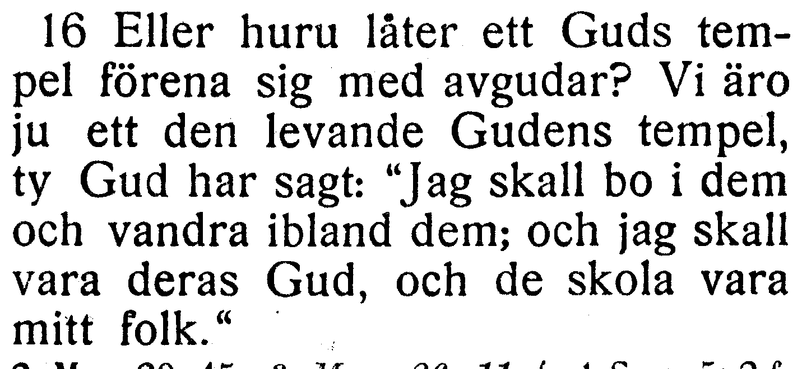

# NT-fotobunt 5: Andra Korinthierbrevet

**Sparad 2026-10-26. Ingen åtgärd behövs nu.** Hela Andra Korinthierbrevet är bildläst. Två frågor i kapitel 5 och 6 väntar på ett annat tryck; de är inte två fastställda fel. Övriga elva kapitel är verifierade efter separata säkra rättelser R260–R261.

När boken finns till hands räcker foton av hela verserna med synliga versnummer. Ingen transkription eller egen diagnos behövs. Codex tolkar bilderna och frågar bara om osäkerheten kvarstår. Originalupplösningen bekräftar mig i 12:18 utan fotofråga. Frågornas ord och alla koordinater behålls. Utsnitten är direkt beskurna originalbilder, utan OCR eller rekonstruerade bokstäver.

| Fråga | Vers | Korpus / EFS 1927 |
| --- | --- | --- |
| [V142](#v142) | 2 Kor. 5:14 | en har dött för alla / en har dött för oss alla |
| [V143](#v143) | 2 Kor. 6:16 | ibland dem; jag skall vara / ibland dem; och jag skall vara |

## V142

**Andra Korinthierbrevet 5:14 — en har dött för alla / en har dött för oss alla.**

**Korpustext:**

**5:14:** Ty Kristi kärlek tvingar oss, eftersom vi tänka så: en har dött för alla, alltså hava de alla dött.

**Foto till senare:** hela 5:14 med synliga versnummer. Ingen rättelse införs enbart från skillnaden mot EFS 1927.

[Full sida, NT s. 291](https://runeberg.org/bibeln/efs1927/nt/0291.html). TIFF: `https://runeberg.org/img/bibeln/efs1927/nt/0291.1.tif`; SHA-256 `5f372e958b6d9fa611449a2422f67fded0a49b2710b96c8c1e27f8b87f1baa3a`. Utsnittets SHA-256 `ab2ef6dc3d51162a4e1555af41689bf47b1f8eb058fd30f6f41ebf80ec5163fe`.

**Beslut:** öppet; inget rättelse-ID för frågan.

## V143

**Andra Korinthierbrevet 6:16 — ibland dem; jag skall vara / ibland dem; och jag skall vara.**

**Korpustext:**

**6:16:** Eller huru låter ett Guds tempel förena sig med avgudar? Vi äro ju ett den levande Gudens tempel, ty Gud har sagt: »Jag skall bo i dem och vandra ibland dem; jag skall vara deras Gud, och de skola vara mitt folk.»

**Foto till senare:** hela 6:16 med synliga versnummer. Ingen rättelse införs enbart från skillnaden mot EFS 1927.

[Full sida, NT s. 292](https://runeberg.org/bibeln/efs1927/nt/0292.html). TIFF: `https://runeberg.org/img/bibeln/efs1927/nt/0292.1.tif`; SHA-256 `a48fdd3febecb52688d344f48e26293c4d86bdcb9874117a641f8dec55e786cf`. Utsnittets SHA-256 `67445ffad1a9fba54ba5024848e442a41134fd4c9ba4d4a0374a835e7e7a89c1`.

**Beslut:** öppet; inget rättelse-ID för frågan.
