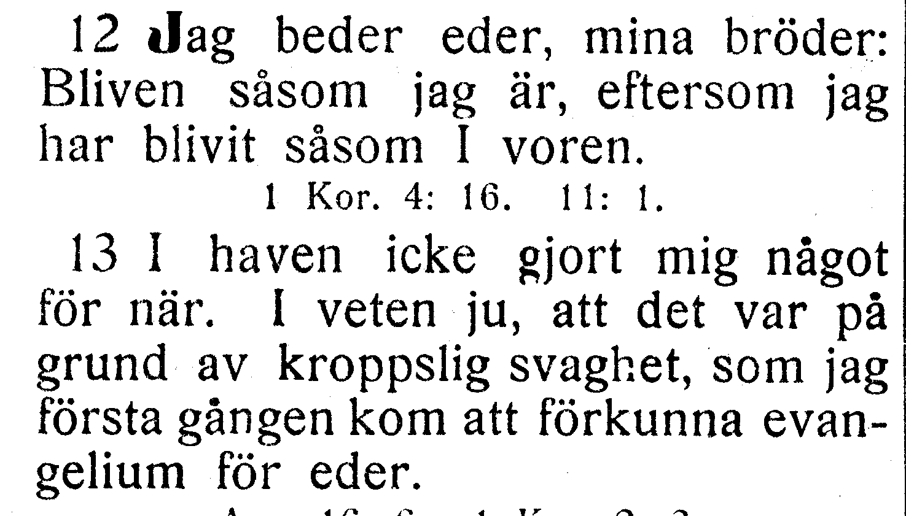
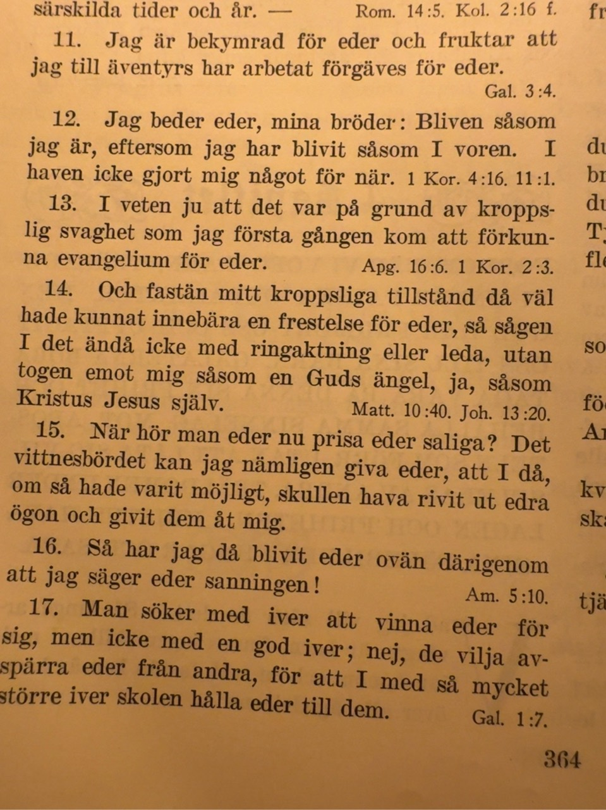

# NT-fotobunt 6: Galaterbrevet

**Frågan avgjord 2026-10-27 mot användarens bevarade originalfoto. Hela Galaterbrevet är verifierat: 6 kapitel och 149 versposter.** V144 bekräftar korpusens gräns 4:12–13 med I haven icke gjort mig något för när i v. 12. Ord och koordinater behålls som dokumenterad tryckvariant. Inga fler foton behövs för denna bunt. Efesierbrevet är sedan tidigare verifierat.

Båda tryckens underlag, fulla aktuella korpusverser och stabilt V-ID bevaras för återkontroll.

| Fråga | Vers | Korpus / EFS 1927 |
| --- | --- | --- |
| [V144](#v144), löst | Gal. 4:12–13 | Versgräns 4:12–13: I haven icke gjort mig något för när ligger i v. 12 / Versgräns 4:12–13: I haven icke gjort mig något för när ligger i v. 13 |

## V144

**Galaterbrevet 4:12–13 — Versgräns 4:12–13: I haven icke gjort mig något för när ligger i v. 12 / Versgräns 4:12–13: I haven icke gjort mig något för när ligger i v. 13.**

**Korpustext:**

**4:12:** Jag beder eder, mina bröder: Bliven såsom jag är, eftersom jag har blivit såsom I voren. I haven icke gjort mig något för när.

**4:13:** I veten ju att det var på grund av kroppslig svaghet som jag första gången kom att förkunna evangelium för eder.

**Kompletterande foto mottaget:** båda hela verserna med synliga nummer. Ingen ytterligare bild behövs för V144.

[Full sida, NT s. 306](https://runeberg.org/bibeln/efs1927/nt/0306.html). TIFF: `https://runeberg.org/img/bibeln/efs1927/nt/0306.1.tif`; SHA-256 `019d271248ad0ccfb483b06f369cdb1e03c9da462ab5482ca51a9a762202b1dd`. Utsnittets SHA-256 `426d115e6d76f37b5c13c82cc0c317d68e8e45007ff7adaa18abea7cad9e3a26`.

**Beslut:** löst 2026-10-27. Användarens originalfoto visar hela 4:12 och 4:13 med båda versnumren. I haven icke gjort mig något för när står sist i v. 12, precis som i korpusen; v. 13 börjar I veten ju att det var på grund av kroppslig svaghet. EFS 1927 lägger den föregående satsen i v. 13. Text och koordinater behålls som belagd tryckvariant; inget rättelse-ID. Verspostens hash låser 4:12; kapitelhashen låser också 4:13 och hela gränsen. Båda verserna är visuellt jämförda.

Originalfotots SHA-256 `887700f3c46c8ca14130d99dc783062baf38e81cf6e8404d4f86702e8fce77bc`. Exakt vershash och beslut i JSON-liggarens `resolved_readings`.
