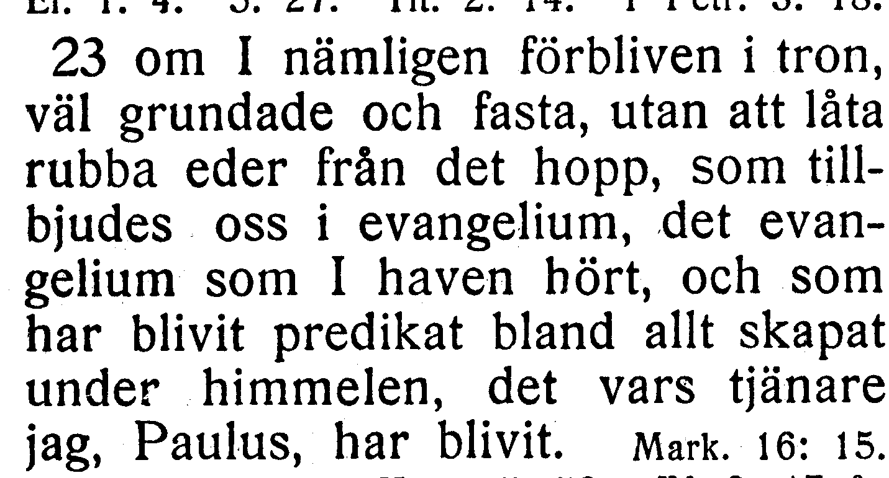
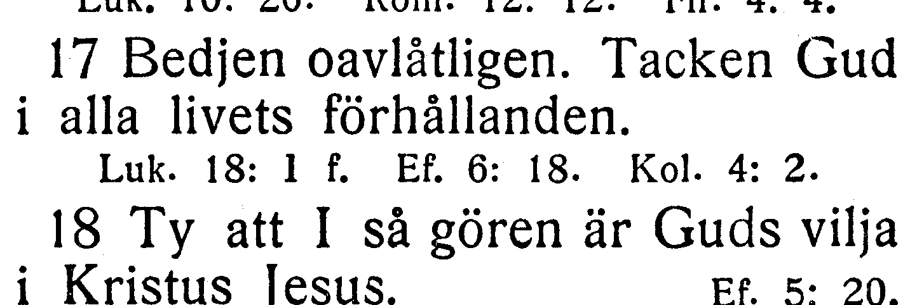
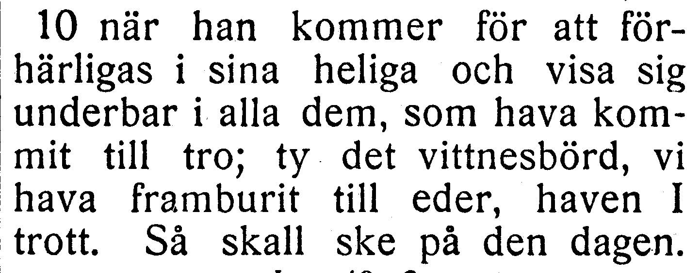

# NT-fotobunt 7: Filipperbrevet till Andra Tessalonikerbrevet

**Sparad 2026-10-26. Ingen åtgärd behövs nu.** Alla fyra böcker är bildlästa. Tre frågor i tre kapitel väntar på ett annat tryck; de är inte tre fastställda fel. Övriga tretton kapitel är verifierade efter separata säkra rättelser R264–R270.

När boken finns till hands räcker foton av hela verserna med synliga versnummer. Ingen transkription eller egen diagnos behövs. Codex tolkar bilderna och frågar bara om osäkerheten kvarstår. Förstorad originalbild bekräftar oomskurenhet i Kol. 2:13 utan fotofråga. Frågornas ord och alla koordinater behålls. Utsnitten är direkt beskurna originalbilder, utan OCR eller rekonstruerade bokstäver.

| Fråga | Vers | Korpus / EFS 1927 |
| --- | --- | --- |
| [V145](#v145) | Kol. 1:23 | och som blivit predikat / och som har blivit predikat |
| [V146](#v146) | 1 Tess. 5:17–18 | Tacken Gud i alla livets förhållanden. i 5:18 / Tacken Gud i alla livets förhållanden. i 5:17 |
| [V147](#v147) | 2 Tess. 1:10 | kommit till att tro / kommit till tro |

## V145

**Kolosserbrevet 1:23 — och som blivit predikat / och som har blivit predikat.**

**Korpustext:**

**1:23:** om I nämligen förbliven i tron, väl grundade och fasta, utan att låta rubba eder från det hopp som tillbjudes oss i evangelium, det evangelium som I haven hört, och som blivit predikat bland allt skapat under himmelen, det vars tjänare jag, Paulus, har blivit.

**Foto till senare:** hela 1:23 med synliga versnummer. Ingen rättelse införs enbart från skillnaden mot EFS 1927.

[Full sida, NT s. 324](https://runeberg.org/bibeln/efs1927/nt/0324.html). TIFF: `https://runeberg.org/img/bibeln/efs1927/nt/0324.1.tif`; SHA-256 `d8958287803115b6d2d105ae1d5674bd4c7504fe4c5e58b874f4fac6a2e71d06`. Utsnittets SHA-256 `172d9f9c3bed098686ffb90a46f2a69bd6e9cb228ead4d7f59ad62bdb10c00f3`.

**Beslut:** öppet; inget rättelse-ID för frågan.

## V146

**Första Tessalonikerbrevet 5:17–18 — Tacken Gud i alla livets förhållanden. i 5:18 / Tacken Gud i alla livets förhållanden. i 5:17.**

**Korpustext:**

**5:17:** Bedjen oavlåtligen.

**5:18:** Tacken Gud i alla livets förhållanden. Ty att I så gören är Guds vilja i Kristus Jesus.

**Foto till senare:** hela 5:17–18 med synliga versnummer. Båda verserna behövs eftersom orden redan finns i korpusen men har en annan versgräns. Ingen rättelse införs enbart från skillnaden mot EFS 1927.

[Full sida, NT s. 332](https://runeberg.org/bibeln/efs1927/nt/0332.html). TIFF: `https://runeberg.org/img/bibeln/efs1927/nt/0332.1.tif`; SHA-256 `1679463dc32387ace53db176de371f336c0d746360de4888d07eb8b31f5a4b93`. Utsnittets SHA-256 `e6c779dbf49af874ed0da5483c50a971e443debca1a8997d1c9f2b330e7f8023`.

**Beslut:** öppet; inget rättelse-ID för frågan.

## V147

**Andra Tessalonikerbrevet 1:10 — kommit till att tro / kommit till tro.**

**Korpustext:**

**1:10:** när han kommer för att förhärligas i sina heliga och visa sig underbar i alla dem som hava kommit till att tro; ty det vittnesbörd vi hava framburit till eder haven I trott. Så skall ske på den dagen.

**Foto till senare:** hela 1:10 med synliga versnummer. Ingen rättelse införs enbart från skillnaden mot EFS 1927.

[Full sida, NT s. 333](https://runeberg.org/bibeln/efs1927/nt/0333.html). TIFF: `https://runeberg.org/img/bibeln/efs1927/nt/0333.1.tif`; SHA-256 `1f31285f05429762b346be37aec7d200c7101593dc6297a6c59f9526511222bc`. Utsnittets SHA-256 `3d5b43a60d7e8affd700e1f9dbd325742b68e3a11a213a8f65a0aa50bbf41e28`.

**Beslut:** öppet; inget rättelse-ID för frågan.
