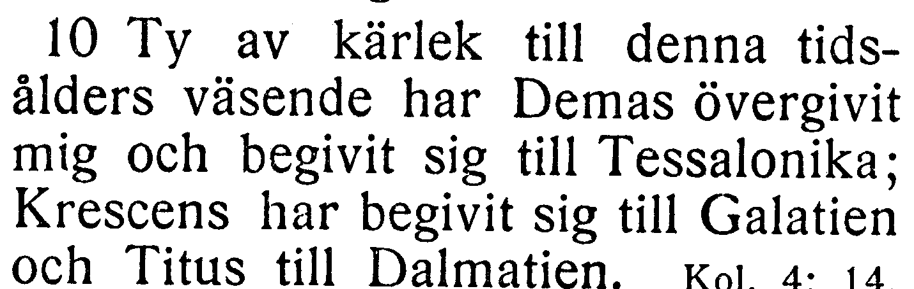

# NT-fotobunt 8: Timoteusbreven, Titus och Filemon

**Alla frågor i denna bunt avgjorda 2026-10-27 mot [EFS 1926](../sv1917-efs1926-witnesses/README.md). Inga foton behövs för denna bunt.** Samtliga berörda kapitel var redan helt bildlästa och är nu verifierade. Tabellens jämförelse visar korpusen före besluten; fulla korpusverser nedan är uppdaterade. Ursprungliga EFS 1927-utsnitt och stabila V-ID bevaras för återkontroll.

| Fråga | Vers | Korpus / EFS 1927 |
| --- | --- | --- |
| [V148](#v148), löst | 2 Tim. 4:10 | och har begivit / och begivit |

## V148

**Andra Timoteusbrevet 4:10 — och har begivit / och begivit.**

**Korpustext:**

**4:10:** Ty av kärlek till denna tidsålders väsende har Demas övergivit mig och har begivit sig till Tessalonika; Krescens har begivit sig till Galatien och Titus till Dalmatien.

**Komplettering:** hela berörda versen visuellt jämförd i EFS 1926. Ingen fotobegäran återstår.

[Full sida, NT s. 346](https://runeberg.org/bibeln/efs1927/nt/0346.html). TIFF: `https://runeberg.org/img/bibeln/efs1927/nt/0346.1.tif`; SHA-256 `bda1749e781848fbb86da03a3dfa7c3912d28b5a755a729c577a261aac6314e8`. Utsnittets SHA-256 `66025e725b34022ccd3fc36c75ca0395b844f481e3223a683b51f2662579b02c`.

**Beslut:** löst 2026-10-27. EFS 1926 bekräftar korpusens och har begivit sig mot EFS 1927:s och begivit sig. Texten behålls som belagd tryckvariant; inget rättelse-ID.

[Bevarad full originalbild från EFS 1926, NT s. 317](../sv1917-efs1926-witnesses/V148.jpg). Original och bevarad bild har samma SHA-256 `7b6c65a544eb7a27ad506d59f37b44f23aab8794084f5e449e7969116358e25c`. [Hämtningsadress](https://archive.org/download/bibelnellerdenhe0000unse/page/n1526.jpg).
