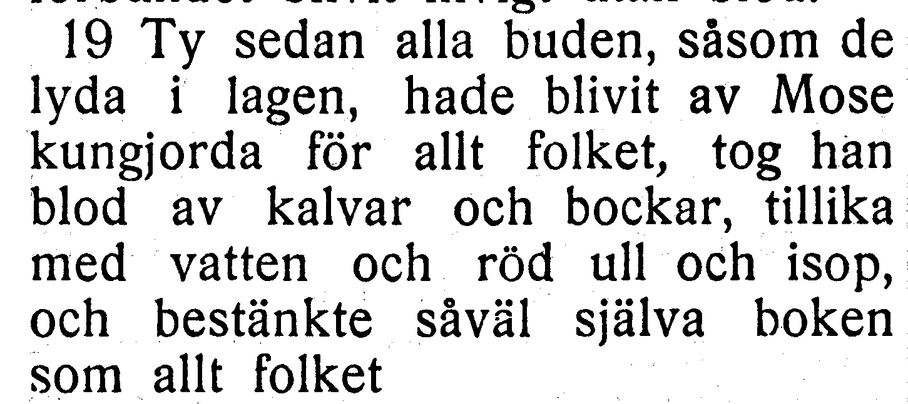
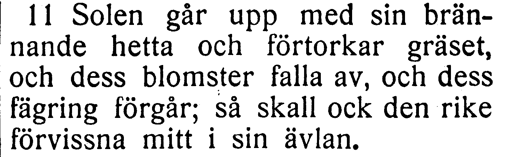
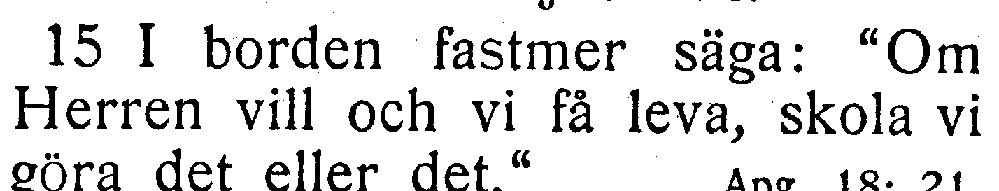

# NT-fotobunt 9: Hebreerbrevet och Jakobs brev

**Alla frågor i denna bunt avgjorda 2026-10-27 mot [EFS 1926](../sv1917-efs1926-witnesses/README.md). Inga foton behövs för denna bunt.** Samtliga berörda kapitel var redan helt bildlästa och är nu verifierade. Tabellens jämförelse visar korpusen före besluten; fulla korpusverser nedan är uppdaterade. Ursprungliga EFS 1927-utsnitt och stabila V-ID bevaras för återkontroll.

| Fråga | Vers | Korpus / EFS 1927 |
| --- | --- | --- |
| [V149](#v149), löst | Hebr. 9:19 | av Moses kungjorda / av Mose kungjorda |
| [V150](#v150), löst | Jak. 1:11 | dess blomster faller av / dess blomster falla av |
| [V151](#v151), löst | Jak. 4:15 | I borden fastmera säga / I borden fastmer säga |

## V149

**Hebreerbrevet 9:19 — av Moses kungjorda / av Mose kungjorda.**

**Korpustext:**

**9:19:** Ty sedan alla buden, såsom de lyda i lagen, hade blivit av Moses kungjorda för allt folket, tog han blod av kalvar och bockar, tillika med vatten och röd ull och isop, och bestänkte såväl själva boken som allt folket

**Komplettering:** hela berörda versen visuellt jämförd i EFS 1926. Ingen fotobegäran återstår.

[Full sida, NT s. 360](https://runeberg.org/bibeln/efs1927/nt/0360.html). TIFF: `https://runeberg.org/img/bibeln/efs1927/nt/0360.1.tif`; SHA-256 `b4f43734a54e4f14939a7d4ed02f88d5f68b69c095ebcdaddc71c6406b5a3aa7`. Utsnittets SHA-256 `4042143b65feaaf2b67512785f132b2965e2f9feda1b6daeb0b6b6365da0eb18`.

**Beslut:** löst 2026-10-27. EFS 1926 visar Mo-ses över radbrytningen, alltså Moses, och bekräftar korpusens av Moses kungjorda mot EFS 1927:s av Mose kungjorda. Texten behålls som belagd tryckvariant; inget rättelse-ID.

[Bevarad full originalbild från EFS 1926, NT s. 332](../sv1917-efs1926-witnesses/V149.jpg). Original och bevarad bild har samma SHA-256 `0bbbd1622e9625048a4c7b060df7bf69cda4254f8371c0d3a691c1211f30695c`. [Hämtningsadress](https://archive.org/download/bibelnellerdenhe0000unse/page/n1541.jpg).

## V150

**Jakobs brev 1:11 — dess blomster faller av / dess blomster falla av.**

**Korpustext:**

**1:11:** Solen går upp med sin brännande hetta och förtorkar gräset, och dess blomster faller av, och dess fägring förgår; så skall ock den rike förvissna mitt i sin ävlan.

**Komplettering:** hela berörda versen visuellt jämförd i EFS 1926. Ingen fotobegäran återstår.

[Full sida, NT s. 386](https://runeberg.org/bibeln/efs1927/nt/0386.html). TIFF: `https://runeberg.org/img/bibeln/efs1927/nt/0386.1.tif`; SHA-256 `b4331a86603e714d916031f274e95ae1af89ae29371abbe0014236488213ad84`. Utsnittets SHA-256 `c996ebda29b25a68ff91143dd763bf36e239f85177d9e6829b2c7c0effdb0e80`.

**Beslut:** löst 2026-10-27. EFS 1926 bekräftar korpusens dess blomster faller av mot EFS 1927:s falla. Texten behålls som belagd tryckvariant; inget rättelse-ID.

[Bevarad full originalbild från EFS 1926, NT s. 359](../sv1917-efs1926-witnesses/V150.jpg). Original och bevarad bild har samma SHA-256 `f2c8a392355983878c9d4a8b310b6159ea8c8969172a05c1910ec4f0e1a9f842`. [Hämtningsadress](https://archive.org/download/bibelnellerdenhe0000unse/page/n1568.jpg).

## V151

**Jakobs brev 4:15 — I borden fastmera säga / I borden fastmer säga.**

**Korpustext:**

**4:15:** I borden fastmer säga: »Om Herren vill, och vi få leva, skola vi göra det, eller det.»

**Komplettering:** hela berörda versen visuellt jämförd i EFS 1926. Ingen fotobegäran återstår.

[Full sida, NT s. 390](https://runeberg.org/bibeln/efs1927/nt/0390.html). TIFF: `https://runeberg.org/img/bibeln/efs1927/nt/0390.1.tif`; SHA-256 `8469457bc12a9f5001f31b14f55eba1c099eb31330762f6cfeb8c3934cdcc86f`. Utsnittets SHA-256 `4dc46605892c0cd7770ad9f1cf13fab2f4077b9fbf0ff1c558fafbb1106925fe`.

**Beslut:** löst 2026-10-27. EFS 1926 och 1927 har båda I borden fastmer säga. Fastmera rättas till fastmer genom R331. Den tidigare rättelsen R277, vi får leva till vi få leva, bevaras i samma vers. Övrig kommatering harmoniseras inte.

[Bevarad full originalbild från EFS 1926, NT s. 363](../sv1917-efs1926-witnesses/V151.jpg). Original och bevarad bild har samma SHA-256 `d712e96af619d892934862d0dc495a467b8d2f0ce778b14543a74a8458bb0ce5`. [Hämtningsadress](https://archive.org/download/bibelnellerdenhe0000unse/page/n1572.jpg).
